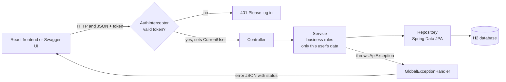
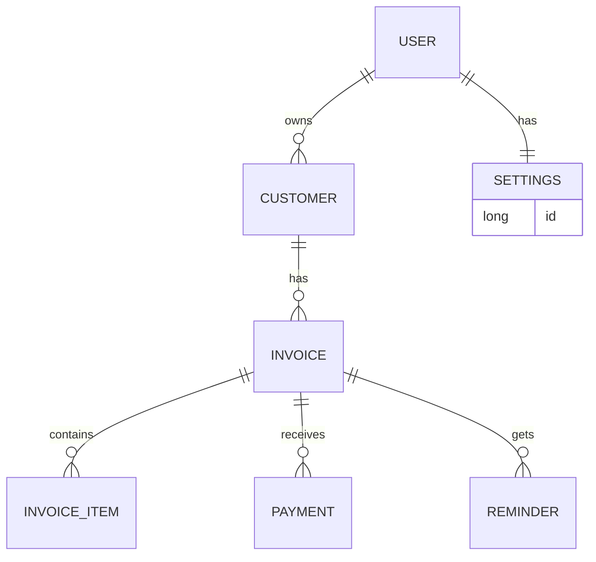

# PayTrack API: features, demo and code walkthrough

PayTrack is a small business invoice and payment tracker. This is its backend: a Spring Boot REST API with a relational H2 database. The React frontend talks to it over JSON. This page lists every feature (what was already there and what was added), shows how to run a live demo, and explains the code file by file so you can walk your professor through it.

## 1. The project in one minute

|   |   |
|---|---|
| Language and framework | Java 17, Spring Boot 3.3 (Spring Web, Spring Data JPA, Bean Validation starter) |
| Database | H2, stored in a file (`./data/paytrackdb`), so data survives a restart |
| Data model | User 1..* Customer, Customer 1..* Invoice, Invoice 1..* InvoiceItem, Invoice 1..* Payment, Invoice 1..* Reminder, one Settings row per user |
| Size | 24 original endpoints, 18 new endpoints (3 for login, 4 for the admin), 30 automated tests |
| Security | Register and login, passwords stored as salted PBKDF2 hashes, signed JWT tokens, an administrator role, every user sees only their own data |
| Layout | One folder, two parts: `backend/` (Spring Boot) and `frontend/` (React). `npm run dev` in the top folder starts both. |
| Run | `npm run setup` once, then `npm run dev`. Open http://localhost:5173 (app) or http://localhost:4000/swagger-ui.html (API) |


### How a request travels through the code

Every request goes through the same four layers. The controller only handles HTTP, the service holds the business rules, the repository talks to the database. Errors from any layer are turned into JSON by one global handler.




### Database relations




## 2. Feature list


### A. Already in the project

| # | Feature | Where it lives |
|---|---|---|
| 1 | REST CRUD for customers, invoices, payments and reminders (payments and reminders have no edit) | controller/ + service/ |
| 2 | Single call that loads all app data (`/api/bootstrap`) | BootstrapController |
| 3 | Business profile (name, GSTIN, UPI id, invoice prefix, default GST and due days) | SettingsController, SettingsService |
| 4 | Invoice maths: line totals, flat or percent discount, GST, grand total, 2 decimal rounding | InvoiceCalcService |
| 5 | Over payment guard: a payment can never exceed the remaining balance (422) | PaymentService |
| 6 | Realistic demo data (12 customers, 26 invoices, payments, reminders) loaded for the logged-in user with Reset Demo Data | SeedService |
| 7 | Reset to demo data and clear all data (`/api/system/reset`, `/api/system/clear`) | SystemController |
| 8 | Persistent file database plus browser console at `/h2-console` | application.properties |
| 9 | Real relational model with cascades (deleting an invoice deletes its items) | model/ package |
| 10 | CORS so the React app on another port can call the API | CorsConfig |
| 11 | Uniform JSON errors `{"error": "..."}` with correct HTTP status | ApiException, GlobalExceptionHandler |
| 12 | Health check (`/api/health`) and JSON shape identical to the old Express server | HealthController, model JSON annotations |


### B. Newly added

| # | Feature | Endpoint | Files |
|---|---|---|---|
| 1 | Invoice status engine: Draft, Unpaid, Partially Paid, Overdue, Paid, with paid, balance and days overdue | GET /api/invoices/{id}/summary | InvoiceStatusService, InvoiceSummary |
| 2 | Dashboard analytics: totals, collection rate, ageing buckets, 6 month collections, payment methods, top debtors | GET /api/dashboard | DashboardService, DashboardResponse |
| 3 | Search, filter and sort invoices (status, customer, text, date range) | GET /api/invoices/search | InvoiceQueryService |
| 4 | Automatic next invoice number from the Settings prefix | GET /api/invoices/next-number | InvoiceQueryService |
| 5 | UPI payment link for the exact balance (opens GPay, PhonePe, Paytm) | GET /api/invoices/{id}/upi-link | InvoiceQueryService, UpiLink |
| 6 | Reminder message writer: friendly, firm or final tone, WhatsApp or Email, one tap link | GET /api/invoices/{id}/reminder-message | ReminderMessageService |
| 7 | Smart reminder suggestions: overdue invoices, recommended tone and channel, is a reminder due | GET /api/reminders/suggestions | ReminderMessageService |
| 8 | Customer statement: invoices, payments, billed, paid, outstanding | GET /api/customers/{id}/statement | StatementService, CustomerStatement |
| 9 | CSV export of invoices and payments, safe against formula injection | GET /api/export/invoices.csv and payments.csv | ExportService |
| 10 | Printable invoice page (Print, Save as PDF), HTML escaped | GET /api/invoices/{id}/print | InvoicePrintService |
| 11 | Input validation: dates, tax and discount ranges, negative items, customer name, email, GSTIN format, unique invoice numbers | existing POST and PATCH endpoints | InvoiceService, CustomerService, SettingsService |
| 12 | Safety rules: no payment on a draft, customer with invoices cannot be deleted (409), deleting an invoice also removes its payments and reminders | existing DELETE and POST endpoints | PaymentService, CustomerService, InvoiceService |
| 13 | Better errors: broken JSON gives 400, database conflicts give 409, unknown URL gives 404 and wrong method gives 405 (before they were all 500) | all endpoints | GlobalExceptionHandler |
| 14 | Interactive API page (Swagger UI) for the demo | /swagger-ui.html | pom.xml (springdoc) |
| 15 | 30 automated end to end tests with an in memory database (17 for the business rules, 8 for login and data separation, 5 for the administrator) | mvn test | PaytrackApiTests |
| 16 | Register and login with hashed passwords and signed JWT tokens. Every customer, invoice, payment and reminder belongs to one user, and users can never see or change each other's data. Swagger has an Authorize button for the token. | POST /api/auth/register, POST /api/auth/login, GET /api/auth/me | User, UserRepository, PasswordHasher, JwtService, AuthInterceptor, CurrentUser, AuthService, AuthController, AuthConfig |
| 17 | Administrator: the account that registers with the admin email gets the ADMIN role. Admins list all accounts with usage counts, disable or enable an account, delete an account with its data, and see platform totals. They never see other users' customers or invoices. Everything under /api/admin is 403 for normal users. | GET /api/admin/overview, GET /api/admin/users, PATCH and DELETE /api/admin/users/{id} | AdminService, AdminController, AdminUserRow, AdminOverview, AuthInterceptor |
| 18 | React frontend: Login and Register pages with validation, saved login, Log out button, an Admin page for admins, and a Smart Tools page (server dashboard, reminder text, UPI link, print, search, CSV) that uses the token | frontend: pages/Login.jsx, Register.jsx, Admin.jsx, SmartTools.jsx, hooks/useAuth.jsx, services/auth.js, services/admin.js | paytrack/src |

> Not added on purpose: roles and permissions (admin, staff), password reset by email, refresh tokens, real sending of email or WhatsApp (the API prepares the message and a click to send link instead), a PDF library (the print page gives a PDF through the browser), recurring invoices, and payment gateway integration. These are good answers if the professor asks about future work.


## 3. How to run the demo


### Setup (once)

- Install JDK 17 or newer, Maven 3.9 or newer and Node 18 or newer. Check with `java -version`, `mvn -v` and `node -v`.
- Unzip the project. You get one folder, `paytrack-app`, with `backend` and `frontend` inside. Open a terminal in `paytrack-app`.
- Run `npm run setup` once. It installs the packages for the frontend and the tool that starts both parts together.
- Run `npm test`. All 30 backend tests should pass. This also downloads the Maven dependencies. If you used an older version before, delete `backend/data` first, because the tables changed.
- Run `npm run dev`. It starts the backend on port 4000 and the frontend on port 5173 in one window. Stop both with Ctrl+C.

```bash
cd paytrack-app
npm run setup
npm test
npm run dev
```


### Three ways to show it

- Swagger UI at http://localhost:4000/swagger-ui.html: every endpoint is listed, click Try it out, then Execute. Best for a live demo, no tools needed.
- The browser address bar for any GET endpoint, for example http://localhost:4000/api/dashboard. The print page and the CSV downloads are best shown this way.
- The React app at http://localhost:5173 (started by `npm run dev`): register an account, then Settings, Reset Demo Data. The Smart Tools page uses the new endpoints. The account `admin@paytrack.in` (register it first) also gets an Admin page.


### Demo cheat sheet (ids from the seed data)

| Id | What it is | Why it is useful in the demo |
|---|---|---|
| inv_1 | Fully paid invoice, INV-1001 | Shows Paid status and the over payment rejection |
| inv_6 | Overdue, nothing paid, Ravi Enterprises | Shows Overdue, a final tone reminder, UPI link |
| inv_13 | Part paid and late | Shows that late wins over partly paid |
| inv_19 | Part paid, not yet due | Shows Partially Paid |
| inv_25 | Draft | Shows that drafts cannot take payments |
| cus_mt | Madurai Textiles | Customer statement |
| cus_ce | Chennai Electronics | Has invoices, so it cannot be deleted |


### Demo script (about 8 minutes)

**Step 1. Register and log in**

Create an account, then log in and keep the token. Everything else needs it, and without it the API answers 401. In Swagger UI paste the token into the Authorize button once instead. Say: the server never stores the password, only a salted hash, and the token is signed so it cannot be edited.

```bash
curl -X POST http://localhost:4000/api/auth/register -H "Content-Type: application/json" -d '{"name":"Demo","email":"demo@shop.in","password":"secret123"}'
# copy the token value from the answer, then:
export TOKEN=paste-the-token-here
curl http://localhost:4000/api/bootstrap          # 401, no token
curl -H "Authorization: Bearer $TOKEN" http://localhost:4000/api/auth/me
```

**Step 2. Start clean**

Load the demo data for your account so the dates are fresh, then show the server is alive. Your sample records get the ids in the cheat sheet only if no other account already holds them (the first account to load demo data does); a later account gets the same records with a `u<userid>_` prefix, for example `u2_inv_1`. Say: the data is created relative to today, so the dashboard always looks real.

```bash
curl -H "Authorization: Bearer $TOKEN" -X POST http://localhost:4000/api/system/reset
curl http://localhost:4000/api/health
```

**Step 3. Show the database**

Open http://localhost:4000/h2-console. JDBC URL `jdbc:h2:file:./data/paytrackdb`, user `sa`, empty password. Run `SELECT * FROM invoices;` and point out the `customer_id` foreign key. Say: these are real related tables, not a JSON file.

**Step 4. Dashboard**

One call gives the owner the whole picture. Point at outstanding, overdue amount, collection rate, the ageing buckets and the top debtors.

```bash
curl -H "Authorization: Bearer $TOKEN" http://localhost:4000/api/dashboard
```

**Step 5. Find overdue invoices**

Filter by status and sort by the biggest balance first.

```bash
curl -H "Authorization: Bearer $TOKEN" "http://localhost:4000/api/invoices/search?status=Overdue&sortBy=balance&desc=true"
```

**Step 6. Status engine**

Compare a paid, a late and a part paid invoice. The status is calculated, not stored.

```bash
curl -H "Authorization: Bearer $TOKEN" http://localhost:4000/api/invoices/inv_1/summary
curl -H "Authorization: Bearer $TOKEN" http://localhost:4000/api/invoices/inv_13/summary
curl -H "Authorization: Bearer $TOKEN" http://localhost:4000/api/invoices/inv_19/summary
```

**Step 7. Business rules**

Try to over pay a paid invoice (expect 422), then pay a draft (expect 422), then make a valid part payment on inv_6 (expect 201) and read the summary again to see paid = 1000.

```bash
curl -H "Authorization: Bearer $TOKEN" -X POST http://localhost:4000/api/payments -H "Content-Type: application/json" -d '{"id":"pay_demo1","invoiceId":"inv_1","amount":1,"method":"Cash"}'
curl -H "Authorization: Bearer $TOKEN" -X POST http://localhost:4000/api/payments -H "Content-Type: application/json" -d '{"id":"pay_demo2","invoiceId":"inv_25","amount":100,"method":"Cash"}'
curl -H "Authorization: Bearer $TOKEN" -X POST http://localhost:4000/api/payments -H "Content-Type: application/json" -d '{"id":"pay_demo3","invoiceId":"inv_6","amount":1000,"method":"UPI"}'
curl -H "Authorization: Bearer $TOKEN" http://localhost:4000/api/invoices/inv_6/summary
```

**Step 8. Smart reminders**

List what needs chasing, then generate the message for inv_6. Copy the `link` value into a browser and WhatsApp opens with the message ready.

```bash
curl -H "Authorization: Bearer $TOKEN" http://localhost:4000/api/reminders/suggestions
curl -H "Authorization: Bearer $TOKEN" "http://localhost:4000/api/invoices/inv_6/reminder-message?channel=WhatsApp"
```

**Step 9. UPI link**

The amount is the exact balance. On a phone the link opens the UPI app.

```bash
curl -H "Authorization: Bearer $TOKEN" http://localhost:4000/api/invoices/inv_6/upi-link
```

**Step 10. Customer statement**

Billed equals paid plus outstanding.

```bash
curl -H "Authorization: Bearer $TOKEN" http://localhost:4000/api/customers/cus_mt/statement
```

**Step 11. Printable invoice and CSV**

Open these in the browser with your token at the end of the link (a new tab cannot send a header). On the print page click Print and choose Save as PDF. Open the CSV in Excel.

```bash
http://localhost:4000/api/invoices/inv_1/print?access_token=PASTE-TOKEN
http://localhost:4000/api/export/invoices.csv?access_token=PASTE-TOKEN
http://localhost:4000/api/export/payments.csv?access_token=PASTE-TOKEN
```

**Step 12. Safety rules**

Each of these must fail with a clear message: duplicate invoice number (409), delete a customer who has invoices (409), wrong GSTIN (422), broken JSON (400).

```bash
curl -H "Authorization: Bearer $TOKEN" -X POST http://localhost:4000/api/invoices -H "Content-Type: application/json" -d '{"id":"inv_x","number":"INV-1001","customerId":"cus_abc"}'
curl -H "Authorization: Bearer $TOKEN" -X DELETE http://localhost:4000/api/customers/cus_ce
curl -H "Authorization: Bearer $TOKEN" -X POST http://localhost:4000/api/customers -H "Content-Type: application/json" -d '{"id":"c_x","name":"Test","gstin":"BAD"}'
curl -H "Authorization: Bearer $TOKEN" -X POST http://localhost:4000/api/customers -H "Content-Type: application/json" -d '{broken'
```

**Step 13. Administrator**

Register the admin account (the admin email from application.properties), log in with it and show the admin endpoints. Then show that a normal user gets 403 on the same URL.

```bash
curl -X POST http://localhost:4000/api/auth/register -H "Content-Type: application/json" -d '{"name":"Admin","email":"admin@paytrack.in","password":"secret123"}'
# copy the token into ADMIN_TOKEN, then:
curl -H "Authorization: Bearer $ADMIN_TOKEN" http://localhost:4000/api/admin/users
curl -i -H "Authorization: Bearer $TOKEN" http://localhost:4000/api/admin/users   # normal user: 403
curl -X PATCH -H "Authorization: Bearer $ADMIN_TOKEN" -H "Content-Type: application/json" -d '{"active":false}' http://localhost:4000/api/admin/users/2
```

**Step 14. Data separation**

Register a second account, log in as it and call /api/bootstrap. It is empty, and asking for another user's invoice id answers 404. This is the multi-user proof.

```bash
curl -X POST http://localhost:4000/api/auth/register -H "Content-Type: application/json" -d '{"name":"Other","email":"other@shop.in","password":"secret123"}'
# use the NEW token:
curl -H "Authorization: Bearer $TOKEN2" http://localhost:4000/api/bootstrap
curl -i -H "Authorization: Bearer $TOKEN2" http://localhost:4000/api/invoices/inv_1/summary
```

**Step 15. Tests**

Finish with the green test run. Say: 30 tests start the real application and call it like a client, so the rules are protected when code changes.

```bash
mvn test
```

> Windows PowerShell: use `curl.exe` instead of `curl`, or Git Bash. Quotes inside JSON are easier in Swagger UI, where you just paste the body.


### How this maps to the judging criteria

- Functionality: invoices, payments, reminders, statements, exports, all working end to end.
- Technical implementation: layered architecture, relational model, JWT authentication, admin role, per-user data isolation, validation, global error handling, automated tests.
- Innovation: automatic status engine, ageing report, tone based reminder writer with a WhatsApp link, UPI deep link.
- UI and UX: login and register pages with validation, a dashboard, and a Smart Tools page that shows the new endpoints.
- Presentation: the demo script above, in the same order as the feature list.


## 4. How to explain it to your professor


### A 2 minute story

Small shop owners lose track of who has paid. PayTrack stores customers, invoices and payments, calculates what is still owed, and helps chase late payments. The backend is a Spring Boot REST API. A request enters a controller, the controller calls a service where the business rules live, the service uses a repository to read or write the H2 database, and any error is converted to a JSON message by one global handler. Users register and log in; the server returns a signed token, and every later request carries it, so each business only ever sees its own data. I started from a working CRUD backend and added login with hashed passwords, per-user data, a status engine, a dashboard, search, reminders, a statement, exports, a printable invoice, validation and tests.


### Suggested order to walk through the code

- PaytrackApiApplication: how the app starts (three lines).
- Login in this order: User entity, PasswordHasher, JwtService, AuthInterceptor, CurrentUser, AuthService. Then show one service (CustomerService) to prove the data is filtered by the logged-in user.
- Invoice and Payment entities: how tables and relations are defined with annotations.
- InvoiceCalcService: the maths. Everything else reuses it.
- PaymentService: the main business rule.
- InvoiceStatusService, then DashboardService: the new core of the project.
- GlobalExceptionHandler: how all errors become clean JSON.
- One controller (InvoiceController): how URLs map to methods.
- PaytrackApiTests: how the rules are protected.


### Questions a professor may ask

**Q. Why is the status not stored in the database?**

A. If it were stored it could become wrong: a payment arrives, or the due date passes, and the saved status is stale. Calculating it from the payments and today's date every time means it is always correct.

**Q. Why BigDecimal and not double for money?**

A. double cannot represent values like 0.1 exactly, so sums drift. BigDecimal is exact and lets us choose the rounding rule (HALF_UP to 2 decimals).

**Q. What is dependency injection here?**

A. Classes declare what they need in their constructor, for example PaymentService needs PaymentRepository. Spring creates one object of each and passes it in. We never write `new` for services.

**Q. What does a repository interface with no code do?**

A. Spring Data JPA generates the implementation at startup. Method names like `findByInvoice_Id` are turned into SQL automatically.

**Q. Why a DTO (InvoiceRequest) and not the entity as the request body?**

A. The entity has relations and internal fields. The request class matches exactly what the client sends, so a client cannot set things it should not, and the JSON shape stays stable.

**Q. What is the difference between 400, 409 and 422?**

A. 400: the request is broken (bad JSON, missing id). 409: the request clashes with existing data (duplicate invoice number, customer still has invoices). 422: the data is well formed but breaks a business rule (over payment, due date before issue date).

**Q. How do you stop someone paying more than the balance?**

A. PaymentService adds up earlier payments, subtracts from the invoice total from InvoiceCalcService, and rejects any amount above the balance. This runs on the server, so it cannot be bypassed from the frontend.

**Q. What is LAZY and EAGER loading?**

A. LAZY loads a related row only when it is used (customer on an invoice). EAGER loads it immediately (invoice items), because totals always need them.

**Q. What security care did you take?**

A. Passwords are stored only as salted PBKDF2 hashes. Login uses signed JWT tokens that expire. Every query is filtered by the logged-in user, so users cannot read each other's data, and re-using another user's id to overwrite a record is refused. The printable invoice escapes user text to prevent XSS, the CSV export prefixes cells that start with = + - @ to prevent formula injection, and inputs are validated.

**Q. How does login work, step by step?**

A. Register or login checks the email and password. The password is hashed with the stored salt and compared. If it matches, the server creates a JWT: a header, a payload with the user id and the expiry time, and a signature made with a secret key only the server has. The browser keeps it and sends `Authorization: Bearer <token>` on every request. The AuthInterceptor recalculates the signature, checks the expiry, and stores the user id in CurrentUser, and every service filters data by that id.

**Q. Why hash passwords instead of encrypting them?**

A. Encryption can be reversed with the key, a hash cannot. The server never needs the original password, it only needs to check that a typed password gives the same hash. PBKDF2 adds a random salt and 120,000 repetitions, so identical passwords look different and guessing is slow.

**Q. What is a JWT and why can it not be forged?**

A. A JWT is three Base64 parts: header, payload and signature. The signature is HMAC-SHA256 of the first two parts with the server's secret. If anyone changes the user id in the payload, the signature no longer matches and the server answers 401. The tests try a tampered token.

**Q. How do you make sure user A cannot see user B's invoices?**

A. Every record has an `owner_id`. The interceptor puts the logged-in id in CurrentUser, and every repository call uses it (`findByOwnerId`, `findByIdAndOwnerId`). Asking for someone else's id gives 404, exactly as if it did not exist. A test registers a second user and tries to read, pay, delete and overwrite the first user's records.

**Q. Why did you not use Spring Security?**

A. Spring Security is the industry standard and the right choice for a large product, but it hides a lot of behaviour behind configuration. Here the token and password handling is written in a few small classes that use only Java's built-in cryptography, so each line can be explained. Moving to Spring Security later would replace only AuthInterceptor and JwtService.

**Q. How does the admin role work?**

A. The user table has a `role` column, USER or ADMIN. The account that registers with the email in `paytrack.admin.email` becomes ADMIN. On every request the AuthInterceptor loads the account, and for any URL starting with /api/admin it answers 403 unless the role is ADMIN. So no admin endpoint can be left open by mistake. The frontend also hides the Admin menu from normal users, but that is only for convenience: the server is what enforces it.

**Q. Can the admin read other people's invoices?**

A. No, by design. The admin endpoints return accounts and counts only. This protects customers' business data, and it keeps the admin role small.

**Q. What happens when an admin disables an account?**

A. The interceptor loads the account on every request, so the user's existing token stops working at once (403 "This account has been disabled"), login is refused, and the frontend logs them out. Enabling the account restores everything. Deleting an account removes the user and all their customers, invoices, payments and reminders in one transaction.

**Q. Why can an admin not disable themselves or another admin?**

A. Disabling yourself would lock everyone out, and letting one admin remove another would be risky. These cases return 422 with a clear message.

**Q. Where is the token stored in the browser and what is the risk?**

A. In localStorage, so the login survives a refresh. The risk is that a cross-site scripting bug could read it. The app escapes user text to reduce that risk. A production system would often use an httpOnly cookie instead.

**Q. Why are there tests, and how do they avoid damaging real data?**

A. They protect the rules when code changes. They use a separate in memory H2 database configured in the test properties and reset the demo data before every test.

**Q. What would you add next?**

A. More roles (for example staff accounts inside one business), password reset by email, refresh tokens, real email and WhatsApp sending, recurring invoices and a payment gateway.


## 5. Code walkthrough

Each box shows the real lines from the project (with line numbers) followed by what they do. Parts marked `new` were added in this update. Files are in the order you would present them.


### 5A. Main code (original project, with the edits made to it)


#### `src/main/resources/application.properties`, 27 lines

All runtime settings. Spring Boot reads this file at startup.

```java
   1  spring.application.name=paytrack-api
```
Name of the application (shows in logs).

```java
   2  server.port=4000
```
The embedded Tomcat listens on port 4000, so every URL starts with http://localhost:4000.

```java
   4  # File-based H2 database so data survives restarts, same spirit as the
   5  # original server/db.json file. The .mv.db file is created under ./data.
```
Comment: the database is a file so data survives a restart.

```java
   6  spring.datasource.url=jdbc:h2:file:./data/paytrackdb;AUTO_SERVER=TRUE
```
JDBC connection string. `jdbc:h2:file:./data/paytrackdb` stores the database in the `data` folder. `AUTO_SERVER=TRUE` lets the H2 console open the same database while the app is running.

```java
   7  spring.datasource.driverClassName=org.h2.Driver
```
The JDBC driver class for H2.

```java
   8  spring.datasource.username=sa
   9  spring.datasource.password=
```
Login for the database: user `sa` with an empty password (fine for a local demo).

```java
  11  spring.jpa.hibernate.ddl-auto=update
```
`update` means Hibernate creates missing tables and columns at startup but keeps the existing data.

```java
  12  spring.jpa.open-in-view=true
```
Keeps the database session open while the response is written, so lazy relations (like invoice.customer) can still be read when the JSON is built.

```java
  13  spring.jpa.properties.hibernate.format_sql=false
```
Do not pretty print SQL in the logs.

```java
  15  # Handy for the demo / grading: browse the data at http://localhost:4000/h2-console
  16  # JDBC URL to paste in: jdbc:h2:file:./data/paytrackdb
```
Comment about the console.

```java
  17  spring.h2.console.enabled=true
```
Turns on the browser database console.

```java
  18  spring.h2.console.path=/h2-console
```
The console is available at /h2-console.

```java
  20  spring.jackson.serialization.indent-output=false
  21  
  22  # Login tokens (JWT). CHANGE the secret before real use; keep it out of source control.
  23  paytrack.jwt.secret=paytrack-dev-secret-change-me-at-least-32-characters
  24  paytrack.jwt.hours=24
  25  
  26  # The account that registers with this email becomes the administrator.
  27  paytrack.admin.email=admin@paytrack.in
```
JSON is returned compact, without extra spaces.


#### `pom.xml` (edited), 64 lines

The Maven build file: which libraries the project uses.

```java
   1  <?xml version="1.0" encoding="UTF-8"?>
```
Standard XML header.

```java
   2  <project xmlns="http://maven.apache.org/POM/4.0.0"
   3           xmlns:xsi="http://www.w3.org/2001/XMLSchema-instance"
   4           xsi:schemaLocation="http://maven.apache.org/POM/4.0.0 https://maven.apache.org/xsd/maven-4.0.0.xsd">
```
Root element of every Maven project file, with the schema references.

```java
   5      <modelVersion>4.0.0</modelVersion>
```
Version of the POM format (always 4.0.0).

```java
   7      <parent>
   8          <groupId>org.springframework.boot</groupId>
   9          <artifactId>spring-boot-starter-parent</artifactId>
  10          <version>3.3.4</version>
  11          <relativePath/>
  12      </parent>
```
Inherits from `spring-boot-starter-parent` 3.3.4. This gives tested versions of all Spring libraries and sensible build defaults, so most dependencies need no version.

```java
  14      <groupId>com.paytrack</groupId>
  15      <artifactId>paytrack-api</artifactId>
  16      <version>1.0.0</version>
  17      <name>paytrack-api</name>
  18      <description>Spring Boot REST API for the PayTrack invoice &amp; payment tracker</description>
```
The project's own identity: group, artifact name and version, plus a human description.

```java
  20      <properties>
  21          <java.version>17</java.version>
  22      </properties>
```
`java.version` 17 sets the Java level.

```java
  24      <dependencies>
```
Start of the list of libraries.

```java
  25          <dependency>
  26              <groupId>org.springframework.boot</groupId>
  27              <artifactId>spring-boot-starter-web</artifactId>
  28          </dependency>
```
`spring-boot-starter-web`: Spring MVC, JSON (Jackson) and the embedded Tomcat server. This makes the REST API possible.

```java
  29          <dependency>
  30              <groupId>org.springframework.boot</groupId>
  31              <artifactId>spring-boot-starter-data-jpa</artifactId>
  32          </dependency>
```
`spring-boot-starter-data-jpa`: JPA, Hibernate and Spring Data repositories. This is the database layer.

```java
  33          <dependency>
  34              <groupId>org.springframework.boot</groupId>
  35              <artifactId>spring-boot-starter-validation</artifactId>
  36          </dependency>
```
`spring-boot-starter-validation`: Bean Validation support.

```java
  37          <!-- Swagger UI: interactive API page at /swagger-ui.html, handy for the demo -->
```
**[new]** comment.

```java
  38          <dependency>
  39              <groupId>org.springdoc</groupId>
  40              <artifactId>springdoc-openapi-starter-webmvc-ui</artifactId>
  41              <version>2.6.0</version>
  42          </dependency>
```
**[new]** `springdoc-openapi-starter-webmvc-ui` scans our controllers and creates the interactive Swagger UI page at /swagger-ui.html and the OpenAPI document at /v3/api-docs.

```java
  43          <dependency>
  44              <groupId>com.h2database</groupId>
  45              <artifactId>h2</artifactId>
  46              <scope>runtime</scope>
  47          </dependency>
```
`h2`: the in process database. Scope `runtime` means it is only needed when the app runs, not to compile.

```java
  48          <dependency>
  49              <groupId>org.springframework.boot</groupId>
  50              <artifactId>spring-boot-starter-test</artifactId>
  51              <scope>test</scope>
  52          </dependency>
  53      </dependencies>
```
`spring-boot-starter-test`: JUnit, MockMvc and friends. Scope `test`, so it is not part of the final app.

```java
  55      <build>
  56          <finalName>paytrack-api</finalName>
  57          <plugins>
  58              <plugin>
  59                  <groupId>org.springframework.boot</groupId>
  60                  <artifactId>spring-boot-maven-plugin</artifactId>
  61              </plugin>
  62          </plugins>
  63      </build>
  64  </project>
```
Build settings: the final file is named `paytrack-api.jar`, built with the Spring Boot Maven plugin, which makes a single runnable jar and enables `mvn spring-boot:run`.


#### `PaytrackApiApplication.java`, 16 lines

The starting point of the whole backend. Running this class starts the server. It no longer creates demo data at startup, because with login every user loads their own demo data after registering.

```java
   1  package com.paytrack;
```
Puts the class in the package `com.paytrack`. Spring scans this package and everything under it, so all our controllers, services and repositories are found automatically.

```java
   3  import org.springframework.boot.SpringApplication;
   4  import org.springframework.boot.autoconfigure.SpringBootApplication;
```
Imports the two Spring Boot classes used below: `SpringApplication` starts the app and `@SpringBootApplication` marks the main class.

```java
   6  /**
   7   * Starts the application. Sample data is no longer created at startup: with login,
   8   * every user loads their own demo data (POST /api/system/reset) after they register.
   9   */
```
**[new]** comment. Before login existed, the app seeded sample data on the first run. Now every record belongs to a user, and at startup nobody is logged in, so that startup code was removed. (Keeping it made the application crash on start, because creating data needs a logged-in user.)

```java
  10  @SpringBootApplication
```
One annotation that does three jobs: marks this as a configuration class, turns on auto configuration (web server, JPA, H2 are set up from the dependencies in pom.xml) and turns on component scanning.

```java
  11  public class PaytrackApiApplication {
```
The main class of the project.

```java
  13      public static void main(String[] args) {
```
The normal Java entry point. The JVM starts here when we run `mvn spring-boot:run` or the jar.

```java
  14          SpringApplication.run(PaytrackApiApplication.class, args);
  15      }
  16  }
```
Boots Spring: starts the embedded Tomcat on port 4000, creates all the beans, connects to the H2 database and creates the tables.


#### `config/CorsConfig.java`, 18 lines

Allows the React frontend (running on a different port) to call this API. Without it the browser would block the requests.

```java
   1  package com.paytrack.config;
```
Package for configuration classes.

```java
   3  import org.springframework.context.annotation.Configuration;
   4  import org.springframework.web.servlet.config.annotation.CorsRegistry;
   5  import org.springframework.web.servlet.config.annotation.WebMvcConfigurer;
```
Imports the annotation, the CORS registry and the interface we customise.

```java
   7  @Configuration
```
Marks the class as configuration, so Spring reads it at startup.

```java
   8  public class CorsConfig implements WebMvcConfigurer {
```
`WebMvcConfigurer` lets us change Spring MVC behaviour. We only override the CORS part.

```java
  10      @Override
```
We are replacing a default method of the interface.

```java
  11      public void addCorsMappings(CorsRegistry registry) {
```
Spring calls this method while building the web layer and gives us a registry to add rules to.

```java
  12          // Wide open for local dev / demo purposes (matches the Express app's `app.use(cors())`).
```
Comment: this is deliberately open for local development and the demo. A real deployment would list the exact frontend URL.

```java
  13          registry.addMapping("/api/**")
```
The rule applies to every URL that starts with /api/.

```java
  14                  .allowedOriginPatterns("*")
```
Any website origin may call the API (the Vite dev server runs on localhost:5173).

```java
  15                  .allowedMethods("GET", "POST", "PATCH", "PUT", "DELETE", "OPTIONS")
```
Which HTTP methods are allowed. OPTIONS is needed because browsers send a preflight request first.

```java
  16                  .allowedHeaders("*");
  17      }
  18  }
```
Any request header is accepted, for example Content-Type: application/json.


#### `exception/ApiException.java` (edited), 42 lines

One custom exception used by every service. It carries an HTTP status together with the message, so the handler can turn it into a clean JSON error.

```java
   1  package com.paytrack.exception;
```
Package for error handling classes.

```java
   3  import org.springframework.http.HttpStatus;
```
`HttpStatus` is Spring's enum of status codes (404, 400 and so on).

```java
   5  /** Thrown anywhere in the service layer when a request can't be fulfilled. */
```
Comment: services throw this whenever a request cannot be completed.

```java
   6  public class ApiException extends RuntimeException {
```
Extends `RuntimeException` (an unchecked exception), so methods do not need `throws` declarations.

```java
   8      private final HttpStatus status;
```
The HTTP status that goes with this error. It is final because it never changes after creation.

```java
  10      public ApiException(HttpStatus status, String message) {
  11          super(message);
  12          this.status = status;
  13      }
  14  
  15      public static ApiException unauthorized(String message) {
  16          return new ApiException(HttpStatus.UNAUTHORIZED, message);
  17      }
  18  
  19      public static ApiException forbidden(String message) {
  20          return new ApiException(HttpStatus.FORBIDDEN, message);
  21      }
```
Constructor. `super(message)` stores the text so `getMessage()` works, and we keep the status.

```java
  23      public static ApiException notFound(String message) {
  24          return new ApiException(HttpStatus.NOT_FOUND, message);
  25      }
```
Factory method for 404 Not Found. Services write `throw ApiException.notFound("...")`, which is shorter and cannot use a wrong code.

```java
  27      public static ApiException badRequest(String message) {
  28          return new ApiException(HttpStatus.BAD_REQUEST, message);
  29      }
```
Factory for 400 Bad Request (the client sent something unusable, like a missing id).

```java
  31      public static ApiException conflict(String message) {
  32          return new ApiException(HttpStatus.CONFLICT, message);
  33      }
```
**[new]** Factory for 409 Conflict (the request is fine but clashes with existing data, like a duplicate invoice number).

```java
  35      public static ApiException unprocessable(String message) {
  36          return new ApiException(HttpStatus.UNPROCESSABLE_ENTITY, message);
  37      }
```
Factory for 422 Unprocessable Entity (the data is well formed but breaks a business rule, like an over payment).

```java
  39      public HttpStatus getStatus() {
  40          return status;
  41      }
  42  }
```
Getter used by the exception handler.


#### `exception/GlobalExceptionHandler.java` (edited), 50 lines

Catches every exception thrown anywhere in the app and converts it to the JSON shape {"error": "message"} that the frontend already expects.

```java
   1  package com.paytrack.exception;
```
Same package as ApiException.

```java
   3  import org.springframework.dao.DataIntegrityViolationException;
   4  import org.springframework.http.HttpStatus;
   5  import org.springframework.http.ResponseEntity;
   6  import org.springframework.http.converter.HttpMessageNotReadableException;
   7  import org.springframework.web.ErrorResponse;
   8  import org.springframework.web.bind.annotation.ExceptionHandler;
   9  import org.springframework.web.bind.annotation.RestControllerAdvice;
  10  
  11  import java.util.Map;
```
Imports: the database integrity exception (NEW), HTTP status and response classes, the exception thrown for unreadable JSON (NEW), Spring's `ErrorResponse` interface (NEW), the two annotations and `Map` for building the JSON body.

```java
  13  /**
  14   * Every error response comes back as {"error": "..."} with the right HTTP
  15   * status, matching the shape the frontend's httpAdapter.js already expects
  16   * (res.json().error).
  17   */
```
Comment: every error looks like {"error": "..."}, which matches `res.json().error` in the frontend's httpAdapter.js.

```java
  18  @RestControllerAdvice
```
Makes this class a global handler for all controllers. Return values are written as JSON.

```java
  19  public class GlobalExceptionHandler {
```
Holds one method per kind of exception.

```java
  21      @ExceptionHandler(ApiException.class)
  22      public ResponseEntity<Map<String, String>> handleApiException(ApiException ex) {
```
This method runs whenever an `ApiException` escapes a controller.

```java
  23          return ResponseEntity.status(ex.getStatus()).body(Map.of("error", ex.getMessage()));
  24      }
```
Builds the response: the status comes from the exception (404, 422...) and the body is a map with the key `error`. `Map.of` becomes JSON automatically.

```java
  26      /** Broken JSON, a date like "32-13-2026", text where a number should be, etc. */
```
**[new]** comment: this handler is for requests whose body cannot be read.

```java
  27      @ExceptionHandler(HttpMessageNotReadableException.class)
  28      public ResponseEntity<Map<String, String>> handleUnreadable(HttpMessageNotReadableException ex) {
```
**[new]** Runs when the body is broken JSON, or a date or number has the wrong format. Before this, such requests ended up as an ugly 500 error.

```java
  29          return ResponseEntity.status(HttpStatus.BAD_REQUEST)
  30                  .body(Map.of("error", "Malformed request body. Check the JSON and the date format (yyyy-MM-dd)"));
  31      }
```
Replies 400 with a simple readable message that also reminds the date format.

```java
  33      /** A database rule was broken, e.g. deleting a row that other rows still point to. */
```
**[new]** comment about database integrity.

```java
  34      @ExceptionHandler(DataIntegrityViolationException.class)
  35      public ResponseEntity<Map<String, String>> handleIntegrity(DataIntegrityViolationException ex) {
```
**[new]** Runs when the database refuses a change, for example deleting a row that another table still points to.

```java
  36          return ResponseEntity.status(HttpStatus.CONFLICT)
  37                  .body(Map.of("error", "This change conflicts with existing data"));
  38      }
```
Replies 409 Conflict instead of a 500 crash.

```java
  40      @ExceptionHandler(Exception.class)
```
The last safety net: any other exception comes here.

```java
  41      public ResponseEntity<Map<String, String>> handleGeneric(Exception ex) {
```
Receives the exception object.

```java
  42          // Spring's own web errors (404 unknown URL, 405 wrong method, 415 ...) already know their status.
```
**[new]** comment: some exceptions come from Spring itself (unknown URL, wrong HTTP method) and already know their correct status.

```java
  43          if (ex instanceof ErrorResponse errorResponse) {
```
**[new]** Checks if the exception is one of those Spring errors. The `instanceof ... errorResponse` form checks the type and gives us a typed variable in one step (Java 17 pattern matching).

```java
  44              return ResponseEntity.status(errorResponse.getStatusCode())
  45                      .body(Map.of("error", ex.getMessage() != null ? ex.getMessage() : "Request failed"));
  46          }
```
Uses Spring's own status, so a wrong URL gives 404 and a wrong method gives 405 instead of 500.

```java
  47          return ResponseEntity.status(HttpStatus.INTERNAL_SERVER_ERROR)
  48                  .body(Map.of("error", ex.getMessage() != null ? ex.getMessage() : "Unexpected error"));
  49      }
  50  }
```
Everything else is a real bug, so reply 500. If the exception has no message we send a generic one.


#### `model/Invoice.java`, 179 lines

The main entity. One object of this class is one row in the `invoices` table, with links to its customer and its line items.

```java
   1  package com.paytrack.model;
```
Package for the database entities.

```java
   3  import com.fasterxml.jackson.annotation.JsonIgnore;
   4  import com.fasterxml.jackson.annotation.JsonProperty;
   5  import jakarta.persistence.*;
   6  
   7  import java.math.BigDecimal;
   8  import java.time.LocalDate;
   9  import java.util.ArrayList;
  10  import java.util.List;
```
Imports Jackson annotations (control the JSON output), JPA annotations (control the table mapping) and the Java types used for money, dates and lists.

```java
  12  @Entity
```
Tells JPA that this class is stored in a database table.

```java
  13  @Table(name = "invoices")
```
The table is named `invoices`.

```java
  14  public class Invoice {
```
Each field below becomes a column.

```java
  16      @Id
  17      private String id;
```
The primary key. The ID is a String that the frontend creates (like `inv_1`), not an auto number.

```java
  19      private String number;
```
The invoice number shown to the customer, for example INV-1001.

```java
  21      @ManyToOne(fetch = FetchType.LAZY)
  22      @JoinColumn(name = "customer_id")
  23      @JsonIgnore
  24      private Customer customer;
```
Many invoices belong to one customer. `LAZY` means the customer row is only loaded when we actually use it. `@JoinColumn` creates the foreign key column `customer_id`. `@JsonIgnore` hides the whole customer object from the JSON, because the frontend only wants `customerId`.

```java
  26      private String customerEmail;
  27      private String customerPhone;
  28      private LocalDate issueDate;
  29      private LocalDate dueDate;
```
Copies of the customer's contact details and the two dates, saved on the invoice itself so they stay the same even if the customer is edited later.

```java
  31      @OneToMany(mappedBy = "invoice", cascade = CascadeType.ALL, orphanRemoval = true, fetch = FetchType.EAGER)
  32      private List<InvoiceItem> items = new ArrayList<>();
```
One invoice has many line items. `mappedBy` says the foreign key lives in `InvoiceItem.invoice`. `cascade = ALL` saves and deletes items together with the invoice. `orphanRemoval` deletes items removed from the list. `EAGER` loads items together with the invoice because totals always need them.

```java
  34      /** "flat" or "percent" */
  35      private String discountType;
  36      private BigDecimal discountValue;
  37      private BigDecimal taxRate;
```
How the discount is applied: a flat rupee amount or a percentage, then the value and the GST rate.

```java
  39      @Column(length = 2000)
  40      private String notes;
```
Notes can be long, so the column is widened from the default 255 characters.

```java
  42      private Boolean isDraft;
  43      private LocalDate createdAt;
```
Drafts are not sent to the customer yet. `createdAt` is the creation date.

```java
  45      public Invoice() {
  46      }
```
JPA needs a public no-argument constructor to build objects from database rows.

```java
  48      // Exposed to JSON as "customerId" so the response shape matches what the
  49      // React frontend's invoiceCalc.js / useData.jsx expect.
  50      @JsonProperty("customerId")
  51      public String getCustomerId() {
  52          return customer != null ? customer.getId() : null;
  53      }
```
Comment: explains the next method.

```java
  55      public String getId() {
  56          return id;
  57      }
  58  
  59      public void setId(String id) {
  60          this.id = id;
  61      }
  62  
      ... 103 more lines, same pattern
```
Standard getters and setters for every field (about 100 lines, all the same pattern). Jackson uses them to turn the object into JSON and back, and JPA uses them to read and write the columns.

```java
 167      /** Which user owns this record. Hidden from JSON; every query filters on it. */
 168      @com.fasterxml.jackson.annotation.JsonIgnore
 169      @jakarta.persistence.Column(name = "owner_id")
 170      private Long ownerId;
 171  
 172      public Long getOwnerId() {
 173          return ownerId;
 174      }
 175  
 176      public void setOwnerId(Long ownerId) {
 177          this.ownerId = ownerId;
 178      }
 179  }
```
**[new]** for login. `ownerId` is the id of the user who owns this record (column `owner_id`). `@JsonIgnore` keeps it out of the JSON. Every query in the services filters on it, so one user can never see or change another user's data. The last lines are its getter and setter. NEW for login: `setOwnerId(...)` stamps the new record with the user who created it.


#### `model/Payment.java`, 129 lines

One payment received against an invoice. Reminder.java follows exactly the same structure (invoice link, channel, tone, date).

```java
   1  package com.paytrack.model;
```
Entity package.

```java
   3  import com.fasterxml.jackson.annotation.JsonIgnore;
   4  import com.fasterxml.jackson.annotation.JsonProperty;
   5  import jakarta.persistence.*;
   6  
   7  import java.math.BigDecimal;
   8  import java.time.LocalDate;
```
Same kind of imports as Invoice.

```java
  10  @Entity
```
Stored in the table `payments`.

```java
  11  @Table(name = "payments")
```
Table name.

```java
  12  public class Payment {
```
One row per payment.

```java
  14      @Id
  15      private String id;
```
Primary key, a String such as `pay_5001`.

```java
  17      private String number;
```
Human readable payment number such as PAY-5001.

```java
  19      @ManyToOne(fetch = FetchType.LAZY)
  20      @JoinColumn(name = "invoice_id")
  21      @JsonIgnore
  22      private Invoice invoice;
```
Many payments can belong to one invoice (a partial payment plan). Stored as the foreign key `invoice_id`, hidden from JSON.

```java
  24      private BigDecimal amount;
```
Money uses `BigDecimal`, never `double`, so there are no floating point rounding errors.

```java
  26      /** UPI, Bank Transfer, Cash, Card */
  27      private String method;
```
The payment method is stored as text.

```java
  29      private LocalDate date;
  30      private String reference;
  31  
  32      @Column(length = 1000)
  33      private String note;
  34  
  35      private LocalDate createdAt;
```
Date of payment, a reference such as a UTR or cheque number, a note (up to 1000 characters) and the creation date.

```java
  37      public Payment() {
  38      }
```
Empty constructor for JPA.

```java
  40      @JsonProperty("invoiceId")
  41      public String getInvoiceId() {
  42          return invoice != null ? invoice.getId() : null;
  43      }
```
Adds a computed `invoiceId` field to the JSON, taken from the linked invoice. This keeps the JSON the same as the old Express version.

```java
  45      public String getId() {
  46          return id;
  47      }
  48  
  49      public void setId(String id) {
  50          this.id = id;
  51      }
  52  
      ... 63 more lines, same pattern
```
Normal getters and setters.

```java
 117      /** Which user owns this record. Hidden from JSON; every query filters on it. */
 118      @com.fasterxml.jackson.annotation.JsonIgnore
 119      @jakarta.persistence.Column(name = "owner_id")
 120      private Long ownerId;
 121  
 122      public Long getOwnerId() {
 123          return ownerId;
 124      }
 125  
 126      public void setOwnerId(Long ownerId) {
 127          this.ownerId = ownerId;
 128      }
 129  }
```
**[new]** for login. `ownerId` is the id of the user who owns this record (column `owner_id`). `@JsonIgnore` keeps it out of the JSON. Every query in the services filters on it, so one user can never see or change another user's data. The last lines are its getter and setter. NEW for login: `setOwnerId(...)` stamps the new record with the user who created it.


#### `model/Customer.java`, 107 lines

A customer (the business that owes money). InvoiceItem, Reminder and Settings use the same plain entity pattern.

```java
   1  package com.paytrack.model;
```
Entity package.

```java
   3  import jakarta.persistence.Entity;
   4  import jakarta.persistence.Id;
   5  import jakarta.persistence.Table;
   6  
   7  import java.time.LocalDate;
```
Only the JPA annotations and `LocalDate` are needed here.

```java
   9  @Entity
```
Mapped to a table.

```java
  10  @Table(name = "customers")
```
Table `customers`.

```java
  11  public class Customer {
```
One row per customer.

```java
  13      @Id
  14      private String id;
```
Primary key (String id like `cus_abc`).

```java
  16      private String name;
  17      private String contactPerson;
  18      private String email;
  19      private String phone;
  20      private String city;
  21      private String gstin;
  22      private LocalDate createdAt;
```
Business name, contact person, email, phone, city, GSTIN (the 15 character GST number) and the date the customer was added.

```java
  24      public Customer() {
  25      }
```
Empty constructor required by JPA.

```java
  27      public Customer(String id) {
  28          this.id = id;
  29      }
```
Convenience constructor used when creating a new customer with a known id.

```java
  31      public String getId() {
  32          return id;
  33      }
  34  
  35      public void setId(String id) {
  36          this.id = id;
      ... 57 more lines, same pattern
```
Getters and setters.

```java
  95      /** Which user owns this record. Hidden from JSON; every query filters on it. */
  96      @com.fasterxml.jackson.annotation.JsonIgnore
  97      @jakarta.persistence.Column(name = "owner_id")
  98      private Long ownerId;
  99  
 100      public Long getOwnerId() {
 101          return ownerId;
 102      }
 103  
 104      public void setOwnerId(Long ownerId) {
 105          this.ownerId = ownerId;
 106      }
 107  }
```
**[new]** for login. `ownerId` is the id of the user who owns this record (column `owner_id`). `@JsonIgnore` keeps it out of the JSON. Every query in the services filters on it, so one user can never see or change another user's data. The last lines are its getter and setter. NEW for login: `setOwnerId(...)` stamps the new record with the user who created it.


#### `service/InvoiceCalcService.java`, 52 lines

All the invoice money maths in one place: subtotal, discount, GST and grand total. Every other feature reuses it, so the numbers are always consistent.

```java
   1  package com.paytrack.service;
```
Service package: the business logic layer.

```java
   3  import com.paytrack.model.Invoice;
   4  import com.paytrack.model.InvoiceItem;
```
Imports the entities we read.

```java
   5  import org.springframework.stereotype.Service;
```
Imports the Service annotation.

```java
   7  import java.math.BigDecimal;
   8  import java.math.RoundingMode;
```
`BigDecimal` for exact money and `RoundingMode` to choose how to round.

```java
  10  /**
  11   * Java port of the frontend's src/utils/invoiceCalc.js totals math.
  12   * Kept identical on purpose: subtotal -> discount -> GST on the discounted
  13   * value -> grand total, all rounded to 2 decimals at each step. This is what
  14   * guards the server-side "a payment can never exceed the remaining balance"
  15   * rule (the one piece of business logic the original Express server also
  16   * duplicated server-side).
  17   */
```
Comment: this is a Java copy of the frontend's invoiceCalc.js, so the server and the UI always calculate the same totals.

```java
  18  @Service
```
Makes Spring create one shared instance that other classes can receive through their constructor.

```java
  19  public class InvoiceCalcService {
```
The class has no state, only calculations.

```java
  21      public record Totals(BigDecimal subtotal, BigDecimal discount, BigDecimal taxable, BigDecimal tax, BigDecimal total) {
  22      }
```
A record is a small immutable data holder (Java 17). It carries the five results out of `calcTotals`, and Java writes the constructor and getters for us.

```java
  24      private static BigDecimal round2(BigDecimal n) {
  25          return (n == null ? BigDecimal.ZERO : n).setScale(2, RoundingMode.HALF_UP);
  26      }
```
Rounds to 2 decimals using HALF_UP (0.005 becomes 0.01), the normal rule for money. A null value is treated as 0.

```java
  28      private BigDecimal lineAmount(InvoiceItem item) {
```
Amount of one invoice line.

```java
  29          BigDecimal qty = item.getQuantity() == null ? BigDecimal.ZERO : BigDecimal.valueOf(item.getQuantity());
```
Quantity as a BigDecimal, 0 if it is missing.

```java
  30          BigDecimal price = item.getUnitPrice() == null ? BigDecimal.ZERO : item.getUnitPrice();
```
Unit price, 0 if missing.

```java
  31          return round2(qty.multiply(price));
  32      }
```
Line amount = quantity x price, rounded.

```java
  34      public Totals calcTotals(Invoice invoice) {
```
The main method. It takes an invoice and returns all totals.

```java
  35          BigDecimal subtotal = round2(invoice.getItems().stream()
  36                  .map(this::lineAmount)
  37                  .reduce(BigDecimal.ZERO, BigDecimal::add));
```
Adds up every line using a stream: map each item to its amount, then reduce by adding, starting from 0.

```java
  39          BigDecimal discountValue = invoice.getDiscountValue() == null ? BigDecimal.ZERO : invoice.getDiscountValue();
```
The discount number typed by the user, 0 if empty.

```java
  40          BigDecimal rawDiscount = "percent".equals(invoice.getDiscountType())
  41                  ? subtotal.multiply(discountValue).divide(BigDecimal.valueOf(100), 10, RoundingMode.HALF_UP)
  42                  : discountValue;
```
If the discount type is "percent" then discount = subtotal x value / 100. Otherwise the value is a flat amount. Scale 10 keeps precision before the final rounding.

```java
  43          BigDecimal discount = round2(rawDiscount.max(BigDecimal.ZERO).min(subtotal));
```
Clamps the discount between 0 and the subtotal, so it can never be negative or bigger than the bill.

```java
  45          BigDecimal taxable = round2(subtotal.subtract(discount));
```
Amount on which GST is charged = subtotal minus discount.

```java
  46          BigDecimal taxRate = invoice.getTaxRate() == null ? BigDecimal.ZERO : invoice.getTaxRate();
```
GST percentage, 0 if not set.

```java
  47          BigDecimal tax = round2(taxable.multiply(taxRate).divide(BigDecimal.valueOf(100), 10, RoundingMode.HALF_UP));
```
GST amount = taxable x rate / 100.

```java
  48          BigDecimal total = round2(taxable.add(tax));
```
Grand total = taxable + tax.

```java
  50          return new Totals(subtotal, discount, taxable, tax, total);
  51      }
  52  }
```
Returns all five numbers together.


#### `service/PaymentService.java` (edited), 98 lines

Records payments. This holds the most important business rule of the app: a payment can never be bigger than what is still owed.

```java
   1  package com.paytrack.service;
   2  
   3  import com.paytrack.security.CurrentUser;
```
Service package. NEW for login: one extra import, `CurrentUser`, which holds the id of the logged-in user.

```java
   4  import com.paytrack.dto.PaymentRequest;
   5  import com.paytrack.exception.ApiException;
   6  import com.paytrack.model.Invoice;
   7  import com.paytrack.model.Payment;
   8  import com.paytrack.repository.InvoiceRepository;
   9  import com.paytrack.repository.PaymentRepository;
  10  import org.springframework.stereotype.Service;
```
Our own classes: the request body, the exception, the entities and the repositories.

```java
  12  import java.math.BigDecimal;
  13  import java.math.RoundingMode;
  14  import java.time.LocalDate;
  15  import java.util.List;
```
Java classes for money, rounding, dates and lists.

```java
  17  @Service
```
Spring bean.

```java
  18  public class PaymentService {
```
Business logic for payments.

```java
  20      private static final BigDecimal TOLERANCE = new BigDecimal("0.001");
```
A tiny allowance (0.001) so that rounding noise does not reject a payment that is exactly equal to the balance.

```java
  22      private final PaymentRepository repository;
  23      private final InvoiceRepository invoiceRepository;
  24      private final InvoiceCalcService invoiceCalcService;
```
The three collaborators this service needs. They are final and set once in the constructor.

```java
  26      public PaymentService(PaymentRepository repository, InvoiceRepository invoiceRepository,
  27                             InvoiceCalcService invoiceCalcService) {
  28          this.repository = repository;
  29          this.invoiceRepository = invoiceRepository;
  30          this.invoiceCalcService = invoiceCalcService;
  31      }
```
Constructor injection: Spring passes the three objects in. No `new` and no `@Autowired` needed.

```java
  33      public List<Payment> findAll() {
  34          return repository.findByOwnerId(CurrentUser.id());
  35      }
```
Returns every payment (`SELECT * FROM payments`). NEW for login: this code now uses `CurrentUser.id()`, the id of the logged-in user, so it only reads or changes that user's records. NEW for login: `findByOwnerId` returns only the logged-in user's rows (`WHERE owner_id = ?`).

```java
  37      public Payment findByIdOrThrow(String id) {
  38          return repository.findByIdAndOwnerId(id, CurrentUser.id()).orElseThrow(() -> ApiException.notFound("Not found"));
  39      }
```
Finds one payment or throws a 404. NEW for login: this code now uses `CurrentUser.id()`, the id of the logged-in user, so it only reads or changes that user's records. NEW for login: `findByIdAndOwnerId` only finds the record if it belongs to the logged-in user, otherwise it behaves as if it does not exist.

```java
  41      /**
  42       * Server-side guard: never accept a payment larger than the invoice's
  43       * remaining balance. Mirrors the Express /api/payments POST handler
  44       * exactly, including the 0.001 rounding tolerance.
  45       */
```
Comment describing the guard.

```java
  46      public Payment create(PaymentRequest request) {
```
Creates a payment after checking all rules.

```java
  47          if (request.getId() == null || request.getId().isBlank()) {
  48              throw ApiException.badRequest("Record id is required");
  49          }
  50          if (repository.existsById(request.getId())) {
  51              throw ApiException.conflict("A record with this id already exists");
  52          }
```
The client must send its own id. Otherwise 400. NEW for login: an extra check refuses (409) an id that is already taken, so nobody can overwrite another user's record by re-using its id.

```java
  53          if (request.getInvoiceId() == null) {
  54              throw ApiException.badRequest("Invoice not found");
  55          }
```
A payment must point to an invoice. Otherwise 400.

```java
  56          Invoice invoice = invoiceRepository.findByIdAndOwnerId(request.getInvoiceId(), CurrentUser.id())
  57                  .orElseThrow(() -> ApiException.badRequest("Invoice not found"));
```
Loads the invoice or answers 400 "Invoice not found". NEW for login: this code now uses `CurrentUser.id()`, the id of the logged-in user, so it only reads or changes that user's records. NEW for login: `findByIdAndOwnerId` only finds the record if it belongs to the logged-in user, otherwise it behaves as if it does not exist.

```java
  59          if (Boolean.TRUE.equals(invoice.getIsDraft())) {
  60              throw ApiException.unprocessable("Cannot record a payment on a draft invoice");
  61          }
```
**[new]** rule. A draft invoice has not been issued, so money cannot be received against it (422). `Boolean.TRUE.equals(...)` is safe even when the value is null.

```java
  63          BigDecimal paidSoFar = repository.findByInvoice_Id(invoice.getId()).stream()
  64                  .map(Payment::getAmount)
  65                  .filter(a -> a != null)
  66                  .reduce(BigDecimal.ZERO, BigDecimal::add);
```
Adds up all earlier payments of this invoice (query by invoice id, skip null amounts, sum from 0).

```java
  68          InvoiceCalcService.Totals totals = invoiceCalcService.calcTotals(invoice);
```
Calculates the invoice total with the shared calculator.

```java
  69          BigDecimal balance = totals.total().subtract(paidSoFar);
```
Balance = total minus paid so far.

```java
  71          BigDecimal amount = request.getAmount();
```
The amount the user wants to pay now.

```java
  72          if (amount == null || amount.compareTo(BigDecimal.ZERO) <= 0
  73                  || amount.compareTo(balance.add(TOLERANCE)) > 0) {
  74              throw ApiException.unprocessable(
  75                      "Amount must be between 1 and " + balance.setScale(2, RoundingMode.HALF_UP));
  76          }
```
Rejects the payment if the amount is missing, zero or negative, or bigger than balance + tolerance. The message tells the user the allowed maximum.

```java
  78          Payment payment = new Payment();
  79          payment.setId(request.getId());
  80          payment.setOwnerId(CurrentUser.id());
  81          payment.setNumber(request.getNumber());
  82          payment.setInvoice(invoice);
  83          payment.setAmount(amount);
  84          payment.setMethod(request.getMethod());
  85          payment.setDate(request.getDate() != null ? request.getDate() : LocalDate.now());
  86          payment.setReference(request.getReference());
  87          payment.setNote(request.getNote());
  88          payment.setCreatedAt(request.getCreatedAt() != null ? request.getCreatedAt() : LocalDate.now());
```
All checks passed. Build the payment entity from the request. If date or createdAt are missing they default to today. NEW for login: this code now uses `CurrentUser.id()`, the id of the logged-in user, so it only reads or changes that user's records. NEW for login: `setOwnerId(...)` stamps the new record with the user who created it.

```java
  89          return repository.save(payment);
  90      }
```
Saves it with an INSERT and returns the saved object (sent back as JSON with status 201).

```java
  92      public void delete(String id) {
  93          if (!repository.existsByIdAndOwnerId(id, CurrentUser.id())) {
  94              throw ApiException.notFound("Not found");
  95          }
  96          repository.deleteById(id);
  97      }
  98  }
```
Deletes a payment. 404 if it does not exist. NEW for login: this code now uses `CurrentUser.id()`, the id of the logged-in user, so it only reads or changes that user's records.


#### `service/InvoiceService.java` (edited), 167 lines

Create, edit and delete invoices. The validation block and the safe delete are new.

```java
   1  package com.paytrack.service;
   2  
   3  import com.paytrack.security.CurrentUser;
```
Service package. NEW for login: one extra import, `CurrentUser`, which holds the id of the logged-in user.

```java
   4  import com.paytrack.dto.InvoiceItemRequest;
   5  import com.paytrack.dto.InvoiceRequest;
   6  import com.paytrack.exception.ApiException;
   7  import com.paytrack.model.Customer;
   8  import com.paytrack.model.Invoice;
   9  import com.paytrack.model.InvoiceItem;
  10  import com.paytrack.repository.CustomerRepository;
  11  import com.paytrack.repository.InvoiceRepository;
  12  import com.paytrack.repository.PaymentRepository;
  13  import com.paytrack.repository.ReminderRepository;
```
Our DTOs, exception, entities and repositories.

```java
  14  import org.springframework.stereotype.Service;
  15  import org.springframework.transaction.annotation.Transactional;
```
`Service` (bean) and `Transactional` (NEW, run a method as one database transaction).

```java
  17  import java.math.BigDecimal;
  18  import java.time.LocalDate;
  19  import java.util.ArrayList;
  20  import java.util.List;
  21  import java.util.UUID;
```
Java utility classes.

```java
  23  @Service
```
Spring bean.

```java
  24  public class InvoiceService {
```
Invoice business logic.

```java
  26      private final InvoiceRepository repository;
  27      private final CustomerRepository customerRepository;
  28      private final PaymentRepository paymentRepository;
  29      private final ReminderRepository reminderRepository;
```
Four repositories. The payment and reminder ones are NEW and are needed for the safe delete.

```java
  31      public InvoiceService(InvoiceRepository repository, CustomerRepository customerRepository,
  32                            PaymentRepository paymentRepository, ReminderRepository reminderRepository) {
  33          this.repository = repository;
  34          this.customerRepository = customerRepository;
  35          this.paymentRepository = paymentRepository;
  36          this.reminderRepository = reminderRepository;
  37      }
```
Constructor injection of the four repositories.

```java
  39      public List<Invoice> findAll() {
  40          return repository.findByOwnerId(CurrentUser.id());
  41      }
```
All invoices. NEW for login: this code now uses `CurrentUser.id()`, the id of the logged-in user, so it only reads or changes that user's records. NEW for login: `findByOwnerId` returns only the logged-in user's rows (`WHERE owner_id = ?`).

```java
  43      public Invoice findByIdOrThrow(String id) {
  44          return repository.findByIdAndOwnerId(id, CurrentUser.id()).orElseThrow(() -> ApiException.notFound("Not found"));
  45      }
```
One invoice or 404. NEW for login: this code now uses `CurrentUser.id()`, the id of the logged-in user, so it only reads or changes that user's records. NEW for login: `findByIdAndOwnerId` only finds the record if it belongs to the logged-in user, otherwise it behaves as if it does not exist.

```java
  47      public Invoice create(InvoiceRequest request) {
```
Creates an invoice from the request body.

```java
  48          if (request.getId() == null || request.getId().isBlank()) {
  49              throw ApiException.badRequest("Record id is required");
  50          }
  51          if (repository.existsById(request.getId())) {
  52              throw ApiException.conflict("A record with this id already exists");
  53          }
```
Client supplied id is mandatory. NEW for login: an extra check refuses (409) an id that is already taken, so nobody can overwrite another user's record by re-using its id.

```java
  54          validate(request, null);
```
**[new]** Runs all business rule checks first. Passing null means there is no existing invoice.

```java
  55          Invoice invoice = new Invoice();
  56          invoice.setId(request.getId());
  57          invoice.setOwnerId(CurrentUser.id());
```
Creates the entity and sets its id. NEW for login: this code now uses `CurrentUser.id()`, the id of the logged-in user, so it only reads or changes that user's records. NEW for login: `setOwnerId(...)` stamps the new record with the user who created it.

```java
  58          apply(invoice, request);
```
Copies the request fields onto the entity (see `apply` below).

```java
  59          if (invoice.getCreatedAt() == null) {
  60              invoice.setCreatedAt(LocalDate.now());
  61          }
```
Default created date is today.

```java
  62          if (invoice.getIsDraft() == null) {
  63              invoice.setIsDraft(false);
  64          }
```
Default: not a draft.

```java
  65          if (invoice.getDiscountType() == null) {
  66              invoice.setDiscountType("flat");
  67          }
```
Default discount type is flat.

```java
  68          return repository.save(invoice);
  69      }
```
INSERT the invoice (items are inserted too because of cascade).

```java
  71      public Invoice update(String id, InvoiceRequest request) {
```
PATCH: partial update of an existing invoice.

```java
  72          Invoice invoice = findByIdOrThrow(id);
```
Loads the current invoice (404 if missing).

```java
  73          validate(request, invoice);
```
**[new]** Validates the changes against the existing values (for example a new due date against the old issue date).

```java
  74          apply(invoice, request);
```
Only the fields that were sent are changed.

```java
  75          return repository.save(invoice);
  76      }
```
UPDATE in the database.

```java
  78      @Transactional
```
**[new]** Everything inside `delete` succeeds or fails together. If the last delete fails, the earlier ones are rolled back.

```java
  79      public void delete(String id) {
```
Deletes an invoice.

```java
  80          if (!repository.existsByIdAndOwnerId(id, CurrentUser.id())) {
  81              throw ApiException.notFound("Not found");
  82          }
```
404 if this invoice does not exist for the logged-in user. NEW for login: this code now uses `CurrentUser.id()`, the id of the logged-in user, so it only reads or changes that user's records.

```java
  83          // Items cascade automatically (orphanRemoval). Payments and reminders
  84          // are removed here too, so deleting an invoice never fails on a foreign
  85          // key even if the client did not clean them up first.
```
Comment explaining why the next lines exist.

```java
  86          paymentRepository.deleteAll(paymentRepository.findByInvoice_Id(id));
```
**[new]** Removes the invoice's payments first. Before this, deleting an invoice that still had payments crashed with a foreign key error.

```java
  87          reminderRepository.deleteAll(reminderRepository.findByInvoice_Id(id));
```
**[new]** Removes its reminders in the same way.

```java
  88          repository.deleteById(id);
  89      }
```
Finally deletes the invoice (and its items through cascade).

```java
  91      /**
  92       * Business rules checked BEFORE anything is changed, so a bad request never
  93       * leaves a half-edited invoice behind. "existing" is null when creating.
  94       */
```
Comment for validate: rules are checked before anything is changed, so a bad request cannot leave half edited data.

```java
  95      private void validate(InvoiceRequest r, Invoice existing) {
```
**[new]** All business rules for an invoice.

```java
  96          LocalDate issue = r.getIssueDate() != null ? r.getIssueDate() : (existing != null ? existing.getIssueDate() : null);
```
Effective issue date: the new value if sent, otherwise the stored one (null when creating).

```java
  97          LocalDate due = r.getDueDate() != null ? r.getDueDate() : (existing != null ? existing.getDueDate() : null);
```
Effective due date, chosen the same way.

```java
  98          if (issue != null && due != null && due.isBefore(issue)) {
  99              throw ApiException.unprocessable("Due date cannot be before the issue date");
 100          }
```
Rule 1: due date cannot be before issue date (422).

```java
 101          if (r.getTaxRate() != null
 102                  && (r.getTaxRate().signum() < 0 || r.getTaxRate().compareTo(BigDecimal.valueOf(100)) > 0)) {
 103              throw ApiException.unprocessable("Tax rate must be between 0 and 100");
 104          }
```
Rule 2: GST rate must be 0 to 100.

```java
 105          if (r.getDiscountValue() != null && r.getDiscountValue().signum() < 0) {
 106              throw ApiException.unprocessable("Discount cannot be negative");
 107          }
```
Rule 3: discount cannot be negative. `signum()` returns -1, 0 or 1.

```java
 108          String discountType = r.getDiscountType() != null ? r.getDiscountType()
 109                  : (existing != null ? existing.getDiscountType() : null);
```
Which discount type will be active after this request.

```java
 110          if ("percent".equals(discountType) && r.getDiscountValue() != null
 111                  && r.getDiscountValue().compareTo(BigDecimal.valueOf(100)) > 0) {
 112              throw ApiException.unprocessable("A percentage discount cannot be more than 100");
 113          }
```
Rule 4: a percentage discount cannot exceed 100. Writing the literal first avoids a NullPointerException.

```java
 114          if (r.getItems() != null) {
 115              for (InvoiceItemRequest item : r.getItems()) {
 116                  if (item.getQuantity() != null && item.getQuantity() < 0) {
 117                      throw ApiException.unprocessable("Item quantity cannot be negative");
 118                  }
 119                  if (item.getUnitPrice() != null && item.getUnitPrice().signum() < 0) {
 120                      throw ApiException.unprocessable("Item price cannot be negative");
 121                  }
 122              }
 123          }
```
Rule 5: loop over the items and reject negative quantity or negative price.

```java
 124          if (r.getNumber() != null && !r.getNumber().isBlank()) {
 125              String ownId = existing != null ? existing.getId() : r.getId();
 126              if (repository.existsByOwnerIdAndNumberAndIdNot(CurrentUser.id(), r.getNumber(), ownId == null ? "" : ownId)) {
 127                  throw ApiException.conflict("Invoice number " + r.getNumber() + " is already used");
 128              }
 129          }
 130      }
```
Rule 6: invoice numbers must be unique, which matters for GST records. The query ignores the invoice's own id, so editing an invoice with its own number is fine. A clash gives 409. NEW for login: this code now uses `CurrentUser.id()`, the id of the logged-in user, so it only reads or changes that user's records.

```java
 132      private void apply(Invoice invoice, InvoiceRequest r) {
```
Copies request values to the entity.

```java
 133          if (r.getNumber() != null) invoice.setNumber(r.getNumber());
```
Null means "not sent", so the old value stays. That is what makes PATCH partial.

```java
 135          if (r.getCustomerId() != null) {
 136              Customer customer = customerRepository.findByIdAndOwnerId(r.getCustomerId(), CurrentUser.id())
 137                      .orElseThrow(() -> ApiException.badRequest("Customer not found"));
 138              invoice.setCustomer(customer);
 139          }
```
Looks up the customer row and links it. If the customer id is wrong the user gets 400 "Customer not found". NEW for login: this code now uses `CurrentUser.id()`, the id of the logged-in user, so it only reads or changes that user's records. NEW for login: `findByIdAndOwnerId` only finds the record if it belongs to the logged-in user, otherwise it behaves as if it does not exist.

```java
 141          if (r.getCustomerEmail() != null) invoice.setCustomerEmail(r.getCustomerEmail());
 142          if (r.getCustomerPhone() != null) invoice.setCustomerPhone(r.getCustomerPhone());
 143          if (r.getIssueDate() != null) invoice.setIssueDate(r.getIssueDate());
 144          if (r.getDueDate() != null) invoice.setDueDate(r.getDueDate());
 145          if (r.getDiscountType() != null) invoice.setDiscountType(r.getDiscountType());
 146          if (r.getDiscountValue() != null) invoice.setDiscountValue(r.getDiscountValue());
 147          if (r.getTaxRate() != null) invoice.setTaxRate(r.getTaxRate());
 148          if (r.getNotes() != null) invoice.setNotes(r.getNotes());
 149          if (r.getIsDraft() != null) invoice.setIsDraft(r.getIsDraft());
 150          if (r.getCreatedAt() != null) invoice.setCreatedAt(r.getCreatedAt());
```
Copies the simple fields (contact, dates, discount, tax, notes, draft flag, created date) only if they were sent.

```java
 152          if (r.getItems() != null) {
```
If a new list of items was sent, replace the old list.

```java
 153              invoice.getItems().clear();
```
Empties the existing list. `orphanRemoval` makes JPA delete those old rows.

```java
 154              List<InvoiceItem> items = new ArrayList<>();
```
A temporary list for the new entities.

```java
 155              for (InvoiceItemRequest itemRequest : r.getItems()) {
 156                  InvoiceItem item = new InvoiceItem();
 157                  item.setId(itemRequest.getId() != null ? itemRequest.getId() : UUID.randomUUID().toString());
 158                  item.setDescription(itemRequest.getDescription());
 159                  item.setQuantity(itemRequest.getQuantity());
 160                  item.setUnitPrice(itemRequest.getUnitPrice());
 161                  item.setInvoice(invoice);
 162                  items.add(item);
 163              }
```
For each item in the request, build an `InvoiceItem` entity. If the client gave no item id, a random UUID is generated. Each item is linked back to its invoice.

```java
 164              invoice.getItems().addAll(items);
 165          }
 166      }
 167  }
```
Adds the new items to the invoice. They are saved together with it.


#### `service/CustomerService.java` (edited), 100 lines

Create, edit and delete customers. Validation and delete protection are new.

```java
   1  package com.paytrack.service;
   2  
   3  import com.paytrack.security.CurrentUser;
```
Service package. NEW for login: one extra import, `CurrentUser`, which holds the id of the logged-in user.

```java
   4  import com.paytrack.dto.CustomerRequest;
   5  import com.paytrack.exception.ApiException;
   6  import com.paytrack.model.Customer;
   7  import com.paytrack.repository.CustomerRepository;
   8  import com.paytrack.repository.InvoiceRepository;
   9  import org.springframework.stereotype.Service;
  10  
  11  import java.time.LocalDate;
  12  import java.util.List;
  13  import java.util.regex.Pattern;
```
Our classes plus `Pattern` (NEW) for the GSTIN check.

```java
  15  @Service
```
Spring bean.

```java
  16  public class CustomerService {
```
Customer business logic.

```java
  18      /** Indian GSTIN format: 2 digit state, 5 letters, 4 digits, 1 letter, 1 entity code, Z, 1 check char. */
  19      private static final Pattern GSTIN = Pattern.compile("^\\d{2}[A-Z]{5}\\d{4}[A-Z][1-9A-Z]Z[0-9A-Z]$");
```
**[new]** A regular expression for the 15 character Indian GST number: 2 digits (state code), 5 letters, 4 digits, 1 letter, 1 entity character, the letter Z, and 1 check character.

```java
  21      private final CustomerRepository repository;
  22      private final InvoiceRepository invoiceRepository;
```
The customer repository, plus the invoice repository (NEW) needed to check whether a customer has invoices.

```java
  24      public CustomerService(CustomerRepository repository, InvoiceRepository invoiceRepository) {
  25          this.repository = repository;
  26          this.invoiceRepository = invoiceRepository;
  27      }
```
Constructor injection.

```java
  29      public List<Customer> findAll() {
  30          return repository.findByOwnerId(CurrentUser.id());
  31      }
```
All customers. NEW for login: this code now uses `CurrentUser.id()`, the id of the logged-in user, so it only reads or changes that user's records. NEW for login: `findByOwnerId` returns only the logged-in user's rows (`WHERE owner_id = ?`).

```java
  33      public Customer findByIdOrThrow(String id) {
  34          return repository.findByIdAndOwnerId(id, CurrentUser.id()).orElseThrow(() -> ApiException.notFound("Not found"));
  35      }
```
One customer or 404. NEW for login: this code now uses `CurrentUser.id()`, the id of the logged-in user, so it only reads or changes that user's records. NEW for login: `findByIdAndOwnerId` only finds the record if it belongs to the logged-in user, otherwise it behaves as if it does not exist.

```java
  37      public Customer create(CustomerRequest request) {
```
Creates a customer.

```java
  38          if (request.getId() == null || request.getId().isBlank()) {
  39              throw ApiException.badRequest("Record id is required");
  40          }
  41          if (repository.existsById(request.getId())) {
  42              throw ApiException.conflict("A record with this id already exists");
  43          }
```
Id is required. NEW for login: an extra check refuses (409) an id that is already taken, so nobody can overwrite another user's record by re-using its id.

```java
  44          if (request.getName() == null || request.getName().isBlank()) {
  45              throw ApiException.badRequest("Customer name is required");
  46          }
```
**[new]** A customer must have a name (400).

```java
  47          validate(request);
```
**[new]** Email and GSTIN checks.

```java
  48          Customer customer = new Customer(request.getId());
  49          apply(customer, request);
```
Builds the entity and copies the fields.

```java
  50          if (customer.getCreatedAt() == null) {
  51              customer.setCreatedAt(LocalDate.now());
  52          }
  53          customer.setOwnerId(CurrentUser.id());
```
Default created date is today. NEW for login: this code now uses `CurrentUser.id()`, the id of the logged-in user, so it only reads or changes that user's records. NEW for login: `setOwnerId(...)` stamps the new record with the user who created it.

```java
  54          return repository.save(customer);
  55      }
```
INSERT.

```java
  57      public Customer update(String id, CustomerRequest request) {
```
PATCH a customer.

```java
  58          Customer customer = findByIdOrThrow(id);
```
Load existing customer or 404.

```java
  59          if (request.getName() != null && request.getName().isBlank()) {
  60              throw ApiException.badRequest("Customer name cannot be empty");
  61          }
```
**[new]** You can leave the name out of a PATCH, but you cannot blank it.

```java
  62          validate(request);
```
**[new]** Same field checks as in create.

```java
  63          apply(customer, request);
```
Copy only the fields that were sent.

```java
  64          return repository.save(customer);
  65      }
```
UPDATE.

```java
  67      public void delete(String id) {
```
Deletes a customer.

```java
  68          if (!repository.existsByIdAndOwnerId(id, CurrentUser.id())) {
  69              throw ApiException.notFound("Not found");
  70          }
```
404 if the customer is not there for the logged-in user. NEW for login: this code now uses `CurrentUser.id()`, the id of the logged-in user, so it only reads or changes that user's records.

```java
  71          // Do not orphan invoices: the user must delete or move them first.
```
Comment for the next check.

```java
  72          if (invoiceRepository.existsByCustomer_Id(id)) {
  73              throw ApiException.conflict("Cannot delete a customer who still has invoices");
  74          }
```
**[new]** If any invoice still belongs to this customer, answer 409 with a clear message instead of a database crash.

```java
  75          repository.deleteById(id);
  76      }
```
Safe to delete.

```java
  78      /** Light checks that only run on the fields that were actually sent. */
```
**[new]** comment.

```java
  79      private void validate(CustomerRequest r) {
```
**[new]** Checks only the fields that were sent.

```java
  80          if (r.getEmail() != null && !r.getEmail().isBlank() && !r.getEmail().contains("@")) {
  81              throw ApiException.unprocessable("Email address looks invalid");
  82          }
```
A non empty email must contain @ (422). A simple check, not a full email validator.

```java
  83          if (r.getGstin() != null && !r.getGstin().isBlank()) {
  84              r.setGstin(r.getGstin().trim().toUpperCase());
```
A GSTIN, if given, is trimmed and converted to upper case first, so lower case input is accepted and stored in the correct form.

```java
  85              if (!GSTIN.matcher(r.getGstin()).matches()) {
  86                  throw ApiException.unprocessable("GSTIN must be 15 characters, e.g. 33AABCA1234F1Z2");
  87              }
  88          }
  89      }
```
Checks the pattern. A wrong GSTIN gives 422 with an example.

```java
  91      private void apply(Customer customer, CustomerRequest r) {
  92          if (r.getName() != null) customer.setName(r.getName());
  93          if (r.getContactPerson() != null) customer.setContactPerson(r.getContactPerson());
  94          if (r.getEmail() != null) customer.setEmail(r.getEmail());
  95          if (r.getPhone() != null) customer.setPhone(r.getPhone());
  96          if (r.getCity() != null) customer.setCity(r.getCity());
  97          if (r.getGstin() != null) customer.setGstin(r.getGstin());
  98          if (r.getCreatedAt() != null) customer.setCreatedAt(r.getCreatedAt());
  99      }
 100  }
```
Copies only non null request fields onto the entity, the same idea as in InvoiceService.


#### `controller/InvoiceController.java`, 47 lines

The HTTP layer for invoices. Customer, Payment and Reminder controllers have exactly the same structure (Payment and Reminder have no PATCH).

```java
   1  package com.paytrack.controller;
```
Controller package.

```java
   3  import com.paytrack.dto.InvoiceRequest;
   4  import com.paytrack.model.Invoice;
   5  import com.paytrack.service.InvoiceService;
```
Our DTO, entity and service.

```java
   6  import org.springframework.http.HttpStatus;
   7  import org.springframework.web.bind.annotation.*;
```
Spring web annotations and status codes.

```java
   9  import java.util.List;
```
List type.

```java
  11  @RestController
```
Every method returns data that is converted to JSON, not a web page.

```java
  12  @RequestMapping("/api/invoices")
```
All URLs in this class start with /api/invoices.

```java
  13  public class InvoiceController {
```
One method per HTTP operation.

```java
  15      private final InvoiceService service;
```
The controller does no logic. It only calls the service.

```java
  17      public InvoiceController(InvoiceService service) {
  18          this.service = service;
  19      }
```
Spring injects the service through the constructor.

```java
  21      @GetMapping
  22      public List<Invoice> all() {
  23          return service.findAll();
  24      }
```
GET /api/invoices returns the list. Jackson converts the list to a JSON array.

```java
  26      @GetMapping("/{id}")
  27      public Invoice byId(@PathVariable String id) {
  28          return service.findByIdOrThrow(id);
  29      }
```
GET /api/invoices/inv_1. `@PathVariable` copies the part of the URL into the `id` parameter.

```java
  31      @PostMapping
  32      @ResponseStatus(HttpStatus.CREATED)
  33      public Invoice create(@RequestBody InvoiceRequest request) {
  34          return service.create(request);
  35      }
```
POST creates an invoice. `@RequestBody` converts the JSON body to an `InvoiceRequest`. `@ResponseStatus(CREATED)` answers 201 instead of 200.

```java
  37      @PatchMapping("/{id}")
  38      public Invoice update(@PathVariable String id, @RequestBody InvoiceRequest request) {
  39          return service.update(id, request);
  40      }
```
PATCH partially updates the invoice with the given id.

```java
  42      @DeleteMapping("/{id}")
  43      @ResponseStatus(HttpStatus.NO_CONTENT)
  44      public void delete(@PathVariable String id) {
  45          service.delete(id);
  46      }
  47  }
```
DELETE removes it and answers 204 No Content.


#### `repository/PaymentRepository.java and InvoiceRepository.java`, 23 lines

Repositories are interfaces. Spring Data JPA writes the SQL for us at startup. All other repositories are one line of this kind.

```java
   1  package com.paytrack.repository;
```
Repository package.

```java
   3  import com.paytrack.model.Payment;
   4  import org.springframework.data.jpa.repository.JpaRepository;
   5  
   6  import java.util.List;
   7  import java.util.Optional;
```
Imports.

```java
   9  public interface PaymentRepository extends JpaRepository<Payment, String> {
```
Extending `JpaRepository<Payment, String>` gives findAll, findById, save, deleteById, count and more without writing any code. `Payment` is the entity, `String` is the type of its id.

```java
  11      // "Invoice_Id" (underscore) explicitly tells Spring Data to traverse the
  12      // invoice relation and match its id, since Payment has no real
  13      // "invoiceId" field (invoiceId is just a computed JSON getter).
```
Comment: the underscore tells Spring Data to go through the `invoice` relation and use its `id`.

```java
  14      List<Payment> findByInvoice_Id(String invoiceId);
  15  
  16      List<Payment> findByOwnerId(Long ownerId);
  17  
  18      long countByOwnerId(Long ownerId);
  19  
  20      Optional<Payment> findByIdAndOwnerId(String id, Long ownerId);
  21  
  22      boolean existsByIdAndOwnerId(String id, Long ownerId);
  23  }
```
A derived query. Spring reads the method name and generates `SELECT * FROM payments WHERE invoice_id = ?`. Used to add up the payments of one invoice. NEW for login: `findByIdAndOwnerId` only finds the record if it belongs to the logged-in user, otherwise it behaves as if it does not exist. NEW for login: `findByOwnerId` returns only the logged-in user's rows (`WHERE owner_id = ?`).


#### `repository/InvoiceRepository.java (new methods)` (edited), 27 lines

Three new derived queries were added. No SQL was written by hand.

```java
   1  package com.paytrack.repository;
```
Repository package.

```java
   3  import com.paytrack.model.Invoice;
   4  import org.springframework.data.jpa.repository.JpaRepository;
   5  
   6  import java.util.List;
   7  import java.util.Optional;
```
Imports.

```java
   9  public interface InvoiceRepository extends JpaRepository<Invoice, String> {
```
Basic CRUD methods come from JpaRepository.

```java
  11      /** All invoices of one customer (traverses Invoice.customer.id). */
  12      List<Invoice> findByCustomer_Id(String customerId);
```
**[new]** `findByCustomer_Id` returns all invoices where customer.id equals the argument. Used by the customer statement.

```java
  14      /** Used to block deleting a customer that still has invoices. */
  15      boolean existsByCustomer_Id(String customerId);
```
**[new]** `existsByCustomer_Id` returns true or false, so the app can refuse to delete a customer who has invoices.

```java
  17      /** Keeps invoice numbers unique per user (the invoice itself is excluded). */
  18      boolean existsByOwnerIdAndNumberAndIdNot(Long ownerId, String number, String id);
```
**[new]** `existsByOwnerIdAndNumberAndIdNot` means: does this user already have another invoice with this number and a different id? Used for the duplicate number rule. Two different users may both have INV-1001.

```java
  20      List<Invoice> findByOwnerId(Long ownerId);
  21  
  22      long countByOwnerId(Long ownerId);
  23  
  24      Optional<Invoice> findByIdAndOwnerId(String id, Long ownerId);
  25  
  26      boolean existsByIdAndOwnerId(String id, Long ownerId);
  27  }
```
**[new]** for login: the three standard per-user queries that every repository now has. `findByOwnerId` lists a user's rows, `findByIdAndOwnerId` finds one row only if it belongs to the user, `existsByIdAndOwnerId` checks the same without loading it. Spring Data writes the SQL from the method names.


#### `controller/BootstrapController.java and SystemController.java`, 42 lines

One call that returns all data for the frontend. SystemController (reset and clear) builds the same response.

```java
   1  package com.paytrack.controller;
   2  
   3  import com.paytrack.security.CurrentUser;
```
Controller package. NEW for login: one extra import, `CurrentUser`, which holds the id of the logged-in user.

```java
   4  import com.paytrack.dto.BootstrapResponse;
   5  import com.paytrack.repository.CustomerRepository;
   6  import com.paytrack.repository.InvoiceRepository;
   7  import com.paytrack.repository.PaymentRepository;
   8  import com.paytrack.repository.ReminderRepository;
   9  import com.paytrack.service.SettingsService;
  10  import org.springframework.web.bind.annotation.GetMapping;
  11  import org.springframework.web.bind.annotation.RestController;
```
Imports of the DTO, the four repositories and the settings service.

```java
  13  @RestController
```
REST controller.

```java
  14  public class BootstrapController {
```
No base path here, the method has the full path.

```java
  16      private final CustomerRepository customerRepository;
  17      private final InvoiceRepository invoiceRepository;
  18      private final PaymentRepository paymentRepository;
  19      private final ReminderRepository reminderRepository;
  20      private final SettingsService settingsService;
```
The controller reads straight from the repositories because there is no logic to apply.

```java
  22      public BootstrapController(CustomerRepository customerRepository, InvoiceRepository invoiceRepository,
  23                                  PaymentRepository paymentRepository, ReminderRepository reminderRepository,
  24                                  SettingsService settingsService) {
  25          this.customerRepository = customerRepository;
  26          this.invoiceRepository = invoiceRepository;
  27          this.paymentRepository = paymentRepository;
  28          this.reminderRepository = reminderRepository;
  29          this.settingsService = settingsService;
  30      }
```
Constructor injection of all dependencies.

```java
  32      /** Everything the frontend needs in one call, matching GET /api/bootstrap on the Express server. */
```
Comment.

```java
  33      @GetMapping("/api/bootstrap")
```
GET /api/bootstrap.

```java
  34      public BootstrapResponse bootstrap() {
```
Returns a single object.

```java
  35          return new BootstrapResponse(
  36                  customerRepository.findByOwnerId(CurrentUser.id()),
  37                  invoiceRepository.findByOwnerId(CurrentUser.id()),
  38                  paymentRepository.findByOwnerId(CurrentUser.id()),
  39                  reminderRepository.findByOwnerId(CurrentUser.id()),
  40                  settingsService.get());
  41      }
  42  }
```
Fills the object with all customers, invoices, payments, reminders and the settings. The frontend loads the whole app state with this one request. NEW for login: this code now uses `CurrentUser.id()`, the id of the logged-in user, so it only reads or changes that user's records. NEW for login: `findByOwnerId` returns only the logged-in user's rows (`WHERE owner_id = ?`).


#### `controller/SystemController.java`, 59 lines

Two admin endpoints that are very useful in a demo: put the sample data back, or empty the app.

```java
   1  package com.paytrack.controller;
   2  
   3  import com.paytrack.security.CurrentUser;
```
Controller package. NEW for login: one extra import, `CurrentUser`, which holds the id of the logged-in user.

```java
   4  import com.paytrack.dto.BootstrapResponse;
   5  import com.paytrack.repository.CustomerRepository;
   6  import com.paytrack.repository.InvoiceRepository;
   7  import com.paytrack.repository.PaymentRepository;
   8  import com.paytrack.repository.ReminderRepository;
   9  import com.paytrack.service.SeedService;
  10  import com.paytrack.service.SettingsService;
  11  import org.springframework.web.bind.annotation.PostMapping;
  12  import org.springframework.web.bind.annotation.RequestMapping;
  13  import org.springframework.web.bind.annotation.RestController;
```
Imports.

```java
  15  @RestController
```
REST controller.

```java
  16  @RequestMapping("/api/system")
```
Base path /api/system.

```java
  17  public class SystemController {
```
Admin operations.

```java
  19      private final SeedService seedService;
  20      private final CustomerRepository customerRepository;
  21      private final InvoiceRepository invoiceRepository;
  22      private final PaymentRepository paymentRepository;
  23      private final ReminderRepository reminderRepository;
  24      private final SettingsService settingsService;
```
Dependencies: the seeder and the repositories.

```java
  26      public SystemController(SeedService seedService, CustomerRepository customerRepository,
  27                               InvoiceRepository invoiceRepository, PaymentRepository paymentRepository,
  28                               ReminderRepository reminderRepository, SettingsService settingsService) {
  29          this.seedService = seedService;
  30          this.customerRepository = customerRepository;
  31          this.invoiceRepository = invoiceRepository;
  32          this.paymentRepository = paymentRepository;
  33          this.reminderRepository = reminderRepository;
  34          this.settingsService = settingsService;
  35      }
```
Constructor injection.

```java
  37      /** Restores the sample demo dataset. Matches POST /api/system/reset. */
```
Comment.

```java
  38      @PostMapping("/reset")
  39      public BootstrapResponse reset() {
  40          seedService.reseed();
  41          return dump();
  42      }
```
POST /api/system/reset deletes everything and re creates the demo data, then returns the fresh data. Use it before every demo.

```java
  44      /** Wipes customers/invoices/payments/reminders, keeps settings. Matches POST /api/system/clear. */
```
Comment.

```java
  45      @PostMapping("/clear")
  46      public BootstrapResponse clear() {
  47          seedService.clearTransactional();
  48          return dump();
  49      }
```
POST /api/system/clear removes customers, invoices, payments and reminders but keeps the business settings, giving a clean start.

```java
  51      private BootstrapResponse dump() {
  52          return new BootstrapResponse(
  53                  customerRepository.findByOwnerId(CurrentUser.id()),
  54                  invoiceRepository.findByOwnerId(CurrentUser.id()),
  55                  paymentRepository.findByOwnerId(CurrentUser.id()),
  56                  reminderRepository.findByOwnerId(CurrentUser.id()),
  57                  settingsService.get());
  58      }
  59  }
```
A helper that collects the current data in one response, reused by both endpoints. NEW for login: this code now uses `CurrentUser.id()`, the id of the logged-in user, so it only reads or changes that user's records. NEW for login: `findByOwnerId` returns only the logged-in user's rows (`WHERE owner_id = ?`).


#### `service/SeedService.java`, 272 lines

Builds the demo data: 12 customers, 26 invoices with payments, 3 reminders and the business profile. All dates are relative to today so the dashboard always looks alive.

```java
   1  package com.paytrack.service;
```
Service package.

```java
   3  import com.paytrack.model.*;
   4  import com.paytrack.repository.*;
   5  import com.paytrack.security.CurrentUser;
   6  import jakarta.persistence.EntityManager;
   7  import jakarta.transaction.Transactional;
   8  import org.springframework.stereotype.Service;
   9  
  10  import java.math.BigDecimal;
  11  import java.time.LocalDate;
  12  import java.util.ArrayList;
  13  import java.util.List;
```
Imports all entities and repositories with a wildcard, plus `EntityManager` (NEW, used to flush and clear the session), Transactional, Service and Java utilities. NEW for login: one extra import, `CurrentUser`, which holds the id of the logged-in user.

```java
  15  /**
  16   * Java port of the frontend's src/data/seed.js. Produces the same realistic
  17   * Indian small-business sample data (12 customers, 26 invoices, matching
  18   * payments, 3 reminders, business settings), all dated relative to "today"
  19   * so the dashboard always looks realistic whenever it's first opened/reset.
  20   */
```
Comment: Java port of the frontend's seed.js.

```java
  21  @Service
```
Spring bean.

```java
  22  public class SeedService {
```
Demo data builder.

```java
  24      private final CustomerRepository customerRepository;
  25      private final InvoiceRepository invoiceRepository;
  26      private final PaymentRepository paymentRepository;
  27      private final ReminderRepository reminderRepository;
  28      private final SettingsRepository settingsRepository;
  29      private final EntityManager entityManager;
```
Five repositories, one per table, plus the `EntityManager` (NEW), JPA's low level handle to the current database session.

```java
  31      public SeedService(CustomerRepository customerRepository, InvoiceRepository invoiceRepository,
  32                          PaymentRepository paymentRepository, ReminderRepository reminderRepository,
  33                          SettingsRepository settingsRepository, EntityManager entityManager) {
  34          this.customerRepository = customerRepository;
  35          this.invoiceRepository = invoiceRepository;
  36          this.paymentRepository = paymentRepository;
  37          this.reminderRepository = reminderRepository;
  38          this.settingsRepository = settingsRepository;
  39          this.entityManager = entityManager;
  40      }
```
Constructor injection.

```java
  42      // id, name, contactPerson, email, phone, city, gstin
```
Comment describing the columns of the next table.

```java
  43      private static final String[][] SEED_CUSTOMERS = {
  44          {"cus_abc", "ABC Traders", "Arjun Balan", "accounts@abctraders.in", "98401 23456", "Chennai", "33AABCA1234F1Z2"},
  45          {"cus_ce", "Chennai Electronics", "Priya Raman", "billing@chennaielectronics.in", "94440 56789", "Chennai", "33AACCC5678G1Z9"},
  46          {"cus_ka", "Kumar Agencies", "Senthil Kumar", "kumaragencies@gmail.com", "98841 34567", "Tambaram", "33AAKFK4321H1Z1"},
      ... 10 more lines, same pattern
```
A table of 12 customers as a 2D String array. One row = one customer. Some rows have an empty GSTIN on purpose (small shops without GST).

```java
  58      private record LineItem(String description, int quantity, double unitPrice) {
  59      }
```
A record for one invoice line: description, quantity, price.

```java
  61      private record PlannedPayment(int offset, Double amount, String method, String reference) {
  62          private static PlannedPayment full(int offset, String method, String reference) {
  63              return new PlannedPayment(offset, null, method, reference); // null amount = "full"
  64          }
  65      }
```
A planned payment. An amount of null means "pay the full invoice". `full(...)` is a shortcut for that.

```java
  67      private record PlannedInvoice(String customerId, int issueOffset, int dueOffset, List<LineItem> items,
  68                                     double discount, double taxRate, boolean isDraft, List<PlannedPayment> payments) {
  69      }
```
A planned invoice: which customer, issue and due date offsets in days from today (negative means in the past), items, discount, GST, draft flag and payments.

```java
  71      private List<PlannedInvoice> buildInvoicePlan() {
```
Returns the list of 26 invoices to create.

```java
  72          List<PlannedInvoice> plan = new ArrayList<>();
```
Empty list to fill.

```java
  73          plan.add(new PlannedInvoice("cus_ce", -175, -160, List.of(new LineItem("32\" LED display panels", 4, 6500)), 0, 18, false,
  74                  List.of(PlannedPayment.full(-162, "Bank Transfer", "NEFT-HDFC-448120"))));
  75          plan.add(new PlannedInvoice("cus_ka", -140, -125, List.of(
  76                  new LineItem("Office stationery – quarterly supply", 1, 15000),
  77                  new LineItem("Printer cartridges (HP 88A)", 6, 850)), 0, 18, false,
      ... 53 more lines, same pattern
```
Each `plan.add` is one invoice. This one: Chennai Electronics, issued 175 days ago, due 160 days ago, 4 LED panels at 6500, no discount, 18% GST, not a draft, one full bank transfer payment. The other 25 follow the same pattern with different offsets, so some are paid, some partly paid, some overdue and two are drafts.

```java
 131          return plan;
 132      }
```
Gives back the list.

```java
 134      private static double round2(double n) {
 135          return Math.round(n * 100.0) / 100.0;
 136      }
```
Rounds a double to 2 decimals. Only used here to compute demo payment amounts.

```java
 138      /** Clears everything and rebuilds the full sample dataset, dated relative to today. */
```
Comment.

```java
 139      @Transactional
```
The whole reseed runs in one transaction: either all data is created or nothing is.

```java
 140      public void reseed() {
```
Main method used by POST /api/system/reset: it loads the sample data for the logged-in user.

```java
 141          clearTransactional();
 142  
 143          Long owner = CurrentUser.id();
 144          // Ids such as inv_1 are primary keys shared by all users. If another user already
 145          // holds them, this user's sample records get a "u<id>_" prefix so nothing collides.
 146          String idPrefix = customerRepository.existsById(SEED_CUSTOMERS[0][0]) ? "u" + owner + "_" : "";
```
Starts by deleting existing data. NEW for login: this code now uses `CurrentUser.id()`, the id of the logged-in user, so it only reads or changes that user's records.

```java
 148          LocalDate today = LocalDate.now();
```
All demo dates are calculated from today.

```java
 150          java.util.Map<String, Customer> customersById = new java.util.HashMap<>();
```
A map from customer id to the customer object, used later when linking invoices.

```java
 151          for (String[] c : SEED_CUSTOMERS) {
 152              Customer customer = new Customer(idPrefix + c[0]);
 153              customer.setOwnerId(owner);
 154              customer.setName(c[1]);
 155              customer.setContactPerson(c[2]);
 156              customer.setEmail(c[3]);
 157              customer.setPhone(c[4]);
 158              customer.setCity(c[5]);
 159              customer.setGstin(c[6]);
 160              customer.setCreatedAt(today.minusDays(180));
 161              customersById.put(c[0], customer);
 162          }
```
Turns each table row into a `Customer` entity. Created date is 180 days ago. NEW for login: `setOwnerId(...)` stamps the new record with the user who created it.

```java
 163          customerRepository.saveAll(customersById.values());
```
Saves all 12 customers in one go.

```java
 165          List<PlannedInvoice> plan = buildInvoicePlan();
```
Gets the invoice plan.

```java
 166          int payNo = 5001;
 167          int idx = 0;
```
Counters for payment numbers (PAY-5001...) and invoice numbers.

```java
 168          for (PlannedInvoice p : plan) {
 169              idx++;
 170              String id = idPrefix + "inv_" + idx;
 171              Customer customer = customersById.get(p.customerId());
```
For every planned invoice, creates the id (`inv_1`...) and finds its customer.

```java
 173              Invoice invoice = new Invoice();
 174              invoice.setId(id);
 175              invoice.setOwnerId(owner);
 176              invoice.setNumber("INV-" + (1000 + idx));
 177              invoice.setCustomer(customer);
 178              invoice.setCustomerEmail(customer.getEmail());
 179              invoice.setCustomerPhone(customer.getPhone());
 180              invoice.setIssueDate(today.plusDays(p.issueOffset()));
 181              invoice.setDueDate(today.plusDays(p.dueOffset()));
 182              invoice.setDiscountType("flat");
 183              invoice.setDiscountValue(BigDecimal.valueOf(p.discount()));
 184              invoice.setTaxRate(BigDecimal.valueOf(p.taxRate()));
 185              invoice.setNotes("Thank you for your business. Please pay by the due date.");
 186              invoice.setIsDraft(p.isDraft());
 187              invoice.setCreatedAt(today.plusDays(p.issueOffset()));
```
Fills the invoice fields: number INV-1001 onwards, customer contact copied, dates from today plus offsets, discount, GST, a standard note and the draft flag. NEW for login: `setOwnerId(...)` stamps the new record with the user who created it.

```java
 189              List<InvoiceItem> items = new ArrayList<>();
 190              int j = 0;
 191              double subtotal = 0;
 192              for (LineItem li : p.items()) {
 193                  InvoiceItem item = new InvoiceItem();
 194                  item.setId(id + "_it" + j);
 195                  item.setDescription(li.description());
 196                  item.setQuantity(li.quantity());
 197                  item.setUnitPrice(BigDecimal.valueOf(li.unitPrice()));
 198                  item.setInvoice(invoice);
 199                  items.add(item);
 200                  subtotal += li.quantity() * li.unitPrice();
 201                  j++;
 202              }
```
Creates an `InvoiceItem` for each line and adds to a running subtotal.

```java
 203              invoice.setItems(items);
 204              invoiceRepository.save(invoice);
```
Attaches the items and saves the invoice (items are saved by cascade).

```java
 206              double total = round2((subtotal - p.discount()) * (1 + p.taxRate() / 100.0));
```
Total of this invoice, needed for "full" payments.

```java
 207              for (PlannedPayment pp : p.payments()) {
 208                  Payment payment = new Payment();
 209                  payment.setId(idPrefix + "pay_" + payNo);
 210                  payment.setOwnerId(owner);
 211                  payment.setNumber("PAY-" + payNo);
 212                  payment.setInvoice(invoice);
 213                  payment.setAmount(BigDecimal.valueOf(pp.amount() == null ? total : pp.amount()));
 214                  payment.setMethod(pp.method());
 215                  payment.setDate(today.plusDays(pp.offset()));
 216                  payment.setReference(pp.reference());
 217                  payment.setNote("");
 218                  payment.setCreatedAt(today.plusDays(pp.offset()));
 219                  paymentRepository.save(payment);
 220                  payNo++;
 221              }
 222          }
```
Creates each planned payment: the amount is the whole total if null, otherwise the planned amount. Payment numbers go up by one each time. NEW for login: `setOwnerId(...)` stamps the new record with the user who created it.

```java
 224          reminderRepository.save(reminder(idPrefix + "rem_1", idPrefix + "inv_6", owner, "Email", "firm", today.minusDays(20)));
 225          reminderRepository.save(reminder(idPrefix + "rem_2", idPrefix + "inv_9", owner, "WhatsApp", "firm", today.minusDays(8)));
 226          reminderRepository.save(reminder(idPrefix + "rem_3", idPrefix + "inv_13", owner, "WhatsApp", "friendly", today.minusDays(5)));
```
Creates three demo reminders on invoices 6, 9 and 13 (the ids get the same prefix as the invoices).

```java
 228          Settings settings = settingsRepository.findById(owner).orElseGet(() -> {
 229              Settings created = new Settings();
 230              created.setId(owner);
 231              return created;
 232          });
 233          settings.setName("Sandeep Distributors");
 234          settings.setOwnerName("Sandeep Kumar");
 235          settings.setEmail("accounts@sandeepdistributors.in");
 236          settings.setPhone("98400 11223");
 237          settings.setAddress("No. 14, Usman Road, T. Nagar, Chennai 600017");
 238          settings.setGstin("33ABCPS1234K1Z5");
 239          settings.setUpiId("sandeepdist@okhdfc");
 240          settings.setInvoicePrefix("INV-");
 241          settings.setDefaultTaxRate(BigDecimal.valueOf(18));
 242          settings.setDefaultDueDays(15);
 243          settingsRepository.save(settings);
 244      }
```
Finds or creates this user's own business profile row (its id is the user id) and fills it: Sandeep Distributors, GSTIN, UPI id, prefix INV-, default GST 18% and default due days 15.

```java
 246      private Reminder reminder(String id, String invoiceId, Long owner, String channel, String tone, LocalDate date) {
 247          Reminder reminder = new Reminder();
 248          reminder.setId(id);
 249          reminder.setOwnerId(owner);
 250          reminder.setInvoice(invoiceRepository.findById(invoiceId).orElseThrow());
 251          reminder.setChannel(channel);
 252          reminder.setTone(tone);
 253          reminder.setDate(date);
 254          return reminder;
 255      }
```
Helper that builds a reminder entity. NEW for login: `setOwnerId(...)` stamps the new record with the user who created it.

```java
 257      /** Wipes customers/invoices/payments/reminders, keeping settings (matches POST /api/system/clear). */
```
Comment.

```java
 258      @Transactional
```
Runs as one transaction.

```java
 259      public void clearTransactional() {
 260          // Only the logged-in user's data is removed, never other users' records.
 261          Long owner = CurrentUser.id();
 262          reminderRepository.deleteAll(reminderRepository.findByOwnerId(owner));
 263          paymentRepository.deleteAll(paymentRepository.findByOwnerId(owner));
 264          invoiceRepository.deleteAll(invoiceRepository.findByOwnerId(owner));
 265          customerRepository.deleteAll(customerRepository.findByOwnerId(owner));
 266          // Run the deletes now and forget the deleted objects. Without this, reseeding
 267          // re-uses ids (inv_1, cus_ka...) that Hibernate still holds as "removed" in the
 268          // same transaction, which made POST /api/system/reset fail on a non-empty database.
 269          entityManager.flush();
 270          entityManager.clear();
 271      }
 272  }
```
Deletes in the right order: reminders and payments first, then invoices, then customers. The order matters because of the foreign keys. NEW: the last two lines `flush()` (run the deletes in the database now) and `clear()` (make Hibernate forget the deleted objects). Without them, re-creating `cus_ka` or `inv_1` in the same transaction clashed with the objects still marked as removed, and `POST /api/system/reset` returned 500 on a database that already had data. This bug was found by running the tests. NEW for login: this code now uses `CurrentUser.id()`, the id of the logged-in user, so it only reads or changes that user's records. NEW for login: `findByOwnerId` returns only the logged-in user's rows (`WHERE owner_id = ?`).


#### `controller/SettingsController.java, HealthController.java`, 27 lines

Business profile endpoints. HealthController is the one line GET /api/health that returns {"ok": true} so you can check the server is running.

```java
   1  package com.paytrack.controller;
```
Controller package.

```java
   3  import com.paytrack.dto.SettingsRequest;
   4  import com.paytrack.model.Settings;
   5  import com.paytrack.service.SettingsService;
   6  import org.springframework.web.bind.annotation.*;
```
Imports.

```java
   8  @RestController
```
REST controller.

```java
   9  @RequestMapping("/api/settings")
```
Base path.

```java
  10  public class SettingsController {
```
Profile of the business that sends the invoices.

```java
  12      private final SettingsService service;
```
Dependency.

```java
  14      public SettingsController(SettingsService service) {
  15          this.service = service;
  16      }
```
Constructor injection.

```java
  18      @GetMapping
  19      public Settings get() {
  20          return service.get();
  21      }
```
GET /api/settings returns the profile.

```java
  23      @PutMapping
  24      public Settings update(@RequestBody SettingsRequest request) {
  25          return service.update(request);
  26      }
  27  }
```
PUT /api/settings updates the profile. Only the fields sent are changed, and SettingsService now checks the tax rate and due days.


### 5B. New features, feature by feature


### Feature 1: Invoice status engine

Every invoice gets a live status: Draft, Unpaid, Partially Paid, Overdue or Paid, with the amount paid, the balance and the number of days overdue. Nothing is stored, it is calculated from the payments and today's date, so it can never be out of date.

Endpoints: `GET /api/invoices/{id}/summary`


#### `dto/InvoiceSummary.java` (new file), 27 lines

The result object of the status engine.

```java
   1  package com.paytrack.dto;
```
DTO package (data transfer objects).

```java
   3  import java.math.BigDecimal;
   4  import java.time.LocalDate;
```
Money and date types.

```java
   6  /**
   7   * A computed, read-only view of one invoice: money totals, how much has been
   8   * paid, what is still owed and the status (Draft / Unpaid / Partially Paid /
   9   * Overdue / Paid). Nothing here is stored in the database, it is calculated
  10   * every time from the invoice items and its payments.
  11   */
```
Comment: this is a calculated view and is never saved in the database.

```java
  12  public record InvoiceSummary(
  13          String invoiceId,
  14          String number,
  15          String customerId,
  16          String customerName,
  17          LocalDate issueDate,
  18          LocalDate dueDate,
  19          BigDecimal subtotal,
  20          BigDecimal discount,
  21          BigDecimal tax,
  22          BigDecimal total,
  23          BigDecimal paid,
  24          BigDecimal balance,
  25          String status,
  26          long daysOverdue) {
  27  }
```
A record: an immutable class where Java generates the constructor, getters and `toString`. Jackson turns it into JSON with the same field names. It holds the ids, the customer name, both dates, the money breakdown (subtotal, discount, tax, total, paid, balance), the status text and `daysOverdue`.


#### `service/InvoiceStatusService.java` (new file), 115 lines

Works out the status of one invoice or many invoices.

```java
   1  package com.paytrack.service;
```
Service package.

```java
   3  import com.paytrack.dto.InvoiceSummary;
   4  import com.paytrack.model.Invoice;
   5  import com.paytrack.model.Payment;
   6  import com.paytrack.repository.PaymentRepository;
   7  import org.springframework.stereotype.Service;
   8  
   9  import java.math.BigDecimal;
  10  import java.math.RoundingMode;
  11  import java.time.LocalDate;
  12  import java.time.temporal.ChronoUnit;
  13  import java.util.Collection;
  14  import java.util.List;
  15  import java.util.Map;
  16  import java.util.Objects;
  17  import java.util.stream.Collectors;
```
Imports: our DTO, entities and repository, then Java classes for money, dates, collections and streams.

```java
  19  /**
  20   * Works out the status of an invoice. The status is never stored, it is
  21   * derived from the totals, the payments received and today's date, so it can
  22   * never go out of date.
  23   */
```
Comment: status is derived, never stored.

```java
  24  @Service
```
Spring bean.

```java
  25  public class InvoiceStatusService {
```
The status engine.

```java
  27      public static final String DRAFT = "Draft";
  28      public static final String UNPAID = "Unpaid";
  29      public static final String PARTIAL = "Partially Paid";
  30      public static final String OVERDUE = "Overdue";
  31      public static final String PAID = "Paid";
```
The five status names as constants, so a typo cannot create a sixth status.

```java
  33      /** All valid status names, in the order the dashboard shows them. */
  34      public static final List<String> ALL_STATUSES = List.of(DRAFT, UNPAID, PARTIAL, OVERDUE, PAID);
```
A list of all statuses in display order. Used to validate the search filter and to build dashboard counts.

```java
  36      private final InvoiceCalcService calcService;
  37      private final PaymentRepository paymentRepository;
```
Needs the calculator (for the total) and the payment repository.

```java
  39      public InvoiceStatusService(InvoiceCalcService calcService, PaymentRepository paymentRepository) {
  40          this.calcService = calcService;
  41          this.paymentRepository = paymentRepository;
  42      }
```
Constructor injection.

```java
  44      /** Summary of a single invoice, loading its payments from the database. */
```
Comment.

```java
  45      public InvoiceSummary summarize(Invoice invoice) {
```
Entry point for one invoice.

```java
  46          List<Payment> payments = paymentRepository.findByInvoice_Id(invoice.getId());
  47          return summarize(invoice, payments, LocalDate.now());
  48      }
```
Loads this invoice's payments and calls the main method with today's date.

```java
  50      /** Summary of many invoices using one payments query (avoids a query per invoice). */
```
Comment: an optimisation.

```java
  51      public List<InvoiceSummary> summarizeAll(List<Invoice> invoices, List<Payment> allPayments, LocalDate today) {
```
Takes all invoices and all payments that were already loaded.

```java
  52          Map<String, List<Payment>> byInvoice = allPayments.stream()
  53                  .filter(p -> p.getInvoiceId() != null)
  54                  .collect(Collectors.groupingBy(Payment::getInvoiceId));
```
Groups payments by invoice id into a map. Payments without an invoice are skipped. This does one payment query for everything instead of one query per invoice.

```java
  55          return invoices.stream()
  56                  .map(inv -> summarize(inv, byInvoice.getOrDefault(inv.getId(), List.of()), today))
  57                  .toList();
  58      }
```
For every invoice, picks its payments from the map (empty list if none) and builds the summary.

```java
  60      /** The core calculation. "today" is passed in so the logic is easy to test. */
```
Comment: today's date is a parameter so the logic is easy to test.

```java
  61      public InvoiceSummary summarize(Invoice invoice, Collection<Payment> payments, LocalDate today) {
```
The core method.

```java
  62          InvoiceCalcService.Totals totals = calcService.calcTotals(invoice);
```
Gets subtotal, discount, tax and total from the shared calculator.

```java
  64          BigDecimal paid = payments.stream()
  65                  .map(Payment::getAmount)
  66                  .filter(Objects::nonNull)
  67                  .reduce(BigDecimal.ZERO, BigDecimal::add)
  68                  .setScale(2, RoundingMode.HALF_UP);
```
Sum of the payment amounts, ignoring nulls, rounded to 2 decimals.

```java
  70          BigDecimal balance = totals.total().subtract(paid)
  71                  .max(BigDecimal.ZERO)
  72                  .setScale(2, RoundingMode.HALF_UP);
```
Balance = total minus paid, never below zero, 2 decimals.

```java
  74          String status = statusOf(invoice, totals.total(), paid, balance, today);
```
Decides the status text using the rules below.

```java
  76          long daysOverdue = 0;
  77          if (OVERDUE.equals(status)) {
  78              daysOverdue = ChronoUnit.DAYS.between(invoice.getDueDate(), today);
  79          }
```
Days overdue is only filled for overdue invoices: the number of days between the due date and today.

```java
  81          String customerName = invoice.getCustomer() != null ? invoice.getCustomer().getName() : "";
```
Customer name for display, empty if there is no customer.

```java
  83          return new InvoiceSummary(
  84                  invoice.getId(),
  85                  invoice.getNumber(),
  86                  invoice.getCustomerId(),
  87                  customerName,
  88                  invoice.getIssueDate(),
  89                  invoice.getDueDate(),
  90                  totals.subtotal(),
  91                  totals.discount(),
  92                  totals.tax(),
  93                  totals.total(),
  94                  paid,
  95                  balance,
  96                  status,
  97                  daysOverdue);
  98      }
```
Builds the result object with all the values.

```java
 100      private String statusOf(Invoice invoice, BigDecimal total, BigDecimal paid, BigDecimal balance, LocalDate today) {
```
The status rules, checked in this order.

```java
 101          if (Boolean.TRUE.equals(invoice.getIsDraft())) {
 102              return DRAFT;
 103          }
```
Rule 1: a draft is always Draft.

```java
 104          if (total.signum() > 0 && balance.signum() == 0) {
 105              return PAID;
 106          }
```
Rule 2: a positive total with nothing left to pay means Paid.

```java
 107          if (invoice.getDueDate() != null && today.isAfter(invoice.getDueDate())) {
 108              return OVERDUE;
 109          }
```
Rule 3: the due date is over and money is still owed, so Overdue. This also applies to a part paid invoice that is late.

```java
 110          if (paid.signum() > 0) {
 111              return PARTIAL;
 112          }
```
Rule 4: something was paid but the due date is not over yet, so Partially Paid.

```java
 113          return UNPAID;
 114      }
 115  }
```
Rule 5: nothing paid and not late yet, so Unpaid.


### Feature 2: Dashboard analytics

One endpoint with everything a dashboard needs: total invoiced, collected and outstanding, overdue amount, collection rate, invoices per status, ageing buckets, collections for the last 6 months, money by payment method and the top 5 customers who owe the most.

Endpoints: `GET /api/dashboard`


#### `dto/DashboardResponse.java` (new file), 25 lines

The shape of the dashboard JSON.

```java
   1  package com.paytrack.dto;
```
DTO package.

```java
   3  import java.math.BigDecimal;
   4  import java.time.LocalDate;
   5  import java.util.List;
   6  import java.util.Map;
```
Imports.

```java
   8  /** Everything the dashboard screen needs, returned by GET /api/dashboard. */
```
Comment.

```java
   9  public record DashboardResponse(
  10          LocalDate asOf,
  11          BigDecimal totalInvoiced,
  12          BigDecimal totalCollected,
  13          BigDecimal outstanding,
  14          BigDecimal overdueAmount,
  15          double collectionRatePercent,
  16          Map<String, Long> invoiceCountByStatus,
  17          Map<String, BigDecimal> agingBuckets,
  18          Map<String, BigDecimal> monthlyCollections,
  19          Map<String, BigDecimal> paymentMethodBreakdown,
  20          List<TopCustomer> topOutstandingCustomers) {
```
A record with all the numbers. The maps keep their insertion order, which is why the ageing buckets and the months come out in the right order.

```java
  22      /** One row of the "who owes me the most" list. */
  23      public record TopCustomer(String customerId, String customerName, BigDecimal outstanding) {
  24      }
  25  }
```
A nested record for one row of the top debtors list.


#### `service/DashboardService.java` (new file), 146 lines

Calculates all dashboard numbers in one pass over the data.

```java
   1  package com.paytrack.service;
   2  
   3  import com.paytrack.security.CurrentUser;
```
Service package. NEW for login: one extra import, `CurrentUser`, which holds the id of the logged-in user.

```java
   4  import com.paytrack.dto.DashboardResponse;
   5  import com.paytrack.dto.InvoiceSummary;
   6  import com.paytrack.model.Payment;
   7  import com.paytrack.repository.InvoiceRepository;
   8  import com.paytrack.repository.PaymentRepository;
   9  import org.springframework.stereotype.Service;
```
Imports.

```java
  11  import java.math.BigDecimal;
  12  import java.math.RoundingMode;
  13  import java.time.LocalDate;
  14  import java.time.YearMonth;
  15  import java.util.HashMap;
  16  import java.util.LinkedHashMap;
  17  import java.util.List;
  18  import java.util.Map;
  19  import java.util.Set;
  20  import java.util.stream.Collectors;
```
Java utility imports.

```java
  22  /** Builds the numbers shown on the dashboard: totals, ageing, monthly collections, top debtors. */
```
Comment.

```java
  23  @Service
```
Spring bean.

```java
  24  public class DashboardService {
```
Dashboard calculations.

```java
  26      static final String NOT_DUE = "Not yet due";
  27      static final String D1_30 = "1-30 days";
  28      static final String D31_60 = "31-60 days";
  29      static final String D61_90 = "61-90 days";
  30      static final String D90_PLUS = "90+ days";
```
Names of the five ageing buckets.

```java
  32      private static final BigDecimal ZERO = new BigDecimal("0.00");
```
A zero with 2 decimals, the starting value for every sum.

```java
  34      private final InvoiceRepository invoiceRepository;
  35      private final PaymentRepository paymentRepository;
  36      private final InvoiceStatusService statusService;
```
Needs the invoices, the payments and the status engine.

```java
  38      public DashboardService(InvoiceRepository invoiceRepository, PaymentRepository paymentRepository,
  39                              InvoiceStatusService statusService) {
  40          this.invoiceRepository = invoiceRepository;
  41          this.paymentRepository = paymentRepository;
  42          this.statusService = statusService;
  43      }
```
Constructor injection.

```java
  45      public DashboardResponse build() {
```
Builds the whole response.

```java
  46          LocalDate today = LocalDate.now();
```
Today's date, used for the ageing and the month list.

```java
  47          List<Payment> payments = paymentRepository.findByOwnerId(CurrentUser.id());
```
Loads all payments once. NEW for login: this code now uses `CurrentUser.id()`, the id of the logged-in user, so it only reads or changes that user's records. NEW for login: `findByOwnerId` returns only the logged-in user's rows (`WHERE owner_id = ?`).

```java
  48          List<InvoiceSummary> all = statusService.summarizeAll(invoiceRepository.findByOwnerId(CurrentUser.id()), payments, today);
```
Summaries of all invoices, using the status engine. NEW for login: this code now uses `CurrentUser.id()`, the id of the logged-in user, so it only reads or changes that user's records. NEW for login: `findByOwnerId` returns only the logged-in user's rows (`WHERE owner_id = ?`).

```java
  50          // Drafts have not been sent to the customer yet, so they do not count as money owed.
  51          List<InvoiceSummary> live = all.stream()
  52                  .filter(s -> !InvoiceStatusService.DRAFT.equals(s.status()))
  53                  .toList();
```
Comment: drafts are not real money owed, so they are left out of the totals.

```java
  55          BigDecimal totalInvoiced = sum(live, InvoiceSummary::total);
```
Sum of the totals of all non draft invoices.

```java
  56          BigDecimal totalCollected = sum(live, InvoiceSummary::paid);
```
Sum of what has been paid.

```java
  57          BigDecimal outstanding = sum(live, InvoiceSummary::balance);
```
Sum of the balances, which is the money still to collect.

```java
  58          BigDecimal overdueAmount = live.stream()
  59                  .filter(s -> InvoiceStatusService.OVERDUE.equals(s.status()))
  60                  .map(InvoiceSummary::balance)
  61                  .reduce(ZERO, BigDecimal::add);
```
Part of the outstanding money that is already late: keep only Overdue invoices and add their balances.

```java
  63          double collectionRate = 0;
  64          if (totalInvoiced.signum() > 0) {
  65              collectionRate = totalCollected.multiply(BigDecimal.valueOf(100))
  66                      .divide(totalInvoiced, 1, RoundingMode.HALF_UP)
  67                      .doubleValue();
  68          }
```
Collection rate = collected x 100 / invoiced, to one decimal. Guarded so we never divide by zero.

```java
  70          // Count of invoices per status. Every status is present, even with 0.
  71          Map<String, Long> counts = new LinkedHashMap<>();
  72          for (String status : InvoiceStatusService.ALL_STATUSES) {
  73              counts.put(status, 0L);
  74          }
  75          for (InvoiceSummary s : all) {
  76              counts.merge(s.status(), 1L, Long::sum);
  77          }
```
Starts every status at 0 so the response always has all five keys, then adds one for each invoice.

```java
  79          // Ageing report: how long has the unpaid money been waiting?
  80          Map<String, BigDecimal> aging = new LinkedHashMap<>();
  81          for (String bucket : List.of(NOT_DUE, D1_30, D31_60, D61_90, D90_PLUS)) {
  82              aging.put(bucket, ZERO);
  83          }
  84          for (InvoiceSummary s : live) {
  85              if (s.balance().signum() > 0) {
  86                  aging.merge(bucketFor(s.daysOverdue()), s.balance(), BigDecimal::add);
  87              }
  88          }
```
Creates the five buckets with zero, then puts each unpaid balance in the bucket that matches how many days late it is (see `bucketFor`). This tells the owner how old the unpaid money is.

```java
  90          // Payments that belong to non-draft invoices only.
  91          Set<String> liveIds = live.stream().map(InvoiceSummary::invoiceId).collect(Collectors.toSet());
  92          List<Payment> livePayments = payments.stream()
  93                  .filter(p -> p.getAmount() != null && liveIds.contains(p.getInvoiceId()))
  94                  .toList();
```
Keeps only payments of non draft invoices that have an amount, using a Set of invoice ids for a fast lookup.

```java
  96          // Collections for the last 6 calendar months (oldest first).
  97          Map<String, BigDecimal> monthly = new LinkedHashMap<>();
  98          YearMonth thisMonth = YearMonth.from(today);
  99          for (int i = 5; i >= 0; i--) {
 100              monthly.put(thisMonth.minusMonths(i).toString(), ZERO);
 101          }
 102          for (Payment p : livePayments) {
 103              if (p.getDate() != null) {
 104                  String key = YearMonth.from(p.getDate()).toString();
 105                  monthly.computeIfPresent(key, (k, v) -> v.add(p.getAmount()));
 106              }
 107          }
```
Creates 6 months (this month and the 5 before) set to zero, in order, then adds each payment to the month of its date. Payments outside those 6 months are ignored.

```java
 109          // Money received per payment method (UPI, Cash, ...).
 110          Map<String, BigDecimal> byMethod = new LinkedHashMap<>();
 111          for (Payment p : livePayments) {
 112              String method = (p.getMethod() == null || p.getMethod().isBlank()) ? "Other" : p.getMethod();
 113              byMethod.merge(method, p.getAmount(), BigDecimal::add);
 114          }
```
Adds payment amounts per method (UPI, Cash, Card, Bank Transfer). A missing method counts as Other.

```java
 116          // Top 5 customers by unpaid amount.
 117          Map<String, BigDecimal> owedByCustomer = new HashMap<>();
 118          Map<String, String> names = new HashMap<>();
 119          for (InvoiceSummary s : live) {
 120              if (s.balance().signum() > 0 && s.customerId() != null) {
 121                  owedByCustomer.merge(s.customerId(), s.balance(), BigDecimal::add);
 122                  names.putIfAbsent(s.customerId(), s.customerName());
 123              }
 124          }
 125          List<DashboardResponse.TopCustomer> top = owedByCustomer.entrySet().stream()
 126                  .sorted(Map.Entry.<String, BigDecimal>comparingByValue().reversed())
 127                  .limit(5)
 128                  .map(e -> new DashboardResponse.TopCustomer(e.getKey(), names.get(e.getKey()), e.getValue()))
 129                  .toList();
```
Adds up unpaid balances per customer, sorts from high to low, keeps 5 and creates the top debtors list.

```java
 131          return new DashboardResponse(today, totalInvoiced, totalCollected, outstanding, overdueAmount,
 132                  collectionRate, counts, aging, monthly, byMethod, top);
 133      }
```
Returns everything in one object.

```java
 135      private static BigDecimal sum(List<InvoiceSummary> list, java.util.function.Function<InvoiceSummary, BigDecimal> f) {
 136          return list.stream().map(f).reduce(ZERO, BigDecimal::add);
 137      }
```
Helper that adds up one field of every summary.

```java
 139      private static String bucketFor(long daysOverdue) {
 140          if (daysOverdue <= 0) return NOT_DUE;
 141          if (daysOverdue <= 30) return D1_30;
 142          if (daysOverdue <= 60) return D31_60;
 143          if (daysOverdue <= 90) return D61_90;
 144          return D90_PLUS;
 145      }
 146  }
```
Maps days overdue to a bucket: 0 or less is not yet due, then 1 to 30, 31 to 60, 61 to 90 and above 90.


#### `controller/DashboardController.java` (new file), 22 lines

Exposes the dashboard over HTTP.

```java
   1  package com.paytrack.controller;
```
Controller package.

```java
   3  import com.paytrack.dto.DashboardResponse;
   4  import com.paytrack.service.DashboardService;
   5  import org.springframework.web.bind.annotation.GetMapping;
   6  import org.springframework.web.bind.annotation.RestController;
```
Imports.

```java
   8  @RestController
```
REST controller.

```java
   9  public class DashboardController {
```
A very small controller.

```java
  11      private final DashboardService service;
```
The service that does the work.

```java
  13      public DashboardController(DashboardService service) {
  14          this.service = service;
  15      }
```
Constructor injection.

```java
  17      /** Totals, ageing buckets, monthly collections and top debtors in one call. */
```
Comment.

```java
  18      @GetMapping("/api/dashboard")
  19      public DashboardResponse dashboard() {
  20          return service.build();
  21      }
  22  }
```
GET /api/dashboard calls the service and returns the result as JSON.


### Feature 3: Search, filter and sort invoices, next invoice number, UPI payment link

Find invoices by status, customer, text or date range and sort them. Get the next invoice number automatically from the prefix in Settings. Get a ready UPI link (works with GPay, PhonePe, Paytm) for the exact amount still due.

Endpoints: `GET /api/invoices/search?status=&customerId=&q=&from=&to=&sortBy=&desc=`, `GET /api/invoices/next-number`, `GET /api/invoices/{id}/upi-link`


#### `dto/UpiLink.java` (new file), 7 lines

Result of the UPI link endpoint.

```java
   1  package com.paytrack.dto;
```
DTO package.

```java
   3  import java.math.BigDecimal;
```
Import.

```java
   5  /** A UPI deep link for the remaining balance of an invoice (opens GPay / PhonePe / Paytm). */
```
Comment.

```java
   6  public record UpiLink(String invoiceNumber, BigDecimal amount, String upiId, String link) {
   7  }
```
Invoice number, amount, the UPI id and the final link.


#### `service/InvoiceQueryService.java` (new file), 151 lines

The logic behind search, next number and UPI link.

```java
   1  package com.paytrack.service;
   2  
   3  import com.paytrack.security.CurrentUser;
```
Service package. NEW for login: one extra import, `CurrentUser`, which holds the id of the logged-in user.

```java
   4  import com.paytrack.dto.InvoiceSummary;
   5  import com.paytrack.dto.UpiLink;
   6  import com.paytrack.exception.ApiException;
   7  import com.paytrack.model.Invoice;
   8  import com.paytrack.model.Settings;
   9  import com.paytrack.repository.InvoiceRepository;
  10  import com.paytrack.repository.PaymentRepository;
  11  import org.springframework.stereotype.Service;
  12  
  13  import java.net.URLEncoder;
  14  import java.nio.charset.StandardCharsets;
  15  import java.time.LocalDate;
  16  import java.util.Comparator;
  17  import java.util.List;
  18  import java.util.regex.Matcher;
  19  import java.util.regex.Pattern;
  20  import java.util.stream.Stream;
```
Imports: DTOs, exception, entities, repositories, and Java classes for URL encoding, dates, comparators, regex and streams.

```java
  22  /** Search / filter / sort invoices, suggest the next invoice number, build UPI payment links. */
```
Comment.

```java
  23  @Service
```
Spring bean.

```java
  24  public class InvoiceQueryService {
```
Query helpers.

```java
  26      private static final Pattern TRAILING_DIGITS = Pattern.compile("(\\d+)$");
```
A compiled regex that finds the digits at the end of text, for example 1006 in INV-1006.

```java
  28      private final InvoiceRepository invoiceRepository;
  29      private final PaymentRepository paymentRepository;
  30      private final InvoiceStatusService statusService;
  31      private final SettingsService settingsService;
```
Four collaborators.

```java
  33      public InvoiceQueryService(InvoiceRepository invoiceRepository, PaymentRepository paymentRepository,
  34                                 InvoiceStatusService statusService, SettingsService settingsService) {
  35          this.invoiceRepository = invoiceRepository;
  36          this.paymentRepository = paymentRepository;
  37          this.statusService = statusService;
  38          this.settingsService = settingsService;
  39      }
```
Constructor injection.

```java
  41      public Invoice findInvoice(String id) {
  42          return invoiceRepository.findByIdAndOwnerId(id, CurrentUser.id()).orElseThrow(() -> ApiException.notFound("Not found"));
  43      }
```
Finds an invoice or answers 404. NEW for login: this code now uses `CurrentUser.id()`, the id of the logged-in user, so it only reads or changes that user's records. NEW for login: `findByIdAndOwnerId` only finds the record if it belongs to the logged-in user, otherwise it behaves as if it does not exist.

```java
  45      public InvoiceSummary summary(String id) {
  46          return statusService.summarize(findInvoice(id));
  47      }
```
Summary of one invoice, used by the summary endpoint.

```java
  49      /**
  50       * Filters are all optional. Anything left null / blank is ignored.
  51       * sortBy: dueDate (default), issueDate, total, balance, number
  52       */
```
Comment: every filter is optional.

```java
  53      public List<InvoiceSummary> search(String status, String customerId, String q,
  54                                         LocalDate from, LocalDate to, String sortBy, boolean desc) {
```
Main search method.

```java
  55          if (status != null && !status.isBlank()
  56                  && InvoiceStatusService.ALL_STATUSES.stream().noneMatch(s -> s.equalsIgnoreCase(status.trim()))) {
  57              throw ApiException.badRequest("Unknown status. Use one of " + InvoiceStatusService.ALL_STATUSES);
  58          }
```
First checks that the status filter is a real status name (ignoring case). A typo gives 400 with the list of valid names instead of an empty list.

```java
  60          Stream<InvoiceSummary> stream = statusService
  61                  .summarizeAll(invoiceRepository.findByOwnerId(CurrentUser.id()), paymentRepository.findByOwnerId(CurrentUser.id()), LocalDate.now())
  62                  .stream();
```
Starts from the summaries of all invoices, as a stream we can filter step by step. NEW for login: this code now uses `CurrentUser.id()`, the id of the logged-in user, so it only reads or changes that user's records. NEW for login: `findByOwnerId` returns only the logged-in user's rows (`WHERE owner_id = ?`).

```java
  64          if (status != null && !status.isBlank()) {
  65              stream = stream.filter(s -> s.status().equalsIgnoreCase(status.trim()));
  66          }
```
Filter by status, ignoring case.

```java
  67          if (customerId != null && !customerId.isBlank()) {
  68              stream = stream.filter(s -> customerId.equals(s.customerId()));
  69          }
```
Filter by customer id.

```java
  70          if (q != null && !q.isBlank()) {
  71              String needle = q.trim().toLowerCase();
  72              stream = stream.filter(s ->
  73                      (s.number() != null && s.number().toLowerCase().contains(needle))
  74                              || (s.customerName() != null && s.customerName().toLowerCase().contains(needle)));
  75          }
```
Free text search: the text must appear in the invoice number or the customer name, ignoring case.

```java
  76          if (from != null) {
  77              stream = stream.filter(s -> s.issueDate() != null && !s.issueDate().isBefore(from));
  78          }
```
Keep invoices issued on or after `from`.

```java
  79          if (to != null) {
  80              stream = stream.filter(s -> s.issueDate() != null && !s.issueDate().isAfter(to));
  81          }
```
Keep invoices issued on or before `to`.

```java
  83          Comparator<InvoiceSummary> comparator = comparatorFor(sortBy);
  84          if (desc) {
  85              comparator = comparator.reversed();
  86          }
  87          return stream.sorted(comparator).toList();
  88      }
```
Chooses the sort order, reversed when `desc=true`, and returns the sorted list.

```java
  90      private Comparator<InvoiceSummary> comparatorFor(String sortBy) {
```
Builds the sort rule from the sortBy text.

```java
  91          String key = sortBy == null || sortBy.isBlank() ? "dueDate" : sortBy;
```
Default sort is by due date.

```java
  92          Comparator<LocalDate> dates = Comparator.nullsLast(Comparator.<LocalDate>naturalOrder());
```
A date comparator that puts missing dates last, so a null date cannot cause an error.

```java
  93          switch (key) {
```
Chooses a comparator for each allowed value.

```java
  94              case "issueDate":
  95                  return Comparator.comparing(InvoiceSummary::issueDate, dates);
```
Sort by issue date.

```java
  96              case "total":
  97                  return Comparator.comparing(InvoiceSummary::total);
```
Sort by invoice total.

```java
  98              case "balance":
  99                  return Comparator.comparing(InvoiceSummary::balance);
```
Sort by amount still owed.

```java
 100              case "number":
 101                  return Comparator.comparing(s -> s.number() == null ? "" : s.number());
```
Sort by invoice number (empty text if missing).

```java
 102              case "dueDate":
 103                  return Comparator.comparing(InvoiceSummary::dueDate, dates);
```
Sort by due date.

```java
 104              default:
 105                  throw ApiException.badRequest("Unknown sortBy. Use dueDate, issueDate, total, balance or number");
 106          }
 107      }
```
Anything else gives 400 with the list of allowed values.

```java
 109      /** Next invoice number = prefix from Settings + (highest number used so far + 1). */
```
Comment.

```java
 110      public String nextInvoiceNumber() {
```
Suggests the next number, so the user never types it.

```java
 111          Settings settings = settingsService.get();
```
Reads the business profile.

```java
 112          String prefix = settings.getInvoicePrefix() == null || settings.getInvoicePrefix().isBlank()
 113                  ? "INV-" : settings.getInvoicePrefix();
```
Uses the invoice prefix from Settings, or INV- if it is empty.

```java
 115          long highest = 1000;
```
Starts from 1000, so the first number is 1001.

```java
 116          for (Invoice invoice : invoiceRepository.findByOwnerId(CurrentUser.id())) {
 117              if (invoice.getNumber() == null) continue;
 118              Matcher m = TRAILING_DIGITS.matcher(invoice.getNumber());
 119              if (m.find()) {
 120                  highest = Math.max(highest, Long.parseLong(m.group(1)));
 121              }
 122          }
```
Looks at every existing number, extracts the trailing digits and keeps the highest. NEW for login: this code now uses `CurrentUser.id()`, the id of the logged-in user, so it only reads or changes that user's records. NEW for login: `findByOwnerId` returns only the logged-in user's rows (`WHERE owner_id = ?`).

```java
 123          return prefix + (highest + 1);
 124      }
```
Prefix plus highest plus one, for example INV-1027.

```java
 126      /** upi://pay deep link for the amount still unpaid on this invoice. */
```
Comment.

```java
 127      public UpiLink upiLink(String invoiceId) {
```
Builds the payment link.

```java
 128          Invoice invoice = findInvoice(invoiceId);
```
Loads the invoice.

```java
 129          InvoiceSummary s = statusService.summarize(invoice);
```
Gets how much is still owed.

```java
 130          Settings settings = settingsService.get();
```
Reads the UPI id from Settings.

```java
 132          if (settings.getUpiId() == null || settings.getUpiId().isBlank()) {
 133              throw ApiException.unprocessable("Set your UPI id in Settings first");
 134          }
```
No UPI id configured: 422 with the message "Set your UPI id in Settings first".

```java
 135          if (s.balance().signum() <= 0) {
 136              throw ApiException.unprocessable("Nothing left to pay on this invoice");
 137          }
```
Nothing left to pay: 422.

```java
 139          String businessName = settings.getName() == null ? "" : settings.getName();
```
The payee name shown in the UPI app.

```java
 140          String link = "upi://pay?pa=" + enc(settings.getUpiId())
 141                  + "&pn=" + enc(businessName)
 142                  + "&am=" + s.balance().toPlainString()
 143                  + "&cu=INR"
 144                  + "&tn=" + enc("Invoice " + s.number());
```
Builds the standard UPI deep link: `pa` payee address, `pn` payee name, `am` amount, `cu` currency INR, `tn` transaction note. Text parts are URL encoded. Opening it on a phone launches the UPI app with the amount filled in.

```java
 145          return new UpiLink(s.number(), s.balance(), settings.getUpiId(), link);
 146      }
```
Returns the invoice number, amount, UPI id and link.

```java
 148      private static String enc(String value) {
 149          return URLEncoder.encode(value, StandardCharsets.UTF_8).replace("+", "%20");
 150      }
 151  }
```
URL encodes text. Java encodes a space as `+`, but UPI and WhatsApp links need `%20`, so it is replaced.


### Feature 4: Smart payment reminders

Writes the reminder message for you in three tones (friendly, firm, final) for WhatsApp or Email, with a one tap link that opens WhatsApp or the mail app with the text already filled in. Another endpoint lists every overdue invoice and tells you which tone and channel to use and whether a reminder is due.

Endpoints: `GET /api/invoices/{id}/reminder-message?channel=WhatsApp&tone=firm`, `GET /api/reminders/suggestions`


#### `dto/ReminderMessage.java and dto/ReminderSuggestion.java` (new file), 14 lines

Result of the message endpoint. ReminderSuggestion is a record in the same style holding the invoice summary, suggested tone, suggested channel, the date of the last reminder and a `reminderDue` flag.

```java
   1  package com.paytrack.dto;
```
DTO package.

```java
   3  /**
   4   * A ready to send payment reminder. "link" is a wa.me link (WhatsApp) or a
   5   * mailto: link (Email) that opens the app with the text already filled in.
   6   */
```
Comment: `link` is a wa.me or mailto link with the text already filled in.

```java
   7  public record ReminderMessage(
   8          String invoiceId,
   9          String channel,
  10          String tone,
  11          String subject,
  12          String body,
  13          String link) {
  14  }
```
Invoice id, channel, tone, email subject, message body and the link.


#### `service/ReminderMessageService.java` (new file), 183 lines

Composes the messages and decides which invoices need a reminder.

```java
   1  package com.paytrack.service;
   2  
   3  import com.paytrack.security.CurrentUser;
```
Service package. NEW for login: one extra import, `CurrentUser`, which holds the id of the logged-in user.

```java
   4  import com.paytrack.dto.InvoiceSummary;
   5  import com.paytrack.dto.ReminderMessage;
   6  import com.paytrack.dto.ReminderSuggestion;
   7  import com.paytrack.exception.ApiException;
   8  import com.paytrack.model.Customer;
   9  import com.paytrack.model.Invoice;
  10  import com.paytrack.model.Reminder;
  11  import com.paytrack.model.Settings;
  12  import com.paytrack.repository.InvoiceRepository;
  13  import com.paytrack.repository.PaymentRepository;
  14  import com.paytrack.repository.ReminderRepository;
  15  import org.springframework.stereotype.Service;
```
Imports.

```java
  17  import java.net.URLEncoder;
  18  import java.nio.charset.StandardCharsets;
  19  import java.time.LocalDate;
  20  import java.time.format.DateTimeFormatter;
  21  import java.util.Comparator;
  22  import java.util.HashMap;
  23  import java.util.List;
  24  import java.util.Locale;
  25  import java.util.Map;
```
Java classes for URL encoding, dates and collections.

```java
  27  /** Writes payment reminder messages and decides which overdue invoices need one. */
```
Comment.

```java
  28  @Service
```
Spring bean.

```java
  29  public class ReminderMessageService {
```
Reminder logic.

```java
  31      private static final DateTimeFormatter DATE_FORMAT = DateTimeFormatter.ofPattern("dd MMM yyyy", Locale.ENGLISH);
```
Dates in messages look like 24 Aug 2026.

```java
  33      /** Do not nag: a reminder is only "due" again after this many days. */
```
Comment.

```java
  34      private static final int MIN_DAYS_BETWEEN_REMINDERS = 3;
```
A reminder becomes due again only after 3 days, so customers are not spammed.

```java
  36      private final InvoiceRepository invoiceRepository;
  37      private final PaymentRepository paymentRepository;
  38      private final ReminderRepository reminderRepository;
  39      private final InvoiceStatusService statusService;
  40      private final SettingsService settingsService;
```
Five collaborators.

```java
  42      public ReminderMessageService(InvoiceRepository invoiceRepository, PaymentRepository paymentRepository,
  43                                    ReminderRepository reminderRepository, InvoiceStatusService statusService,
  44                                    SettingsService settingsService) {
  45          this.invoiceRepository = invoiceRepository;
  46          this.paymentRepository = paymentRepository;
  47          this.reminderRepository = reminderRepository;
  48          this.statusService = statusService;
  49          this.settingsService = settingsService;
  50      }
```
Constructor injection.

```java
  52      /** friendly for a few days late, firm for a month, final after that. */
```
Comment.

```java
  53      public static String toneForDaysOverdue(long daysOverdue) {
  54          if (daysOverdue <= 7) return "friendly";
  55          if (daysOverdue <= 30) return "firm";
  56          return "final";
  57      }
```
Chooses the tone from how late the payment is: up to 7 days friendly, up to 30 days firm, after that final.

```java
  59      public ReminderMessage compose(String invoiceId, String channelInput, String toneInput) {
```
Builds one message. Channel and tone are optional.

```java
  60          Invoice invoice = invoiceRepository.findByIdAndOwnerId(invoiceId, CurrentUser.id())
  61                  .orElseThrow(() -> ApiException.notFound("Not found"));
```
Loads the invoice or 404. NEW for login: this code now uses `CurrentUser.id()`, the id of the logged-in user, so it only reads or changes that user's records. NEW for login: `findByIdAndOwnerId` only finds the record if it belongs to the logged-in user, otherwise it behaves as if it does not exist.

```java
  62          InvoiceSummary s = statusService.summarize(invoice);
```
Gets balance, due date and days overdue.

```java
  64          if (InvoiceStatusService.DRAFT.equals(s.status())) {
  65              throw ApiException.unprocessable("This invoice is still a draft");
  66          }
```
No reminder for a draft (422).

```java
  67          if (s.balance().signum() <= 0) {
  68              throw ApiException.unprocessable("This invoice is already fully paid");
  69          }
```
No reminder for a fully paid invoice (422).

```java
  71          String channel = normaliseChannel(channelInput);
```
Cleans the channel text. The default is WhatsApp.

```java
  72          String tone = toneInput == null || toneInput.isBlank()
  73                  ? toneForDaysOverdue(s.daysOverdue())
  74                  : toneInput.trim().toLowerCase();
```
If no tone is given, it is chosen automatically from the days overdue.

```java
  75          if (!List.of("friendly", "firm", "final").contains(tone)) {
  76              throw ApiException.badRequest("Tone must be friendly, firm or final");
  77          }
```
Only friendly, firm or final are accepted, otherwise 400.

```java
  79          Settings settings = settingsService.get();
  80          Customer customer = invoice.getCustomer();
```
Business details for the signature and the UPI line.

```java
  82          String contact = customer != null && customer.getContactPerson() != null && !customer.getContactPerson().isBlank()
  83                  ? customer.getContactPerson()
  84                  : (customer != null && customer.getName() != null ? customer.getName() : "there");
```
Whom to address: the contact person if known, otherwise the business name, otherwise "there".

```java
  85          String amount = "Rs " + String.format(Locale.US, "%,.2f", s.balance());
```
Amount like `Rs 9,440.00` with thousands separators.

```java
  86          String due = s.dueDate() == null ? "" : s.dueDate().format(DATE_FORMAT);
```
Due date as text.

```java
  87          String sender = (settings.getOwnerName() == null ? "" : settings.getOwnerName())
  88                  + (settings.getName() == null ? "" : "\n" + settings.getName());
```
Signature: owner name and business name.

```java
  90          StringBuilder body = new StringBuilder();
  91          String subject;
```
The message is built piece by piece. `subject` is used for emails.

```java
  92          switch (tone) {
```
Chooses the wording.

```java
  93              case "friendly":
  94                  subject = "Reminder: invoice " + s.number();
  95                  body.append("Hi ").append(contact).append(",\n\n")
  96                          .append("Just a gentle reminder that invoice ").append(s.number())
  97                          .append(" for ").append(amount)
  98                          .append(s.daysOverdue() > 0 ? " was due on " : " is due on ").append(due).append(".\n")
  99                          .append("If you have already paid, please ignore this message.\n");
 100                  break;
```
Friendly: a polite reminder. The wording changes between "was due on" and "is due on" depending on whether the date has passed.

```java
 101              case "firm":
 102                  subject = "Payment overdue: invoice " + s.number();
 103                  body.append("Dear ").append(contact).append(",\n\n")
 104                          .append("Invoice ").append(s.number()).append(" for ").append(amount)
 105                          .append(" was due on ").append(due).append(" and is now ")
 106                          .append(s.daysOverdue()).append(" day(s) overdue.\n")
 107                          .append("Please arrange the payment at the earliest.\n");
 108                  break;
```
Firm: states how many days overdue and asks for payment at the earliest.

```java
 109              default:
 110                  subject = "FINAL NOTICE: invoice " + s.number();
 111                  body.append("Dear ").append(contact).append(",\n\n")
 112                          .append("This is the final reminder for invoice ").append(s.number())
 113                          .append(" of ").append(amount).append(", overdue by ").append(s.daysOverdue())
 114                          .append(" days (due ").append(due).append(").\n")
 115                          .append("Please clear the dues immediately to avoid further action.\n");
 116                  break;
 117          }
```
Final: a final notice that mentions possible further action.

```java
 118          if (settings.getUpiId() != null && !settings.getUpiId().isBlank()) {
 119              body.append("\nYou can pay by UPI to: ").append(settings.getUpiId()).append("\n");
 120          }
```
If a UPI id is configured, adds a line telling the customer where to pay.

```java
 121          body.append("\nThank you,\n").append(sender);
```
Adds the thank you line and the signature.

```java
 123          String text = body.toString();
```
Converts the builder to a normal String.

```java
 124          String link = buildLink(channel, invoice, subject, text);
```
Creates the WhatsApp or mailto link.

```java
 125          return new ReminderMessage(invoice.getId(), channel, tone, subject, text, link);
 126      }
```
Returns the finished message.

```java
 128      /** Every overdue invoice, oldest debt first, with the tone / channel we recommend. */
```
Comment.

```java
 129      public List<ReminderSuggestion> suggestions() {
```
Lists overdue invoices that need chasing.

```java
 130          LocalDate today = LocalDate.now();
```
Today.

```java
 131          List<Invoice> invoices = invoiceRepository.findByOwnerId(CurrentUser.id());
```
Loads invoices and creates a map from id to invoice, used for the customer phone. NEW for login: this code now uses `CurrentUser.id()`, the id of the logged-in user, so it only reads or changes that user's records. NEW for login: `findByOwnerId` returns only the logged-in user's rows (`WHERE owner_id = ?`).

```java
 132          Map<String, Invoice> invoiceById = new HashMap<>();
 133          for (Invoice i : invoices) {
 134              invoiceById.put(i.getId(), i);
 135          }
```
Empty map to fill.

```java
 137          Map<String, LocalDate> lastReminder = new HashMap<>();
 138          for (Reminder r : reminderRepository.findByOwnerId(CurrentUser.id())) {
 139              if (r.getInvoiceId() != null && r.getDate() != null) {
 140                  lastReminder.merge(r.getInvoiceId(), r.getDate(), (a, b) -> a.isAfter(b) ? a : b);
 141              }
 142          }
```
For every invoice, finds the latest reminder date among the stored reminders (`merge` keeps the later date). NEW for login: this code now uses `CurrentUser.id()`, the id of the logged-in user, so it only reads or changes that user's records. NEW for login: `findByOwnerId` returns only the logged-in user's rows (`WHERE owner_id = ?`).

```java
 144          return statusService.summarizeAll(invoices, paymentRepository.findByOwnerId(CurrentUser.id()), today).stream()
```
Starts from the summaries of all invoices. NEW for login: this code now uses `CurrentUser.id()`, the id of the logged-in user, so it only reads or changes that user's records. NEW for login: `findByOwnerId` returns only the logged-in user's rows (`WHERE owner_id = ?`).

```java
 145                  .filter(s -> InvoiceStatusService.OVERDUE.equals(s.status()))
```
Keeps only overdue invoices.

```java
 146                  .sorted(Comparator.comparingLong(InvoiceSummary::daysOverdue).reversed())
```
Oldest debt first, so the most urgent is at the top.

```java
 147                  .map(s -> {
```
Turns every summary into a suggestion.

```java
 148                      Invoice invoice = invoiceById.get(s.invoiceId());
```
Gets the invoice to read the phone number.

```java
 149                      boolean hasPhone = invoice.getCustomerPhone() != null && !invoice.getCustomerPhone().isBlank();
```
True if the customer has a phone number.

```java
 150                      LocalDate last = lastReminder.get(s.invoiceId());
```
Date of the last reminder, or null.

```java
 151                      boolean due = last == null || last.plusDays(MIN_DAYS_BETWEEN_REMINDERS).isBefore(today);
```
A reminder is due if none was ever sent, or the last one was more than 3 days ago.

```java
 152                      return new ReminderSuggestion(s, toneForDaysOverdue(s.daysOverdue()),
 153                              hasPhone ? "WhatsApp" : "Email", last, due);
 154                  })
```
Recommended tone from the days overdue. Recommended channel: WhatsApp if there is a phone number, otherwise Email.

```java
 155                  .toList();
 156      }
```
Collects the results into a list.

```java
 158      private String normaliseChannel(String channel) {
 159          if (channel == null || channel.isBlank() || "whatsapp".equalsIgnoreCase(channel.trim())) {
 160              return "WhatsApp";
 161          }
 162          if ("email".equalsIgnoreCase(channel.trim())) {
 163              return "Email";
 164          }
 165          throw ApiException.badRequest("Channel must be Email or WhatsApp");
 166      }
```
Accepts whatsapp or email in any letter case, WhatsApp by default, anything else gives 400.

```java
 168      private String buildLink(String channel, Invoice invoice, String subject, String text) {
```
Builds the one tap link.

```java
 169          if ("Email".equals(channel)) {
 170              if (invoice.getCustomerEmail() == null || invoice.getCustomerEmail().isBlank()) return null;
 171              return "mailto:" + invoice.getCustomerEmail() + "?subject=" + enc(subject) + "&body=" + enc(text);
 172          }
```
Email: a `mailto:` link with subject and body filled in. Returns null if the customer has no email.

```java
 173          if (invoice.getCustomerPhone() == null) return null;
```
WhatsApp needs a phone number.

```java
 174          String digits = invoice.getCustomerPhone().replaceAll("\\D", "");
```
Removes spaces and other non digit characters.

```java
 175          if (digits.isEmpty()) return null;
```
No digits means no link.

```java
 176          if (digits.length() == 10) digits = "91" + digits; // assume India for 10 digit numbers
```
A 10 digit Indian number gets the 91 country code in front.

```java
 177          return "https://wa.me/" + digits + "?text=" + enc(text);
 178      }
```
The WhatsApp click to chat link with the encoded message.

```java
 180      private static String enc(String value) {
 181          return URLEncoder.encode(value, StandardCharsets.UTF_8).replace("+", "%20");
 182      }
 183  }
```
URL encoding helper, same as in InvoiceQueryService.


#### `controller/ReminderToolsController.java` (new file), 26 lines

Endpoint for the suggestions list. The message endpoint lives in InvoiceToolsController below.

```java
   1  package com.paytrack.controller;
```
Controller package.

```java
   3  import com.paytrack.dto.ReminderSuggestion;
   4  import com.paytrack.service.ReminderMessageService;
   5  import org.springframework.web.bind.annotation.GetMapping;
   6  import org.springframework.web.bind.annotation.RequestMapping;
   7  import org.springframework.web.bind.annotation.RestController;
   8  
   9  import java.util.List;
```
Imports.

```java
  11  @RestController
```
REST controller.

```java
  12  @RequestMapping("/api/reminders")
```
Shares the base path with the original ReminderController. The fixed path `/suggestions` is more specific than `/{id}`, so Spring picks it correctly.

```java
  13  public class ReminderToolsController {
```
Small controller.

```java
  15      private final ReminderMessageService service;
```
Dependency.

```java
  17      public ReminderToolsController(ReminderMessageService service) {
  18          this.service = service;
  19      }
```
Constructor injection.

```java
  21      /** Overdue invoices that need chasing, with the recommended tone and channel. */
```
Comment.

```java
  22      @GetMapping("/suggestions")
  23      public List<ReminderSuggestion> suggestions() {
  24          return service.suggestions();
  25      }
  26  }
```
GET /api/reminders/suggestions.


### Feature 5: Customer statement

A statement for one customer: all their issued invoices with status, every payment they made, the total billed, total paid and the amount outstanding. Drafts are left out.

Endpoints: `GET /api/customers/{id}/statement`


#### `dto/CustomerStatement.java` (new file), 19 lines

Result object of the statement.

```java
   1  package com.paytrack.dto;
```
DTO package.

```java
   3  import com.paytrack.model.Customer;
   4  import com.paytrack.model.Payment;
   5  
   6  import java.math.BigDecimal;
   7  import java.time.LocalDate;
   8  import java.util.List;
```
Imports.

```java
  10  /** Account statement for one customer: what was billed, what was paid, what is left. */
```
Comment.

```java
  11  public record CustomerStatement(
  12          Customer customer,
  13          LocalDate asOf,
  14          List<InvoiceSummary> invoices,
  15          List<Payment> payments,
  16          BigDecimal totalBilled,
  17          BigDecimal totalPaid,
  18          BigDecimal outstanding) {
  19  }
```
The customer, the date, the list of invoice summaries, the list of payments and the three totals.


#### `service/StatementService.java` (new file), 66 lines

Builds the statement.

```java
   1  package com.paytrack.service;
   2  
   3  import com.paytrack.security.CurrentUser;
```
Service package. NEW for login: one extra import, `CurrentUser`, which holds the id of the logged-in user.

```java
   4  import com.paytrack.dto.CustomerStatement;
   5  import com.paytrack.dto.InvoiceSummary;
   6  import com.paytrack.exception.ApiException;
   7  import com.paytrack.model.Customer;
   8  import com.paytrack.model.Invoice;
   9  import com.paytrack.model.Payment;
  10  import com.paytrack.repository.CustomerRepository;
  11  import com.paytrack.repository.InvoiceRepository;
  12  import com.paytrack.repository.PaymentRepository;
  13  import org.springframework.stereotype.Service;
  14  
  15  import java.math.BigDecimal;
  16  import java.time.LocalDate;
  17  import java.util.Comparator;
  18  import java.util.List;
  19  import java.util.Set;
  20  import java.util.stream.Collectors;
```
Imports.

```java
  22  /** Customer account statement: all non-draft invoices, all payments and the balance owed. */
```
Comment.

```java
  23  @Service
```
Spring bean.

```java
  24  public class StatementService {
```
Statement logic.

```java
  26      private static final BigDecimal ZERO = new BigDecimal("0.00");
```
Starting value for sums.

```java
  28      private final CustomerRepository customerRepository;
  29      private final InvoiceRepository invoiceRepository;
  30      private final PaymentRepository paymentRepository;
  31      private final InvoiceStatusService statusService;
```
Four collaborators.

```java
  33      public StatementService(CustomerRepository customerRepository, InvoiceRepository invoiceRepository,
  34                              PaymentRepository paymentRepository, InvoiceStatusService statusService) {
  35          this.customerRepository = customerRepository;
  36          this.invoiceRepository = invoiceRepository;
  37          this.paymentRepository = paymentRepository;
  38          this.statusService = statusService;
  39      }
```
Constructor injection.

```java
  41      public CustomerStatement build(String customerId) {
```
Builds a statement for one customer.

```java
  42          Customer customer = customerRepository.findByIdAndOwnerId(customerId, CurrentUser.id())
  43                  .orElseThrow(() -> ApiException.notFound("Not found"));
```
Finds the customer or 404. NEW for login: this code now uses `CurrentUser.id()`, the id of the logged-in user, so it only reads or changes that user's records. NEW for login: `findByIdAndOwnerId` only finds the record if it belongs to the logged-in user, otherwise it behaves as if it does not exist.

```java
  44          LocalDate today = LocalDate.now();
```
Statement date.

```java
  46          List<Invoice> invoices = invoiceRepository.findByCustomer_Id(customerId).stream()
  47                  .filter(i -> !Boolean.TRUE.equals(i.getIsDraft()))
  48                  .toList();
```
Loads this customer's invoices (the new `findByCustomer_Id` query) and removes drafts.

```java
  49          Set<String> ids = invoices.stream().map(Invoice::getId).collect(Collectors.toSet());
```
The ids of those invoices, for fast lookup.

```java
  51          List<Payment> payments = paymentRepository.findByOwnerId(CurrentUser.id()).stream()
  52                  .filter(p -> ids.contains(p.getInvoiceId()))
  53                  .sorted(Comparator.comparing(Payment::getDate, Comparator.nullsLast(Comparator.<LocalDate>naturalOrder())))
  54                  .toList();
```
Keeps only payments that belong to those invoices and sorts them by date (oldest first, missing dates last). NEW for login: this code now uses `CurrentUser.id()`, the id of the logged-in user, so it only reads or changes that user's records. NEW for login: `findByOwnerId` returns only the logged-in user's rows (`WHERE owner_id = ?`).

```java
  56          List<InvoiceSummary> summaries = statusService.summarizeAll(invoices, payments, today).stream()
  57                  .sorted(Comparator.comparing(InvoiceSummary::issueDate, Comparator.nullsLast(Comparator.<LocalDate>naturalOrder())))
  58                  .toList();
```
Status and money for each invoice, sorted by issue date.

```java
  60          BigDecimal billed = summaries.stream().map(InvoiceSummary::total).reduce(ZERO, BigDecimal::add);
```
Total billed = sum of invoice totals.

```java
  61          BigDecimal paid = summaries.stream().map(InvoiceSummary::paid).reduce(ZERO, BigDecimal::add);
```
Total paid.

```java
  62          BigDecimal outstanding = summaries.stream().map(InvoiceSummary::balance).reduce(ZERO, BigDecimal::add);
```
Outstanding = sum of balances. Always equals billed minus paid.

```java
  64          return new CustomerStatement(customer, today, summaries, payments, billed, paid, outstanding);
  65      }
  66  }
```
Returns the full statement.


#### `controller/CustomerToolsController.java` (new file), 24 lines

Endpoint for the statement.

```java
   1  package com.paytrack.controller;
```
Controller package.

```java
   3  import com.paytrack.dto.CustomerStatement;
   4  import com.paytrack.service.StatementService;
   5  import org.springframework.web.bind.annotation.GetMapping;
   6  import org.springframework.web.bind.annotation.PathVariable;
   7  import org.springframework.web.bind.annotation.RequestMapping;
   8  import org.springframework.web.bind.annotation.RestController;
```
Imports.

```java
  10  @RestController
```
REST controller.

```java
  11  @RequestMapping("/api/customers")
```
Shares the base path with the original CustomerController.

```java
  12  public class CustomerToolsController {
```
Small controller.

```java
  14      private final StatementService statementService;
```
Dependency.

```java
  16      public CustomerToolsController(StatementService statementService) {
  17          this.statementService = statementService;
  18      }
```
Constructor injection.

```java
  20      @GetMapping("/{id}/statement")
  21      public CustomerStatement statement(@PathVariable String id) {
  22          return statementService.build(id);
  23      }
  24  }
```
GET /api/customers/cus_mt/statement.


### Feature 6: CSV export

Download all invoices or all payments as a CSV file that opens in Excel or Google Sheets, for the accountant. Text cells are protected against spreadsheet formula injection.

Endpoints: `GET /api/export/invoices.csv`, `GET /api/export/payments.csv`


#### `service/ExportService.java` (new file), 86 lines

Creates the CSV text.

```java
   1  package com.paytrack.service;
   2  
   3  import com.paytrack.security.CurrentUser;
```
Service package. NEW for login: one extra import, `CurrentUser`, which holds the id of the logged-in user.

```java
   4  import com.paytrack.dto.InvoiceSummary;
   5  import com.paytrack.model.Payment;
   6  import com.paytrack.repository.InvoiceRepository;
   7  import com.paytrack.repository.PaymentRepository;
   8  import org.springframework.stereotype.Service;
   9  
  10  import java.time.LocalDate;
  11  import java.util.List;
```
Imports.

```java
  13  /** Produces CSV text that opens directly in Excel / Google Sheets. */
```
Comment.

```java
  14  @Service
```
Spring bean.

```java
  15  public class ExportService {
```
CSV logic.

```java
  17      private final InvoiceRepository invoiceRepository;
  18      private final PaymentRepository paymentRepository;
  19      private final InvoiceStatusService statusService;
```
Three collaborators.

```java
  21      public ExportService(InvoiceRepository invoiceRepository, PaymentRepository paymentRepository,
  22                           InvoiceStatusService statusService) {
  23          this.invoiceRepository = invoiceRepository;
  24          this.paymentRepository = paymentRepository;
  25          this.statusService = statusService;
  26      }
```
Constructor injection.

```java
  28      public String invoicesCsv() {
```
CSV of all invoices.

```java
  29          List<InvoiceSummary> rows = statusService.summarizeAll(
  30                  invoiceRepository.findByOwnerId(CurrentUser.id()), paymentRepository.findByOwnerId(CurrentUser.id()), LocalDate.now());
```
Summaries of all invoices, so status, paid and balance are included. NEW for login: this code now uses `CurrentUser.id()`, the id of the logged-in user, so it only reads or changes that user's records. NEW for login: `findByOwnerId` returns only the logged-in user's rows (`WHERE owner_id = ?`).

```java
  32          StringBuilder sb = new StringBuilder();
```
The text is collected in a builder.

```java
  33          sb.append("Invoice No,Customer,Issue Date,Due Date,Subtotal,Discount,GST,Total,Paid,Balance,Status,Days Overdue\n");
```
The header row.

```java
  34          for (InvoiceSummary s : rows) {
  35              sb.append(text(s.number())).append(',')
  36                      .append(text(s.customerName())).append(',')
  37                      .append(s.issueDate() == null ? "" : s.issueDate()).append(',')
  38                      .append(s.dueDate() == null ? "" : s.dueDate()).append(',')
  39                      .append(s.subtotal()).append(',')
  40                      .append(s.discount()).append(',')
  41                      .append(s.tax()).append(',')
  42                      .append(s.total()).append(',')
  43                      .append(s.paid()).append(',')
  44                      .append(s.balance()).append(',')
  45                      .append(text(s.status())).append(',')
  46                      .append(s.daysOverdue()).append('\n');
  47          }
```
One line per invoice. Text columns go through `text(...)` to be escaped, numbers and dates are written as they are. Null dates become empty cells.

```java
  48          return sb.toString();
  49      }
```
Returns the finished text.

```java
  51      public String paymentsCsv() {
```
CSV of all payments.

```java
  52          StringBuilder sb = new StringBuilder();
```
Builder again.

```java
  53          sb.append("Payment No,Invoice No,Customer,Amount,Method,Date,Reference,Note\n");
```
Header row of the payments file.

```java
  54          for (Payment p : paymentRepository.findByOwnerId(CurrentUser.id())) {
```
One line per payment. NEW for login: this code now uses `CurrentUser.id()`, the id of the logged-in user, so it only reads or changes that user's records. NEW for login: `findByOwnerId` returns only the logged-in user's rows (`WHERE owner_id = ?`).

```java
  55              String invoiceNo = p.getInvoice() == null ? "" : p.getInvoice().getNumber();
```
Invoice number of the payment, empty if missing.

```java
  56              String customer = (p.getInvoice() == null || p.getInvoice().getCustomer() == null)
  57                      ? "" : p.getInvoice().getCustomer().getName();
```
Customer name found through the invoice.

```java
  58              sb.append(text(p.getNumber())).append(',')
  59                      .append(text(invoiceNo)).append(',')
  60                      .append(text(customer)).append(',')
  61                      .append(p.getAmount() == null ? "" : p.getAmount()).append(',')
  62                      .append(text(p.getMethod())).append(',')
  63                      .append(p.getDate() == null ? "" : p.getDate()).append(',')
  64                      .append(text(p.getReference())).append(',')
  65                      .append(text(p.getNote())).append('\n');
  66          }
```
Writes the payment number, invoice, customer, amount, method, date, reference and note.

```java
  67          return sb.toString();
  68      }
```
Returns the text.

```java
  70      /**
  71       * Makes a text value safe for a CSV cell: wraps it in quotes when it has a
  72       * comma / quote / newline, and defuses spreadsheet formulas (=, +, -, @)
  73       * by putting a ' in front, so a malicious customer name cannot run a formula.
  74       */
```
Comment: how a value is made safe for a CSV cell.

```java
  75      static String text(String value) {
```
Package private so it can be tested.

```java
  76          if (value == null) return "";
```
Null becomes an empty cell.

```java
  77          String v = value;
```
Works on a copy.

```java
  78          if (!v.isEmpty() && "=+-@".indexOf(v.charAt(0)) >= 0) {
  79              v = "'" + v;
  80          }
```
If the text starts with =, +, - or @, Excel could run it as a formula. Putting a `'` in front makes it plain text. This stops CSV injection.

```java
  81          if (v.contains(",") || v.contains("\"") || v.contains("\n")) {
  82              v = "\"" + v.replace("\"", "\"\"") + "\"";
  83          }
```
If the text has a comma, a quote or a new line, wrap it in quotes and double any quote inside. This keeps the columns aligned.

```java
  84          return v;
  85      }
  86  }
```
Returns the safe text.


#### `controller/ExportController.java` (new file), 39 lines

The two download endpoints.

```java
   1  package com.paytrack.controller;
```
Controller package.

```java
   3  import com.paytrack.service.ExportService;
   4  import org.springframework.http.HttpHeaders;
   5  import org.springframework.http.MediaType;
   6  import org.springframework.http.ResponseEntity;
   7  import org.springframework.web.bind.annotation.GetMapping;
   8  import org.springframework.web.bind.annotation.RequestMapping;
   9  import org.springframework.web.bind.annotation.RestController;
  10  
  11  import java.nio.charset.StandardCharsets;
```
Imports.

```java
  13  @RestController
```
REST controller.

```java
  14  @RequestMapping("/api/export")
```
Base path.

```java
  15  public class ExportController {
```
Download endpoints.

```java
  17      private final ExportService service;
```
Dependency.

```java
  19      public ExportController(ExportService service) {
  20          this.service = service;
  21      }
```
Constructor injection.

```java
  23      @GetMapping("/invoices.csv")
  24      public ResponseEntity<String> invoices() {
  25          return csv("invoices.csv", service.invoicesCsv());
  26      }
```
GET /api/export/invoices.csv.

```java
  28      @GetMapping("/payments.csv")
  29      public ResponseEntity<String> payments() {
  30          return csv("payments.csv", service.paymentsCsv());
  31      }
```
GET /api/export/payments.csv.

```java
  33      private ResponseEntity<String> csv(String filename, String body) {
  34          return ResponseEntity.ok()
  35                  .header(HttpHeaders.CONTENT_DISPOSITION, "attachment; filename=\"" + filename + "\"")
  36                  .contentType(new MediaType("text", "csv", StandardCharsets.UTF_8))
  37                  .body(body);
  38      }
  39  }
```
Builds the response: the `Content-Disposition: attachment` header makes the browser download a file with the given name, and the content type is text/csv in UTF-8.


### Feature 7: Printable invoice

A clean invoice page for any invoice with business details, customer, line items, GST, totals, balance and UPI id. Open it in a browser and use Print, Save as PDF to get a PDF, with no PDF library needed. All user text is HTML escaped.

Endpoints: `GET /api/invoices/{id}/print`


#### `service/InvoicePrintService.java` (new file), 119 lines

Generates the HTML page.

```java
   1  package com.paytrack.service;
   2  
   3  import com.paytrack.security.CurrentUser;
```
Service package. NEW for login: one extra import, `CurrentUser`, which holds the id of the logged-in user.

```java
   4  import com.paytrack.dto.InvoiceSummary;
   5  import com.paytrack.exception.ApiException;
   6  import com.paytrack.model.Customer;
   7  import com.paytrack.model.Invoice;
   8  import com.paytrack.model.InvoiceItem;
   9  import com.paytrack.model.Settings;
  10  import com.paytrack.repository.InvoiceRepository;
  11  import org.springframework.stereotype.Service;
  12  import org.springframework.web.util.HtmlUtils;
  13  
  14  import java.math.BigDecimal;
  15  import java.time.format.DateTimeFormatter;
  16  import java.util.Locale;
```
Imports, including Spring's `HtmlUtils` for escaping.

```java
  18  /**
  19   * Renders a clean, printable invoice page. Open it in a browser and press
  20   * Ctrl+P / "Save as PDF" to get a PDF without any extra library.
  21   */
```
Comment: Print or Save as PDF in the browser gives the PDF.

```java
  22  @Service
```
Spring bean.

```java
  23  public class InvoicePrintService {
```
Renders the invoice page.

```java
  25      private static final DateTimeFormatter DATE_FORMAT = DateTimeFormatter.ofPattern("dd MMM yyyy", Locale.ENGLISH);
```
Date format such as 24 Aug 2026.

```java
  27      private final InvoiceRepository invoiceRepository;
  28      private final InvoiceStatusService statusService;
  29      private final SettingsService settingsService;
```
Three collaborators.

```java
  31      public InvoicePrintService(InvoiceRepository invoiceRepository, InvoiceStatusService statusService,
  32                                 SettingsService settingsService) {
  33          this.invoiceRepository = invoiceRepository;
  34          this.statusService = statusService;
  35          this.settingsService = settingsService;
  36      }
```
Constructor injection.

```java
  38      public String render(String invoiceId) {
```
Returns the whole HTML page as a String.

```java
  39          Invoice invoice = invoiceRepository.findByIdAndOwnerId(invoiceId, CurrentUser.id())
  40                  .orElseThrow(() -> ApiException.notFound("Not found"));
```
Loads the invoice or 404. NEW for login: this code now uses `CurrentUser.id()`, the id of the logged-in user, so it only reads or changes that user's records. NEW for login: `findByIdAndOwnerId` only finds the record if it belongs to the logged-in user, otherwise it behaves as if it does not exist.

```java
  41          InvoiceSummary s = statusService.summarize(invoice);
```
Totals, paid, balance and status.

```java
  42          Settings biz = settingsService.get();
```
The business that issues the invoice.

```java
  43          Customer customer = invoice.getCustomer();
```
The customer being billed.

```java
  45          StringBuilder h = new StringBuilder();
```
The page is built in a StringBuilder `h`.

```java
  46          h.append("<!doctype html><html><head><meta charset=\"utf-8\">")
  47                  .append("<meta name=\"viewport\" content=\"width=device-width,initial-scale=1\">")
  48                  .append("<title>Invoice ").append(esc(s.number())).append("</title>")
  49                  .append("<style>")
  50                  .append("body{font-family:Arial,sans-serif;max-width:800px;margin:24px auto;padding:0 16px;color:#222}")
  51                  .append("h1{margin:0}table{width:100%;border-collapse:collapse;margin-top:16px}")
  52                  .append("th,td{border-bottom:1px solid #ddd;padding:8px;text-align:left}")
  53                  .append("td.r,th.r{text-align:right}.tot td{border:none;padding:4px 8px}")
  54                  .append(".badge{display:inline-block;padding:2px 10px;border:1px solid #222;border-radius:12px;font-size:13px}")
  55                  .append("@media print{button{display:none}}")
  56                  .append("</style></head><body>");
```
Page start: head, title and a small stylesheet. The `@media print` rule hides the Print button when printing.

```java
  58          h.append("<button onclick=\"window.print()\">Print / Save as PDF</button>");
```
A Print button that calls `window.print()`.

```java
  59          h.append("<h1>").append(esc(biz.getName())).append("</h1>");
```
Business name as heading.

```java
  60          h.append("<div>").append(esc(biz.getAddress())).append("<br>GSTIN: ").append(esc(biz.getGstin()))
  61                  .append(" | ").append(esc(biz.getPhone())).append(" | ").append(esc(biz.getEmail())).append("</div>");
```
Address, GSTIN, phone and email.

```java
  63          h.append("<h2>Invoice ").append(esc(s.number())).append(" <span class=\"badge\">")
  64                  .append(esc(s.status())).append("</span></h2>");
```
Invoice number with a status badge.

```java
  65          h.append("<div>Issued: ").append(s.issueDate() == null ? "-" : s.issueDate().format(DATE_FORMAT))
  66                  .append(" &nbsp; Due: ").append(s.dueDate() == null ? "-" : s.dueDate().format(DATE_FORMAT)).append("</div>");
```
Issue date and due date.

```java
  68          h.append("<p><b>Bill to:</b><br>").append(esc(customer == null ? "" : customer.getName()));
```
Starts the customer block with the name.

```java
  69          if (customer != null) {
  70              h.append("<br>").append(esc(customer.getCity()))
  71                      .append("<br>GSTIN: ").append(esc(customer.getGstin()));
  72          }
```
Adds city and customer GSTIN.

```java
  73          h.append("</p>");
```
Closes the block.

```java
  75          h.append("<table><tr><th>#</th><th>Description</th><th class=\"r\">Qty</th>")
  76                  .append("<th class=\"r\">Rate</th><th class=\"r\">Amount</th></tr>");
```
Starts the items table with its header.

```java
  77          int n = 1;
```
Row counter.

```java
  78          for (InvoiceItem item : invoice.getItems()) {
```
For every line item:

```java
  79              BigDecimal qty = BigDecimal.valueOf(item.getQuantity() == null ? 0 : item.getQuantity());
```
quantity as a number,

```java
  80              BigDecimal rate = item.getUnitPrice() == null ? BigDecimal.ZERO : item.getUnitPrice();
```
and the price (0 if missing).

```java
  81              h.append("<tr><td>").append(n++).append("</td><td>").append(esc(item.getDescription()))
  82                      .append("</td><td class=\"r\">").append(item.getQuantity() == null ? 0 : item.getQuantity())
  83                      .append("</td><td class=\"r\">").append(money(rate))
  84                      .append("</td><td class=\"r\">").append(money(qty.multiply(rate))).append("</td></tr>");
  85          }
```
writes a row: number, description, quantity, rate and amount (quantity x rate).

```java
  86          h.append("</table>");
```
Closes the items table.

```java
  88          h.append("<table class=\"tot\" style=\"width:320px;margin-left:auto\">")
```
Starts a second small table, aligned right, for the totals.

```java
  89                  .append(row("Subtotal", s.subtotal()))
  90                  .append(row("Discount", s.discount().negate()))
  91                  .append(row("GST (" + (invoice.getTaxRate() == null ? "0" : invoice.getTaxRate().stripTrailingZeros().toPlainString()) + "%)", s.tax()))
  92                  .append(row("<b>Total</b>", s.total()))
  93                  .append(row("Paid", s.paid()))
  94                  .append(row("<b>Balance due</b>", s.balance()))
  95                  .append("</table>");
```
Rows: subtotal, discount (shown negative), GST with its percentage, total, paid so far and balance due.

```java
  97          if (biz.getUpiId() != null && !biz.getUpiId().isBlank()) {
  98              h.append("<p>Pay by UPI: <b>").append(esc(biz.getUpiId())).append("</b></p>");
  99          }
```
Shows the UPI id for payment.

```java
 100          if (invoice.getNotes() != null && !invoice.getNotes().isBlank()) {
 101              h.append("<p><i>").append(esc(invoice.getNotes())).append("</i></p>");
 102          }
```
Shows the notes in italics.

```java
 103          h.append("</body></html>");
```
Closes the page.

```java
 104          return h.toString();
 105      }
```
Returns the HTML.

```java
 107      private static String row(String label, BigDecimal value) {
 108          return "<tr><td>" + label + "</td><td class=\"r\">" + money(value) + "</td></tr>";
 109      }
```
Helper that creates one row of the totals table.

```java
 111      private static String money(BigDecimal value) {
 112          return "Rs " + String.format(Locale.US, "%,.2f", value);
 113      }
```
Formats an amount like `Rs 30,680.00`.

```java
 115      /** Escape user text so a customer name like <script> cannot inject HTML. */
```
Comment: security.

```java
 116      private static String esc(String value) {
 117          return value == null ? "" : HtmlUtils.htmlEscape(value);
 118      }
 119  }
```
Escapes `<`, `>`, `&` and quotes, so a customer named `<script>` is shown as text and cannot run code (prevents XSS).


### Controller for the invoice tools (Features 1, 3, 4 and 7)

One controller exposes the new invoice endpoints. It shares the /api/invoices base path with the original InvoiceController.

Endpoints: `GET /api/invoices/search`, `GET /api/invoices/next-number`, `GET /api/invoices/{id}/summary`, `GET /api/invoices/{id}/upi-link`, `GET /api/invoices/{id}/reminder-message`, `GET /api/invoices/{id}/print`


#### `controller/InvoiceToolsController.java` (new file), 82 lines

Maps the new URLs to the services.

```java
   1  package com.paytrack.controller;
```
Controller package.

```java
   3  import com.paytrack.dto.InvoiceSummary;
   4  import com.paytrack.dto.ReminderMessage;
   5  import com.paytrack.dto.UpiLink;
   6  import com.paytrack.service.InvoicePrintService;
   7  import com.paytrack.service.InvoiceQueryService;
   8  import com.paytrack.service.ReminderMessageService;
   9  import org.springframework.format.annotation.DateTimeFormat;
  10  import org.springframework.http.MediaType;
  11  import org.springframework.http.ResponseEntity;
  12  import org.springframework.web.bind.annotation.GetMapping;
  13  import org.springframework.web.bind.annotation.PathVariable;
  14  import org.springframework.web.bind.annotation.RequestMapping;
  15  import org.springframework.web.bind.annotation.RequestParam;
  16  import org.springframework.web.bind.annotation.RestController;
  17  
  18  import java.nio.charset.StandardCharsets;
  19  import java.time.LocalDate;
  20  import java.util.List;
  21  import java.util.Map;
```
Imports: DTOs, the three services, Spring web classes and Java types.

```java
  23  /**
  24   * Extra invoice endpoints that sit next to the plain CRUD ones in InvoiceController.
  25   * Fixed paths such as /search and /next-number win over the /{id} pattern.
  26   */
```
Comment: fixed paths such as /search win over the /{id} pattern, so there is no clash with the original controller.

```java
  27  @RestController
```
REST controller.

```java
  28  @RequestMapping("/api/invoices")
```
Same base path as InvoiceController.

```java
  29  public class InvoiceToolsController {
```
Collects the extra invoice endpoints.

```java
  31      private final InvoiceQueryService queryService;
  32      private final ReminderMessageService reminderMessageService;
  33      private final InvoicePrintService printService;
```
Three services are injected.

```java
  35      public InvoiceToolsController(InvoiceQueryService queryService, ReminderMessageService reminderMessageService,
  36                                    InvoicePrintService printService) {
  37          this.queryService = queryService;
  38          this.reminderMessageService = reminderMessageService;
  39          this.printService = printService;
  40      }
```
Constructor injection.

```java
  42      @GetMapping("/search")
  43      public List<InvoiceSummary> search(
  44              @RequestParam(required = false) String status,
  45              @RequestParam(required = false) String customerId,
  46              @RequestParam(required = false) String q,
  47              @RequestParam(required = false) @DateTimeFormat(iso = DateTimeFormat.ISO.DATE) LocalDate from,
  48              @RequestParam(required = false) @DateTimeFormat(iso = DateTimeFormat.ISO.DATE) LocalDate to,
  49              @RequestParam(required = false) String sortBy,
  50              @RequestParam(defaultValue = "false") boolean desc) {
```
GET /api/invoices/search. Each `@RequestParam(required = false)` is an optional query parameter. `@DateTimeFormat(iso = DATE)` tells Spring that `from` and `to` are written as yyyy-MM-dd. `desc` defaults to false.

```java
  51          return queryService.search(status, customerId, q, from, to, sortBy, desc);
  52      }
```
Passes the parameters to the service.

```java
  54      @GetMapping("/next-number")
  55      public Map<String, String> nextNumber() {
  56          return Map.of("number", queryService.nextInvoiceNumber());
  57      }
```
GET /api/invoices/next-number returns {"number": "INV-1027"}.

```java
  59      @GetMapping("/{id}/summary")
  60      public InvoiceSummary summary(@PathVariable String id) {
  61          return queryService.summary(id);
  62      }
```
Status engine result for one invoice.

```java
  64      @GetMapping("/{id}/upi-link")
  65      public UpiLink upiLink(@PathVariable String id) {
  66          return queryService.upiLink(id);
  67      }
```
UPI link for the balance.

```java
  69      @GetMapping("/{id}/reminder-message")
  70      public ReminderMessage reminderMessage(@PathVariable String id,
  71                                             @RequestParam(required = false) String channel,
  72                                             @RequestParam(required = false) String tone) {
  73          return reminderMessageService.compose(id, channel, tone);
  74      }
```
Reminder text. The channel and tone are optional query parameters.

```java
  76      @GetMapping("/{id}/print")
  77      public ResponseEntity<String> print(@PathVariable String id) {
  78          return ResponseEntity.ok()
  79                  .contentType(new MediaType("text", "html", StandardCharsets.UTF_8))
  80                  .body(printService.render(id));
  81      }
  82  }
```
Returns the printable page. The content type is set to text/html in UTF-8 so the browser shows it as a web page and not as JSON.


### Feature 16: Login, register and per-user data

Anyone can create an account (register) and log in. After login the server gives a signed token (JWT). The browser sends that token with every request, the server checks it and then only shows that user's own customers, invoices, payments and reminders. Passwords are never stored: only a salted PBKDF2 hash is saved. Three endpoints are public (register, login, health), everything else answers 401 without a valid token.

Endpoints: `POST /api/auth/register`, `POST /api/auth/login`, `GET /api/auth/me`


#### `model/User.java` (new file), 56 lines

The account table.

```java
   1  package com.paytrack.model;
```
Entity package.

```java
   3  import jakarta.persistence.Column;
   4  import jakarta.persistence.Entity;
   5  import jakarta.persistence.GeneratedValue;
   6  import jakarta.persistence.GenerationType;
   7  import jakarta.persistence.Id;
   8  import jakarta.persistence.Table;
   9  
  10  import java.time.LocalDate;
```
JPA annotations used to map the class to a table, plus `LocalDate`.

```java
  12  /** A registered account. Every customer, invoice, payment and reminder belongs to exactly one user. */
```
Comment: every record in the app belongs to exactly one user.

```java
  13  @Entity
```
Stored in a database table.

```java
  14  @Table(name = "users") // "user" is a reserved word in H2, so the table is called users
```
The table is named `users`, because `user` is a reserved word in H2.

```java
  15  public class User {
```
One row per account.

```java
  17      @Id
```
The primary key...

```java
  18      @GeneratedValue(strategy = GenerationType.IDENTITY)
  19      private Long id;
```
...which the database generates itself (1, 2, 3...). Here the id is a number, unlike the other tables where the client creates a text id.

```java
  21      private String name;
```
The person's display name.

```java
  23      @Column(unique = true, nullable = false)
  24      private String email;
```
The email must be present and unique. The database itself refuses a second account with the same email, even if the code had a bug.

```java
  26      /** Never the real password: "pbkdf2$iterations$salt$hash" (see PasswordHasher). */
```
Comment: only a hash is stored.

```java
  27      @Column(nullable = false, length = 300)
  28      private String passwordHash;
```
The hash text is longer than the default 255 characters, so the column is widened.

```java
  30      private LocalDate createdAt;
```
The date the account was created.

```java
  32      /** "USER" for normal accounts, "ADMIN" for administrators. */
  33      @Column(length = 10)
  34      private String role = "USER";
```
**[new]** The role: `USER` for normal accounts, `ADMIN` for administrators. It defaults to USER.

```java
  36      /** A disabled account cannot log in and its existing tokens stop working. */
  37      private Boolean active = true;
```
**[new]** A flag the administrator can switch off. A disabled account cannot log in and its existing tokens stop working.

```java
  39      public User() {
  40      }
```
Empty constructor required by JPA.

```java
  42      public Long getId() { return id; }
  43      public void setId(Long id) { this.id = id; }
  44      public String getName() { return name; }
  45      public void setName(String name) { this.name = name; }
      ... 4 more lines, same pattern
```
Getters and setters, one pair per field.

```java
  50      public String getRole() { return role == null ? "USER" : role; }
  51      public void setRole(String role) { this.role = role; }
  52      public boolean isActive() { return active == null || active; }
  53      public void setActive(Boolean active) { this.active = active; }
```
**[new]** `getRole` never returns null (old rows count as USER). `isActive` treats a missing value as active. These two make older rows safe.

```java
  54      public LocalDate getCreatedAt() { return createdAt; }
  55      public void setCreatedAt(LocalDate createdAt) { this.createdAt = createdAt; }
  56  }
```
Getter and setter for the creation date.


#### `repository/UserRepository.java` (new file), 14 lines

Database access for users. Spring Data writes the SQL from the method names.

```java
   1  package com.paytrack.repository;
```
Repository package.

```java
   3  import com.paytrack.model.User;
   4  import org.springframework.data.jpa.repository.JpaRepository;
   5  
   6  import java.util.Optional;
```
Imports.

```java
   8  public interface UserRepository extends JpaRepository<User, Long> {
```
Extends `JpaRepository<User, Long>`: save, findById, existsById and more for free. The id type is `Long`.

```java
  10      /** Login and the "email already registered" check. Emails are stored in lower case. */
```
Comment: emails are stored in lower case.

```java
  11      Optional<User> findByEmail(String email);
```
Derived query `SELECT * FROM users WHERE email = ?`. `Optional` forces the caller to handle "no such user".

```java
  13      boolean existsByEmail(String email);
  14  }
```
True or false: is this email already registered? Used to give a clean 409 on register.


#### `security/CurrentUser.java` (new file), 41 lines

A small holder that remembers who is making the current request.

```java
   1  package com.paytrack.security;
```
New package for everything about security.

```java
   3  import com.paytrack.exception.ApiException;
```
Used to throw 401.

```java
   5  /**
   6   * Remembers WHO is making the current request. The AuthInterceptor sets it after
   7   * checking the token, services read it to filter data, and it is cleared when the
   8   * request ends. A ThreadLocal is used because each request runs on its own thread.
   9   */
```
Comment: set after the token is checked, read by services, cleared at the end.

```java
  10  public final class CurrentUser {
```
`final` means nobody can extend it. It only has static members, so it is never instantiated.

```java
  12      private static final ThreadLocal<Long> HOLDER = new ThreadLocal<>();
  13      private static final ThreadLocal<String> ROLE = new ThreadLocal<>();
```
A `ThreadLocal` is a variable with a separate value for every thread. The server handles each request on its own thread, so two users at the same moment never see each other's id. NEW: a second one, `ROLE`, remembers whether that user is a USER or an ADMIN.

```java
  15      private CurrentUser() {
  16      }
```
Private constructor: nobody can create an object of this class.

```java
  18      public static void set(Long userId, String role) {
  19          HOLDER.set(userId);
  20          ROLE.set(role);
  21      }
```
Stores the user id and the role for this thread. Called by the interceptor after the token is verified.

```java
  23      public static void clear() {
  24          HOLDER.remove();
  25          ROLE.remove();
  26      }
```
Removes both values, so a thread reused for the next request starts clean.

```java
  28      /** True when the logged-in user is an administrator. */
```
**[new]** Comment.

```java
  29      public static boolean isAdmin() {
  30          return "ADMIN".equals(ROLE.get());
  31      }
```
**[new]** True only when the role stored for this request is `ADMIN`.

```java
  33      /** The logged-in user's id. Throws 401 if called outside an authenticated request. */
```
Comment.

```java
  34      public static Long id() {
```
Returns the logged-in user's id. Every service uses this to filter data.

```java
  35          Long id = HOLDER.get();
```
Reads the value for this thread.

```java
  36          if (id == null) {
  37              throw ApiException.unauthorized("Please log in");
  38          }
```
If nobody is logged in the code cannot continue: it throws 401, which is a safety net in case a route was ever left unprotected.

```java
  39          return id;
  40      }
  41  }
```
Returns the id.


#### `security/PasswordHasher.java` (new file), 60 lines

Turns a password into a hash that cannot be turned back into the password.

```java
   1  package com.paytrack.security;
```
Security package.

```java
   3  import org.springframework.stereotype.Component;
   4  
   5  import javax.crypto.SecretKeyFactory;
   6  import javax.crypto.spec.PBEKeySpec;
   7  import java.security.GeneralSecurityException;
   8  import java.security.MessageDigest;
   9  import java.security.SecureRandom;
  10  import java.util.Base64;
```
Imports: Spring's `@Component`, and Java's built-in cryptography classes. No extra library is needed.

```java
  12  /**
  13   * Turns a password into a one-way hash (PBKDF2 with HMAC-SHA256, built into Java).
  14   * A random salt is added, so two users with the same password get different hashes,
  15   * and 120,000 repetitions make guessing passwords slow for an attacker.
  16   * Stored format: pbkdf2$120000$<salt>$<hash>
  17   */
```
Comment: PBKDF2 with HMAC-SHA256, random salt, 120,000 repetitions. Format `pbkdf2$120000$salt$hash`.

```java
  18  @Component
```
A Spring bean (like `@Service`, used for helpers that are not business logic).

```java
  19  public class PasswordHasher {
```
The hasher.

```java
  21      private static final int ITERATIONS = 120_000;
```
The password is mixed 120,000 times. This makes one guess slow for an attacker who steals the database, but it is still only a fraction of a second for a real login.

```java
  22      private static final int KEY_BITS = 256;
```
The hash is 256 bits long.

```java
  23      private static final SecureRandom RANDOM = new SecureRandom();
```
A cryptographically secure random generator, used to make the salt.

```java
  25      public String hash(String password) {
```
Creates the stored text for a new password.

```java
  26          byte[] salt = new byte[16];
```
16 random bytes of salt. The salt is added to the password before hashing, so two users with the same password get different hashes and ready made password tables are useless.

```java
  27          RANDOM.nextBytes(salt);
```
Fills the salt with random values.

```java
  28          byte[] hash = derive(password, salt, ITERATIONS);
```
Runs the PBKDF2 calculation.

```java
  29          return "pbkdf2$" + ITERATIONS + "$" + b64(salt) + "$" + b64(hash);
  30      }
```
Packs everything into one text: algorithm, iterations, salt and hash, joined by `$`. Base64 turns the bytes into readable letters. The salt and iteration count are stored so the password can be checked later.

```java
  32      /** Hashes the typed password with the stored salt and compares in constant time. */
```
Comment.

```java
  33      public boolean matches(String password, String stored) {
```
Checks a typed password against the stored text.

```java
  34          try {
```
Any problem while reading the stored text (broken format) simply means "does not match".

```java
  35              String[] parts = stored.split("\\$");
```
Splits the stored text at each `$`.

```java
  36              if (parts.length != 4 || !parts[0].equals("pbkdf2")) {
  37                  return false;
  38              }
```
The format must be exactly 4 parts starting with `pbkdf2`.

```java
  39              int iterations = Integer.parseInt(parts[1]);
  40              byte[] salt = Base64.getDecoder().decode(parts[2]);
  41              byte[] expected = Base64.getDecoder().decode(parts[3]);
```
Reads the iteration count, the salt and the expected hash from the stored text.

```java
  42              return MessageDigest.isEqual(expected, derive(password, salt, iterations));
```
Hashes the typed password with the SAME salt and iterations and compares. `isEqual` takes the same time whether the first byte or the last byte differs, so an attacker cannot learn anything from timing.

```java
  43          } catch (RuntimeException e) {
  44              return false;
  45          }
  46      }
```
Bad data: return false.

```java
  48      private static byte[] derive(String password, byte[] salt, int iterations) {
  49          try {
```
The one place where the hash is calculated.

```java
  50              PBEKeySpec spec = new PBEKeySpec(password.toCharArray(), salt, iterations, KEY_BITS);
```
Describes the calculation: password characters, salt, repetitions and output size.

```java
  51              return SecretKeyFactory.getInstance("PBKDF2WithHmacSHA256").generateSecret(spec).getEncoded();
```
Runs PBKDF2WithHmacSHA256 and returns the hash bytes.

```java
  52          } catch (GeneralSecurityException e) {
  53              throw new IllegalStateException("Password hashing is not available", e);
  54          }
  55      }
```
Only happens if the Java installation lacks the algorithm, which is a setup bug, so it becomes an unchecked error.

```java
  57      private static String b64(byte[] bytes) {
  58          return Base64.getEncoder().encodeToString(bytes);
  59      }
  60  }
```
Small helper: bytes to Base64 text.


#### `security/JwtService.java` (new file), 85 lines

Creates and checks login tokens in the standard JWT format `header.payload.signature`.

```java
   1  package com.paytrack.security;
```
Security package.

```java
   3  import com.paytrack.exception.ApiException;
   4  import org.springframework.beans.factory.annotation.Value;
   5  import org.springframework.stereotype.Service;
   6  
   7  import javax.crypto.Mac;
   8  import javax.crypto.spec.SecretKeySpec;
   9  import java.nio.charset.StandardCharsets;
  10  import java.security.GeneralSecurityException;
  11  import java.security.MessageDigest;
  12  import java.time.Instant;
  13  import java.util.Base64;
  14  import java.util.regex.Matcher;
  15  import java.util.regex.Pattern;
```
Imports: our exception, Spring's `@Value`, and Java classes for HMAC signing, time, Base64 and regular expressions.

```java
  17  /**
  18   * Creates and checks login tokens in the standard JWT format: header.payload.signature.
  19   * The signature is HMAC-SHA256 over "header.payload" with a secret only the server knows,
  20   * so nobody can change the user id inside a token without the server noticing.
  21   */
```
Comment: the signature stops anybody from changing the user id inside a token.

```java
  22  @Service
```
Spring bean.

```java
  23  public class JwtService {
```
The token service.

```java
  25      private static final String HEADER = "{\"alg\":\"HS256\",\"typ\":\"JWT\"}";
```
The JWT header: the algorithm HS256 (HMAC with SHA-256) and the type JWT.

```java
  26      private static final Pattern SUB = Pattern.compile("\"sub\":(\\d+)");
  27      private static final Pattern EXP = Pattern.compile("\"exp\":(\\d+)");
```
Two regular expressions that pull the user id (`sub`, short for subject) and the expiry time (`exp`) out of the payload text.

```java
  29      private final byte[] secret;
```
The secret key, known only to the server.

```java
  30      private final long validSeconds;
```
How long a token stays valid.

```java
  32      public JwtService(@Value("${paytrack.jwt.secret}") String secret,
  33                        @Value("${paytrack.jwt.hours:24}") long hours) {
```
Constructor. `@Value` reads `paytrack.jwt.secret` and `paytrack.jwt.hours` from application.properties. If hours is missing it defaults to 24.

```java
  34          this.secret = secret.getBytes(StandardCharsets.UTF_8);
  35          this.validSeconds = hours * 3600;
  36      }
```
Stores the secret as bytes and converts hours to seconds.

```java
  38      public String create(Long userId) {
```
Makes a token for a user.

```java
  39          long expires = Instant.now().getEpochSecond() + validSeconds;
```
Expiry time = now + validity, as Unix seconds.

```java
  40          String payload = "{\"sub\":" + userId + ",\"exp\":" + expires + "}";
```
The payload text, for example `{"sub":3,"exp":1790000000}`.

```java
  41          String unsigned = encode(HEADER) + "." + encode(payload);
```
Base64 text of the header and payload, joined by a dot.

```java
  42          return unsigned + "." + sign(unsigned);
  43      }
```
Adds the signature as the third part.

```java
  45      /** Returns the user id inside a valid, unexpired token, otherwise throws 401. */
```
Comment.

```java
  46      public Long verify(String token) {
```
Checks a token. Returns the user id or throws 401.

```java
  47          String[] parts = token == null ? new String[0] : token.split("\\.");
```
A token must have exactly three parts separated by dots.

```java
  48          if (parts.length != 3) {
  49              throw ApiException.unauthorized("Invalid login token");
  50          }
```
Anything else is rejected.

```java
  51          String expected = sign(parts[0] + "." + parts[1]);
```
Recalculates the signature from the first two parts with the server's secret.

```java
  52          if (!MessageDigest.isEqual(expected.getBytes(StandardCharsets.UTF_8), parts[2].getBytes(StandardCharsets.UTF_8))) {
  53              throw ApiException.unauthorized("Invalid login token");
  54          }
```
Compares it with the signature in the token (in constant time). If someone edited the payload, for example changed the user id, the signatures differ and the token is rejected.

```java
  55          String payload;
  56          try {
  57              payload = new String(Base64.getUrlDecoder().decode(parts[1]), StandardCharsets.UTF_8);
  58          } catch (IllegalArgumentException e) {
  59              throw ApiException.unauthorized("Invalid login token");
  60          }
```
Decodes the payload text.

```java
  61          Matcher sub = SUB.matcher(payload);
  62          Matcher exp = EXP.matcher(payload);
```
Finds the user id and the expiry in the payload.

```java
  63          if (!sub.find() || !exp.find()) {
  64              throw ApiException.unauthorized("Invalid login token");
  65          }
```
Missing fields: invalid token.

```java
  66          if (Long.parseLong(exp.group(1)) < Instant.now().getEpochSecond()) {
  67              throw ApiException.unauthorized("Your session has expired, please log in again");
  68          }
```
Expired tokens are rejected with a clear message, so the frontend can ask the user to log in again.

```java
  69          return Long.parseLong(sub.group(1));
  70      }
```
Valid: return the user id.

```java
  72      private String sign(String text) {
  73          try {
```
Signs a text.

```java
  74              Mac mac = Mac.getInstance("HmacSHA256");
  75              mac.init(new SecretKeySpec(secret, "HmacSHA256"));
  76              return Base64.getUrlEncoder().withoutPadding().encodeToString(mac.doFinal(text.getBytes(StandardCharsets.UTF_8)));
```
HMAC-SHA256 from Java's standard library, initialised with the secret key.

```java
  77          } catch (GeneralSecurityException e) {
  78              throw new IllegalStateException("Token signing is not available", e);
  79          }
  80      }
```
Only if the Java installation lacks the algorithm.

```java
  82      private static String encode(String text) {
  83          return Base64.getUrlEncoder().withoutPadding().encodeToString(text.getBytes(StandardCharsets.UTF_8));
  84      }
  85  }
```
Base64 URL-safe encoding without padding, which is what JWT requires.


#### `security/AuthInterceptor.java` (new file), 63 lines

The login check that runs before every /api request.

```java
   1  package com.paytrack.security;
```
Security package.

```java
   3  import com.paytrack.exception.ApiException;
   4  import com.paytrack.model.User;
   5  import com.paytrack.repository.UserRepository;
   6  import jakarta.servlet.http.HttpServletRequest;
   7  import jakarta.servlet.http.HttpServletResponse;
   8  import org.springframework.stereotype.Component;
   9  import org.springframework.web.servlet.HandlerInterceptor;
```
Imports: our classes (now including the `User` entity) and the servlet and Spring web classes for requests.

```java
  11  /**
  12   * Runs before every /api request (see AuthConfig). It reads the token from
  13   * "Authorization: Bearer ...", checks it, and remembers the user in CurrentUser.
  14   * Print pages and CSV downloads open in a new browser tab, which cannot send a
  15   * header, so those links may carry the token as ?access_token=... instead.
  16   */
```
Comment: reads the token, checks it, remembers the user. Downloads may use `?access_token=` because a new browser tab cannot send headers.

```java
  17  @Component
```
Spring bean.

```java
  18  public class AuthInterceptor implements HandlerInterceptor {
```
A `HandlerInterceptor` is a gate: Spring calls it before the controller method runs, and again after the request finishes.

```java
  20      private final JwtService jwtService;
  21      private final UserRepository userRepository;
```
It needs the token checker and the user table.

```java
  23      public AuthInterceptor(JwtService jwtService, UserRepository userRepository) {
  24          this.jwtService = jwtService;
  25          this.userRepository = userRepository;
  26      }
```
Constructor injection.

```java
  28      @Override
  29      public boolean preHandle(HttpServletRequest request, HttpServletResponse response, Object handler) {
```
`preHandle` runs before the controller. Returning true lets the request continue, throwing an exception stops it.

```java
  30          CurrentUser.clear();
```
Starts every request with nobody logged in.

```java
  31          // Browser pre-flight (CORS) requests carry no token by design.
```
Comment about CORS pre-flight.

```java
  32          if ("OPTIONS".equals(request.getMethod())) {
  33              return true;
  34          }
```
Before a cross-origin call the browser sends an OPTIONS "pre-flight" request, which can never carry the token. Letting it through is required, otherwise the frontend on port 5173 could not call the API on port 4000.

```java
  35          String token = null;
```
Will hold the token.

```java
  36          String header = request.getHeader("Authorization");
```
The normal place: the header `Authorization: Bearer <token>`.

```java
  37          if (header != null && header.startsWith("Bearer ")) {
  38              token = header.substring(7).trim();
```
If the header is there, cut off the word `Bearer ` and keep the token.

```java
  39          } else if (request.getParameter("access_token") != null) {
  40              token = request.getParameter("access_token");
  41          }
```
Fallback for links that open in a new tab (print page, CSV downloads): the token can be in the URL.

```java
  42          if (token == null || token.isBlank()) {
  43              throw ApiException.unauthorized("Please log in");
  44          }
```
No token at all: 401 "Please log in".

```java
  45          Long userId = jwtService.verify(token);
```
Checks the signature and expiry. Throws 401 if invalid.

```java
  46          User user = userRepository.findById(userId)
  47                  .orElseThrow(() -> ApiException.unauthorized("This account no longer exists"));
```
Loads the account from the database on every request. This is what makes a deleted account (401) or a disabled account stop working immediately, even though its token is still valid.

```java
  48          if (!user.isActive()) {
  49              throw ApiException.forbidden("This account has been disabled");
  50          }
```
**[new]** A disabled account gets 403 "This account has been disabled". The frontend sees this message and logs the user out.

```java
  51          // Everything under /api/admin is for administrators only.
```
**[new]** comment.

```java
  52          if (request.getRequestURI().startsWith("/api/admin") && !"ADMIN".equals(user.getRole())) {
  53              throw ApiException.forbidden("Administrator access only");
  54          }
```
**[new]** Every URL that starts with /api/admin is for administrators only. A normal user gets 403 here, before any controller code runs, so no admin endpoint can be forgotten and left open.

```java
  55          CurrentUser.set(userId, user.getRole());
```
Remembers the user and the role for the rest of this request. The services read it from here.

```java
  56          return true;
  57      }
  58  
  59      @Override
```
Let the request reach the controller.

```java
  60      public void afterCompletion(HttpServletRequest request, HttpServletResponse response, Object handler, Exception ex) {
```
Runs after the response is finished, even after an error.

```java
  61          CurrentUser.clear();
  62      }
  63  }
```
Forgets the user so the thread is clean for the next request.


#### `config/AuthConfig.java` (new file), 32 lines

Connects the interceptor to the URLs it must protect and tells Swagger about the token.

```java
   1  package com.paytrack.config;
```
Config package.

```java
   3  import com.paytrack.security.AuthInterceptor;
   4  import io.swagger.v3.oas.annotations.OpenAPIDefinition;
   5  import io.swagger.v3.oas.annotations.enums.SecuritySchemeType;
   6  import io.swagger.v3.oas.annotations.info.Info;
   7  import io.swagger.v3.oas.annotations.security.SecurityRequirement;
   8  import io.swagger.v3.oas.annotations.security.SecurityScheme;
   9  import org.springframework.context.annotation.Configuration;
  10  import org.springframework.web.servlet.config.annotation.InterceptorRegistry;
  11  import org.springframework.web.servlet.config.annotation.WebMvcConfigurer;
```
Imports for our interceptor, the Swagger annotations and Spring's MVC configuration classes.

```java
  13  /** Puts the login check in front of the API. Only register, login and health stay public. */
```
Comment: only register, login and health are public.

```java
  14  @Configuration
```
Spring reads this class at startup.

```java
  15  @OpenAPIDefinition(info = @Info(title = "PayTrack API", version = "2.0"),
  16          security = @SecurityRequirement(name = "bearerAuth"))
```
Swagger setup: the page title and version, and that every endpoint needs the `bearerAuth` scheme.

```java
  17  @SecurityScheme(name = "bearerAuth", type = SecuritySchemeType.HTTP, scheme = "bearer", bearerFormat = "JWT")
```
Defines `bearerAuth` as an HTTP bearer token (JWT). Swagger UI now shows an Authorize button where you paste the token, and then sends it with every Try it out.

```java
  18  public class AuthConfig implements WebMvcConfigurer {
```
`WebMvcConfigurer` lets us add our own settings to Spring MVC, like CorsConfig did.

```java
  20      private final AuthInterceptor authInterceptor;
```
The gate to install.

```java
  22      public AuthConfig(AuthInterceptor authInterceptor) {
  23          this.authInterceptor = authInterceptor;
  24      }
```
Constructor injection.

```java
  26      @Override
```
Spring calls this at startup to collect interceptors.

```java
  27      public void addInterceptors(InterceptorRegistry registry) {
```
Registers the interceptor.

```java
  28          registry.addInterceptor(authInterceptor)
```
Install the login check...

```java
  29                  .addPathPatterns("/api/**")
```
...on every URL that starts with /api...

```java
  30                  .excludePathPatterns("/api/auth/register", "/api/auth/login", "/api/health");
  31      }
  32  }
```
...except these three, which must work without a token: register, login and the health check. Swagger and the H2 console are not under /api, so they are not affected.


#### `dto/RegisterRequest.java, LoginRequest.java, UserView.java, AuthResponse.java` (new file), 4 lines

Four small records. A record is an immutable class: Java generates the constructor and getters, and Jackson reads or writes JSON with the same field names.

```java
   1  package com.paytrack.dto;
```
DTO package.

```java
   3  public record RegisterRequest(String name, String email, String password) {
   4  }
```
The JSON body of register: `{name, email, password}`. LoginRequest is the same with `{email, password}`. UserView is what the API shows about a user, `{id, name, email, role}`: the password hash is deliberately not included. AuthResponse is what login and register return, `{token, user}`.


#### `service/AuthService.java` (new file), 106 lines

The business rules for register and login.

```java
   1  package com.paytrack.service;
```
Service package.

```java
   3  import com.paytrack.dto.AuthResponse;
   4  import com.paytrack.dto.LoginRequest;
   5  import com.paytrack.dto.RegisterRequest;
   6  import com.paytrack.dto.UserView;
   7  import com.paytrack.exception.ApiException;
   8  import com.paytrack.model.Settings;
   9  import com.paytrack.model.User;
  10  import com.paytrack.repository.SettingsRepository;
  11  import com.paytrack.repository.UserRepository;
  12  import com.paytrack.security.CurrentUser;
  13  import com.paytrack.security.JwtService;
  14  import com.paytrack.security.PasswordHasher;
  15  import org.springframework.beans.factory.annotation.Value;
  16  import org.springframework.stereotype.Service;
  17  
  18  import java.time.LocalDate;
  19  import java.util.regex.Pattern;
```
Imports: DTOs, exception, entities, repositories, the security helpers and `Pattern` for the email check. NEW for login: one extra import, `CurrentUser`, which holds the id of the logged-in user.

```java
  21  @Service
```
Spring bean.

```java
  22  public class AuthService {
```
Account logic.

```java
  24      private static final Pattern EMAIL = Pattern.compile("^[^@\\s]+@[^@\\s]+\\.[^@\\s]+$");
```
A regular expression: some text, `@`, some text, a dot, some text, and no spaces. Simple but catches most typing mistakes.

```java
  26      private final UserRepository userRepository;
  27      private final SettingsRepository settingsRepository;
  28      private final PasswordHasher passwordHasher;
  29      private final JwtService jwtService;
  30      private final String adminEmail;
```
Four collaborators, all injected, plus NEW `adminEmail`: the email address that makes an account the administrator.

```java
  32      public AuthService(UserRepository userRepository, SettingsRepository settingsRepository,
  33                         PasswordHasher passwordHasher, JwtService jwtService,
  34                         @Value("${paytrack.admin.email:admin@paytrack.in}") String adminEmail) {
  35          this.userRepository = userRepository;
  36          this.settingsRepository = settingsRepository;
  37          this.passwordHasher = passwordHasher;
  38          this.jwtService = jwtService;
  39          this.adminEmail = adminEmail.trim().toLowerCase();
  40      }
```
Constructor injection. NEW: `@Value` reads `paytrack.admin.email` from application.properties (default admin@paytrack.in) and stores it in lower case.

```java
  42      public AuthResponse register(RegisterRequest r) {
```
Creates an account.

```java
  43          String name = r.name() == null ? "" : r.name().trim();
```
Cleans the input: a missing name becomes empty, spaces are trimmed.

```java
  44          String email = normalise(r.email());
```
Email is trimmed and converted to lower case so `Alice@Shop.in` and `alice@shop.in` are the same account.

```java
  45          if (name.isEmpty()) {
  46              throw ApiException.badRequest("Name is required");
  47          }
```
Name is required (400).

```java
  48          if (!EMAIL.matcher(email).matches()) {
  49              throw ApiException.unprocessable("Enter a valid email address");
  50          }
```
Email must look valid (422).

```java
  51          if (r.password() == null || r.password().length() < 6) {
  52              throw ApiException.unprocessable("Password must be at least 6 characters");
  53          }
```
Password must be at least 6 characters (422).

```java
  54          if (userRepository.existsByEmail(email)) {
  55              throw ApiException.conflict("An account with this email already exists");
  56          }
```
Duplicate email gives 409 Conflict.

```java
  57          User user = new User();
  58          user.setName(name);
  59          user.setEmail(email);
  60          user.setPasswordHash(passwordHasher.hash(r.password()));
  61          user.setCreatedAt(LocalDate.now());
```
Builds the user. The password is run through the hasher, so the real password is never stored.

```java
  62          // The account that registers with the configured admin email becomes the administrator.
  63          user.setRole(email.equals(adminEmail) ? "ADMIN" : "USER");
  64          user.setActive(true);
```
**[new]** The account that registers with the admin email gets the `ADMIN` role, everybody else is a `USER`. The account starts as active. In a real deployment you would register this account first so nobody else can claim the address.

```java
  65          user = userRepository.save(user);
```
INSERT. The database gives the new id and `save` returns the saved object with it.

```java
  67          // Every user gets their own business-profile row; its id is the user's id.
```
Comment.

```java
  68          Settings settings = new Settings();
  69          settings.setId(user.getId());
  70          settings.setOwnerName(name);
  71          settings.setEmail(email);
  72          settingsRepository.save(settings);
```
Creates this user's own business profile row. Its id is the user's id, so each user has exactly one profile. The name and email are pre-filled from the registration.

```java
  74          return respond(user);
  75      }
```
Logs the new user in straight away by returning a token.

```java
  77      public AuthResponse login(LoginRequest r) {
```
Checks credentials.

```java
  78          User user = userRepository.findByEmail(normalise(r.email())).orElse(null);
```
Looks the user up by email. `orElse(null)` gives null if there is none.

```java
  79          // Same message for "no such email" and "wrong password", so the API does not reveal which emails exist.
```
Comment: security reason.

```java
  80          if (user == null || r.password() == null || !passwordHasher.matches(r.password(), user.getPasswordHash())) {
  81              throw ApiException.unauthorized("Incorrect email or password");
  82          }
```
Wrong email and wrong password both give the SAME message with 401. If the messages differed, an attacker could find out which emails have accounts.

```java
  83          if (!user.isActive()) {
  84              throw ApiException.forbidden("This account has been disabled");
  85          }
```
**[new]** Correct password but a disabled account: 403 "This account has been disabled".

```java
  86          return respond(user);
  87      }
```
Correct credentials: return a token.

```java
  89      public UserView me() {
```
Returns the logged-in user (used by the frontend on page load to check the saved token).

```java
  90          User user = userRepository.findById(CurrentUser.id())
  91                  .orElseThrow(() -> ApiException.unauthorized("This account no longer exists"));
  92          return view(user);
  93      }
```
Reads the user id from the token via `CurrentUser`. NEW for login: this code now uses `CurrentUser.id()`, the id of the logged-in user, so it only reads or changes that user's records.

```java
  95      private AuthResponse respond(User user) {
  96          return new AuthResponse(jwtService.create(user.getId()), view(user));
  97      }
```
Builds the token and the user view together.

```java
  99      private static UserView view(User user) {
 100          return new UserView(user.getId(), user.getName(), user.getEmail(), user.getRole());
 101      }
```
Copies only the safe fields (never the hash).

```java
 103      private static String normalise(String email) {
 104          return email == null ? "" : email.trim().toLowerCase();
 105      }
 106  }
```
Trim and lower-case an email, null becomes empty.


#### `controller/AuthController.java` (new file), 42 lines

The three account endpoints.

```java
   1  package com.paytrack.controller;
```
Controller package.

```java
   3  import com.paytrack.dto.AuthResponse;
   4  import com.paytrack.dto.LoginRequest;
   5  import com.paytrack.dto.RegisterRequest;
   6  import com.paytrack.dto.UserView;
   7  import com.paytrack.service.AuthService;
   8  import org.springframework.http.HttpStatus;
   9  import org.springframework.web.bind.annotation.GetMapping;
  10  import org.springframework.web.bind.annotation.PostMapping;
  11  import org.springframework.web.bind.annotation.RequestBody;
  12  import org.springframework.web.bind.annotation.RequestMapping;
  13  import org.springframework.web.bind.annotation.ResponseStatus;
  14  import org.springframework.web.bind.annotation.RestController;
```
Imports.

```java
  16  @RestController
```
Returns JSON.

```java
  17  @RequestMapping("/api/auth")
```
All URLs start with /api/auth.

```java
  18  public class AuthController {
```
Only calls the service.

```java
  20      private final AuthService service;
```
Dependency.

```java
  22      public AuthController(AuthService service) {
  23          this.service = service;
  24      }
```
Constructor injection.

```java
  26      @PostMapping("/register")
```
POST /api/auth/register.

```java
  27      @ResponseStatus(HttpStatus.CREATED)
```
Answers 201 Created because a new account was made.

```java
  28      public AuthResponse register(@RequestBody RegisterRequest request) {
  29          return service.register(request);
  30      }
```
`@RequestBody` turns the JSON into a RegisterRequest.

```java
  32      @PostMapping("/login")
```
POST /api/auth/login answers 200 with the token.

```java
  33      public AuthResponse login(@RequestBody LoginRequest request) {
  34          return service.login(request);
  35      }
```
Calls the service.

```java
  37      /** Who am I? Used by the frontend on page load to check the saved token is still valid. */
```
Comment.

```java
  38      @GetMapping("/me")
```
GET /api/auth/me. This one is protected, so it only works with a valid token.

```java
  39      public UserView me() {
  40          return service.me();
  41      }
  42  }
```
Returns the logged-in user.


### Feature 17: Administrator

One account is the administrator: the account that registers with the email set in `paytrack.admin.email` (default admin@paytrack.in). Admins get four endpoints under /api/admin: platform totals, a list of all accounts with usage counts, disable or enable an account, and delete an account with all its data. Admins never see other users' customers or invoices, only counts. Everything under /api/admin answers 403 to normal users, and a disabled account is locked out immediately.

Endpoints: `GET /api/admin/overview`, `GET /api/admin/users`, `PATCH /api/admin/users/{id}`, `DELETE /api/admin/users/{id}`


#### `dto/AdminOverview.java, AdminUserRow.java, UserActiveRequest.java` (new file), 6 lines

Three small records. AdminUserRow has the fields `id, name, email, role, active, createdAt, customers, invoices, payments`: who the account is and how much it is used. UserActiveRequest is just `{"active": true or false}`, the body of the disable and enable call.

```java
   1  package com.paytrack.dto;
```
DTO package.

```java
   3  /** Platform-wide counts for the admin page. Counts only: no invoice or customer details. */
```
Comment: counts only, no business details. This is a privacy choice.

```java
   4  public record AdminOverview(long users, long admins, long disabledUsers,
   5                              long customers, long invoices, long payments) {
   6  }
```
The totals shown on the admin page: number of accounts, admins, disabled accounts, and how many customers, invoices and payments exist across all users.


#### `service/AdminService.java` (new file), 98 lines

The administrator's actions.

```java
   1  package com.paytrack.service;
```
Service package.

```java
   3  import com.paytrack.dto.AdminOverview;
   4  import com.paytrack.dto.AdminUserRow;
   5  import com.paytrack.exception.ApiException;
   6  import com.paytrack.model.User;
   7  import com.paytrack.repository.CustomerRepository;
   8  import com.paytrack.repository.InvoiceRepository;
   9  import com.paytrack.repository.PaymentRepository;
  10  import com.paytrack.repository.ReminderRepository;
  11  import com.paytrack.repository.SettingsRepository;
  12  import com.paytrack.repository.UserRepository;
  13  import com.paytrack.security.CurrentUser;
  14  import org.springframework.stereotype.Service;
  15  import org.springframework.transaction.annotation.Transactional;
  16  
  17  import java.util.List;
```
Imports: DTOs, exception, the user entity, all repositories, `CurrentUser` and `Transactional`.

```java
  19  /**
  20   * Administrator tools. Only reachable under /api/admin, which the AuthInterceptor
  21   * restricts to ADMIN accounts. The admin sees accounts and usage counts, never
  22   * the customers or invoices of other users.
  23   */
```
Comment: only reachable under /api/admin. The admin sees accounts and counts, never other users' data.

```java
  24  @Service
```
Spring bean.

```java
  25  public class AdminService {
```
Admin logic.

```java
  27      private final UserRepository userRepository;
  28      private final CustomerRepository customerRepository;
  29      private final InvoiceRepository invoiceRepository;
  30      private final PaymentRepository paymentRepository;
  31      private final ReminderRepository reminderRepository;
  32      private final SettingsRepository settingsRepository;
```
Six repositories: the users table and the tables for each kind of data.

```java
  34      public AdminService(UserRepository userRepository, CustomerRepository customerRepository,
  35                          InvoiceRepository invoiceRepository, PaymentRepository paymentRepository,
  36                          ReminderRepository reminderRepository, SettingsRepository settingsRepository) {
  37          this.userRepository = userRepository;
  38          this.customerRepository = customerRepository;
  39          this.invoiceRepository = invoiceRepository;
  40          this.paymentRepository = paymentRepository;
  41          this.reminderRepository = reminderRepository;
  42          this.settingsRepository = settingsRepository;
  43      }
```
Constructor injection.

```java
  45      public AdminOverview overview() {
```
Platform totals.

```java
  46          List<User> users = userRepository.findAll();
```
Loads all accounts.

```java
  47          long admins = users.stream().filter(u -> "ADMIN".equals(u.getRole())).count();
```
Counts accounts whose role is ADMIN, using a stream filter.

```java
  48          long disabled = users.stream().filter(u -> !u.isActive()).count();
```
Counts accounts that are not active.

```java
  49          return new AdminOverview(users.size(), admins, disabled,
  50                  customerRepository.count(), invoiceRepository.count(), paymentRepository.count());
  51      }
```
The user counts come from the list above. The customer, invoice and payment counts come straight from the database with `count()`, which runs `SELECT COUNT(*)` and does not load any rows.

```java
  53      public List<AdminUserRow> listUsers() {
```
One row per account.

```java
  54          return userRepository.findAll().stream().map(this::row).toList();
  55      }
```
Turns each user into a row with its counts (see `row` below). `this::row` is a method reference, short for `u -> row(u)`.

```java
  57      /** Disable or enable an account. */
```
Comment.

```java
  58      public AdminUserRow setActive(Long id, Boolean active) {
```
Switches an account on or off.

```java
  59          if (active == null) {
  60              throw ApiException.badRequest("Send {\"active\": true} or {\"active\": false}");
  61          }
```
The body must contain the flag, otherwise 400.

```java
  62          User user = target(id);
```
Finds the account and applies the safety rules in `target` (below).

```java
  63          user.setActive(active);
```
Sets the flag.

```java
  64          return row(userRepository.save(user));
  65      }
```
Saves and returns the updated row.

```java
  67      /** Delete an account together with everything it owns. */
```
Comment.

```java
  68      @Transactional
```
Everything in `deleteUser` succeeds or fails together, so a half deleted account can never be left behind.

```java
  69      public void deleteUser(Long id) {
```
Deletes an account and all its data.

```java
  70          User user = target(id);
```
Same safety rules as for disabling.

```java
  71          // Children first, because of the foreign keys: reminders, payments, invoices, customers.
```
Comment: the order matters because of foreign keys.

```java
  72          reminderRepository.deleteAll(reminderRepository.findByOwnerId(id));
```
Deletes the account's reminders, then payments, invoices and customers, in that order. Each repository call only touches rows with this `ownerId`. NEW for login: `findByOwnerId` returns only the logged-in user's rows (`WHERE owner_id = ?`).

```java
  73          paymentRepository.deleteAll(paymentRepository.findByOwnerId(id));
```
Payments next. NEW for login: `findByOwnerId` returns only the logged-in user's rows (`WHERE owner_id = ?`).

```java
  74          invoiceRepository.deleteAll(invoiceRepository.findByOwnerId(id));
```
Then invoices (their items are removed by cascade). NEW for login: `findByOwnerId` returns only the logged-in user's rows (`WHERE owner_id = ?`).

```java
  75          customerRepository.deleteAll(customerRepository.findByOwnerId(id));
```
Then customers. NEW for login: `findByOwnerId` returns only the logged-in user's rows (`WHERE owner_id = ?`).

```java
  76          settingsRepository.deleteById(id);
```
Removes the account's business profile row.

```java
  77          userRepository.delete(user);
  78      }
```
Finally removes the account itself.

```java
  80      /** The account an admin action is aimed at. Admins cannot act on themselves or on other admins. */
```
Comment.

```java
  81      private User target(Long id) {
```
Finds the account an admin action is aimed at and checks it is allowed.

```java
  82          User user = userRepository.findById(id).orElseThrow(() -> ApiException.notFound("User not found"));
```
404 if there is no such account.

```java
  83          if (user.getId().equals(CurrentUser.id())) {
  84              throw ApiException.unprocessable("You cannot change your own account here");
  85          }
```
An admin cannot disable or delete their own account (422), which would lock everyone out. NEW for login: this code now uses `CurrentUser.id()`, the id of the logged-in user, so it only reads or changes that user's records.

```java
  86          if ("ADMIN".equals(user.getRole())) {
  87              throw ApiException.unprocessable("Administrator accounts cannot be changed here");
  88          }
```
Admin accounts cannot be changed through this screen (422), so one admin cannot remove another.

```java
  89          return user;
  90      }
```
The account is allowed to be changed.

```java
  92      private AdminUserRow row(User u) {
```
Builds one row for the admin table.

```java
  93          return new AdminUserRow(u.getId(), u.getName(), u.getEmail(), u.getRole(), u.isActive(), u.getCreatedAt(),
  94                  customerRepository.countByOwnerId(u.getId()),
  95                  invoiceRepository.countByOwnerId(u.getId()),
  96                  paymentRepository.countByOwnerId(u.getId()));
  97      }
  98  }
```
Copies the account fields and adds three counts using `countByOwnerId`, a derived query that runs `SELECT COUNT(*) ... WHERE owner_id = ?`. No customer or invoice details are read.


#### `controller/AdminController.java` (new file), 50 lines

The four admin endpoints. The interceptor has already checked that the caller is an admin before any of these methods run.

```java
   1  package com.paytrack.controller;
```
Controller package.

```java
   3  import com.paytrack.dto.AdminOverview;
   4  import com.paytrack.dto.AdminUserRow;
   5  import com.paytrack.dto.UserActiveRequest;
   6  import com.paytrack.service.AdminService;
   7  import org.springframework.http.HttpStatus;
   8  import org.springframework.web.bind.annotation.DeleteMapping;
   9  import org.springframework.web.bind.annotation.GetMapping;
  10  import org.springframework.web.bind.annotation.PatchMapping;
  11  import org.springframework.web.bind.annotation.PathVariable;
  12  import org.springframework.web.bind.annotation.RequestBody;
  13  import org.springframework.web.bind.annotation.RequestMapping;
  14  import org.springframework.web.bind.annotation.ResponseStatus;
  15  import org.springframework.web.bind.annotation.RestController;
  16  
  17  import java.util.List;
```
Imports.

```java
  19  /** Administrator endpoints. The AuthInterceptor answers 403 to anyone who is not an admin. */
```
Comment: the AuthInterceptor answers 403 to anyone who is not an admin.

```java
  20  @RestController
```
Returns JSON.

```java
  21  @RequestMapping("/api/admin")
```
Every URL starts with /api/admin. That prefix is exactly what the interceptor checks.

```java
  22  public class AdminController {
```
Only calls the service.

```java
  24      private final AdminService service;
```
Dependency.

```java
  26      public AdminController(AdminService service) {
  27          this.service = service;
  28      }
```
Constructor injection.

```java
  30      @GetMapping("/overview")
```
GET /api/admin/overview: platform totals.

```java
  31      public AdminOverview overview() {
  32          return service.overview();
  33      }
```
Calls the service.

```java
  35      @GetMapping("/users")
```
GET /api/admin/users: all accounts with counts.

```java
  36      public List<AdminUserRow> users() {
  37          return service.listUsers();
  38      }
```
Calls the service.

```java
  40      @PatchMapping("/users/{id}")
```
PATCH /api/admin/users/3 with {"active": false} disables account 3.

```java
  41      public AdminUserRow setActive(@PathVariable Long id, @RequestBody UserActiveRequest request) {
  42          return service.setActive(id, request.active());
  43      }
```
`@PathVariable` copies the id from the URL, `@RequestBody` turns the JSON into a `UserActiveRequest`.

```java
  45      @DeleteMapping("/users/{id}")
```
DELETE /api/admin/users/3 removes the account.

```java
  46      @ResponseStatus(HttpStatus.NO_CONTENT)
```
Answers 204 No Content, because there is nothing to return.

```java
  47      public void delete(@PathVariable Long id) {
  48          service.deleteUser(id);
  49      }
  50  }
```
Calls the service.


### Automated tests

30 end to end tests (17 for the business rules, 8 for login and data separation, 5 for the administrator). Each one starts the real Spring application with an in memory database, logs in as a test user, resets that user's demo data and calls the API like a client would. They protect the business rules and the new features. Test settings live in `src/test/resources/application.properties` and point to a temporary in memory H2 database, so tests never touch your real data.

Endpoints: `Run with: mvn test`


#### `test/PaytrackApiTests.java` (new file), 396 lines

The test class.

```java
   1  package com.paytrack;
```
Test package, the same as the app.

```java
   3  import com.jayway.jsonpath.JsonPath;
   4  import com.paytrack.repository.UserRepository;
   5  import org.junit.jupiter.api.BeforeEach;
   6  import org.junit.jupiter.api.Test;
   7  import org.springframework.beans.factory.annotation.Autowired;
   8  import org.springframework.boot.test.autoconfigure.web.servlet.AutoConfigureMockMvc;
   9  import org.springframework.boot.test.context.SpringBootTest;
  10  import org.springframework.http.MediaType;
  11  import org.springframework.test.web.servlet.MockMvc;
  12  import org.springframework.test.web.servlet.MvcResult;
  13  import org.springframework.test.web.servlet.request.MockHttpServletRequestBuilder;
  14  
  15  import java.util.UUID;
```
Imports: JSON reading, JUnit 5, Spring test support and MockMvc request builders and matchers.

```java
  17  import static org.junit.jupiter.api.Assertions.assertEquals;
  18  import static org.junit.jupiter.api.Assertions.assertTrue;
  19  import static org.springframework.test.web.servlet.request.MockMvcRequestBuilders.delete;
  20  import static org.springframework.test.web.servlet.request.MockMvcRequestBuilders.get;
  21  import static org.springframework.test.web.servlet.request.MockMvcRequestBuilders.patch;
  22  import static org.springframework.test.web.servlet.request.MockMvcRequestBuilders.post;
  23  import static org.springframework.test.web.servlet.result.MockMvcResultMatchers.content;
  24  import static org.springframework.test.web.servlet.result.MockMvcResultMatchers.jsonPath;
  25  import static org.springframework.test.web.servlet.result.MockMvcResultMatchers.status;
```
Static imports so tests can write `get(...)`, `status()` and `assertEquals(...)` directly.

```java
  27  /**
  28   * End to end tests: real Spring context, real (in-memory) database, real HTTP
  29   * layer through MockMvc. The demo data is re-seeded before every test.
  30   *
  31   * Seed facts used below (see SeedService): inv_1 is fully paid, inv_6 is
  32   * overdue with no payment, inv_19 is partially paid but not yet due,
  33   * inv_25 is a draft, cus_ce owns several invoices.
  34   */
```
Comment: lists which seed invoices the tests rely on.

```java
  35  @SpringBootTest
```
Starts the full application context for the test.

```java
  36  @AutoConfigureMockMvc
```
Gives us a `MockMvc` object that calls the controllers in memory, without opening a real port.

```java
  37  class PaytrackApiTests {
```
The test class.

```java
  39      @Autowired
  40      MockMvc mvc;
```
Spring injects the MockMvc object.

```java
  42      @Autowired
  43      UserRepository userRepository;
```
**[new]** Also injects the user repository, used by one test to look at the stored password hash.

```java
  45      /** Token of the main test user, who owns the sample data (ids inv_1, cus_abc ...). */
  46      private String token;
```
**[new]** The login token of the main test user, who owns the sample data (ids like `inv_1`).

```java
  48      @BeforeEach
  49      void loginAndResetDemoData() throws Exception {
  50          String credentials = "{\"name\":\"Tester\",\"email\":\"tester@paytrack.test\",\"password\":\"secret123\"}";
  51          MvcResult result = mvc.perform(post("/api/auth/register").contentType(MediaType.APPLICATION_JSON).content(credentials))
  52                  .andReturn();
  53          if (result.getResponse().getStatus() == 409) { // already registered by an earlier test
  54              result = mvc.perform(post("/api/auth/login").contentType(MediaType.APPLICATION_JSON)
  55                      .content("{\"email\":\"tester@paytrack.test\",\"password\":\"secret123\"}")).andReturn();
  56          }
  57          token = JsonPath.read(result.getResponse().getContentAsString(), "$.token");
  58          mvc.perform(apost("/api/system/reset")).andExpect(status().isOk());
  59      }
```
Runs before every test. NEW: it registers the test user (or logs in if an earlier test already registered it), keeps the token, then calls POST /api/system/reset with that token so each test starts from the same demo data. The `409` check is how it detects an existing account.

```java
  61      // Request builders that already carry the main user's login token.
  62      private MockHttpServletRequestBuilder aget(String path) { return get(path).header("Authorization", "Bearer " + token); }
  63      private MockHttpServletRequestBuilder apost(String path) { return post(path).header("Authorization", "Bearer " + token); }
  64      private MockHttpServletRequestBuilder adelete(String path) { return delete(path).header("Authorization", "Bearer " + token); }
```
**[new]** Three helper methods `aget`, `apost`, `adelete` that build a request with the `Authorization: Bearer` header already added, so the old tests only needed a one word change.

```java
  66      /** Registers a brand new user and returns their token. */
  67      private String newUserToken() throws Exception {
  68          String email = "user" + UUID.randomUUID() + "@paytrack.test";
  69          MvcResult r = mvc.perform(post("/api/auth/register").contentType(MediaType.APPLICATION_JSON)
  70                  .content("{\"name\":\"Other\",\"email\":\"" + email + "\",\"password\":\"secret123\"}"))
  71                  .andExpect(status().isCreated()).andReturn();
  72          return JsonPath.read(r.getResponse().getContentAsString(), "$.token");
  73      }
```
**[new]** Helper that registers a new random user and returns that user's token. Used to play the part of a second person.

```java
  75      @Test
  76      void healthEndpointIsUp() throws Exception {
  77          mvc.perform(aget("/api/health")).andExpect(status().isOk()).andExpect(jsonPath("$.ok").value(true));
  78      }
```
Checks GET /api/health returns 200 and {ok: true}.

```java
  80      @Test
  81      void seedHas12CustomersAnd26Invoices() throws Exception {
  82          mvc.perform(aget("/api/bootstrap"))
  83                  .andExpect(status().isOk())
  84                  .andExpect(jsonPath("$.customers.length()").value(12))
  85                  .andExpect(jsonPath("$.invoices.length()").value(26));
  86      }
```
Checks that the seed created 12 customers and 26 invoices.

```java
  88      @Test
  89      void paymentLargerThanBalanceIsRejected() throws Exception {
  90          mvc.perform(apost("/api/payments").contentType(MediaType.APPLICATION_JSON)
  91                          .content("{\"id\":\"pay_x\",\"invoiceId\":\"inv_1\",\"amount\":1,\"method\":\"Cash\"}"))
  92                  .andExpect(status().isUnprocessableEntity())
  93                  .andExpect(jsonPath("$.error").exists());
  94      }
```
Pays 1 rupee on a fully paid invoice and expects 422, which proves the over payment rule.

```java
  96      @Test
  97      void validPartialPaymentIsAccepted() throws Exception {
  98          mvc.perform(apost("/api/payments").contentType(MediaType.APPLICATION_JSON)
  99                          .content("{\"id\":\"pay_ok\",\"invoiceId\":\"inv_6\",\"amount\":1000,\"method\":\"UPI\"}"))
 100                  .andExpect(status().isCreated())
 101                  .andExpect(jsonPath("$.invoiceId").value("inv_6"));
 102      }
```
Pays 1000 on an overdue invoice and expects 201 Created with the correct invoiceId.

```java
 104      @Test
 105      void paymentOnDraftInvoiceIsRejected() throws Exception {
 106          mvc.perform(apost("/api/payments").contentType(MediaType.APPLICATION_JSON)
 107                          .content("{\"id\":\"pay_d\",\"invoiceId\":\"inv_25\",\"amount\":100,\"method\":\"Cash\"}"))
 108                  .andExpect(status().isUnprocessableEntity());
 109      }
```
Tries to pay a draft invoice and expects 422.

```java
 111      @Test
 112      void invoiceStatusesAreDerivedCorrectly() throws Exception {
 113          mvc.perform(aget("/api/invoices/inv_1/summary")).andExpect(jsonPath("$.status").value("Paid"));
 114          mvc.perform(aget("/api/invoices/inv_6/summary")).andExpect(jsonPath("$.status").value("Overdue"));
 115          mvc.perform(aget("/api/invoices/inv_19/summary")).andExpect(jsonPath("$.status").value("Partially Paid"));
 116          mvc.perform(aget("/api/invoices/inv_25/summary")).andExpect(jsonPath("$.status").value("Draft"));
 117      }
```
Checks the four statuses: Paid, Overdue, Partially Paid and Draft.

```java
 119      @Test
 120      void searchFiltersByStatusAndText() throws Exception {
 121          mvc.perform(aget("/api/invoices/search").param("status", "Overdue"))
 122                  .andExpect(status().isOk())
 123                  .andExpect(jsonPath("$[0].status").value("Overdue"));
 124          mvc.perform(aget("/api/invoices/search").param("q", "madurai"))
 125                  .andExpect(jsonPath("$[0].customerName").value("Madurai Textiles"));
 126          mvc.perform(aget("/api/invoices/search").param("status", "Nonsense"))
 127                  .andExpect(status().isBadRequest());
 128      }
```
Checks the search by status and by text, and that a made up status gives 400.

```java
 130      @Test
 131      void dashboardNumbersAddUp() throws Exception {
 132          String body = mvc.perform(aget("/api/dashboard")).andExpect(status().isOk())
 133                  .andReturn().getResponse().getContentAsString();
 134          double invoiced = ((Number) JsonPath.read(body, "$.totalInvoiced")).doubleValue();
 135          double collected = ((Number) JsonPath.read(body, "$.totalCollected")).doubleValue();
 136          double outstanding = ((Number) JsonPath.read(body, "$.outstanding")).doubleValue();
 137          assertTrue(invoiced > 0);
 138          assertEquals(invoiced, collected + outstanding, 0.01);
 139      }
```
Reads the dashboard and checks that invoiced = collected + outstanding.

```java
 141      @Test
 142      void nextInvoiceNumberContinuesTheSequence() throws Exception {
 143          mvc.perform(aget("/api/invoices/next-number")).andExpect(jsonPath("$.number").value("INV-1027"));
 144      }
```
After 26 seed invoices the next number must be INV-1027.

```java
 146      @Test
 147      void duplicateInvoiceNumberIsRejected() throws Exception {
 148          mvc.perform(apost("/api/invoices").contentType(MediaType.APPLICATION_JSON)
 149                          .content("{\"id\":\"inv_new\",\"number\":\"INV-1001\",\"customerId\":\"cus_abc\"}"))
 150                  .andExpect(status().isConflict());
 151      }
```
Creating an invoice with an existing number must give 409.

```java
 153      @Test
 154      void customerWithInvoicesCannotBeDeleted() throws Exception {
 155          mvc.perform(adelete("/api/customers/cus_ce")).andExpect(status().isConflict());
 156      }
```
Deleting a customer who has invoices must give 409.

```java
 158      @Test
 159      void customerNameAndGstinAreValidated() throws Exception {
 160          mvc.perform(apost("/api/customers").contentType(MediaType.APPLICATION_JSON)
 161                          .content("{\"id\":\"c1\",\"name\":\"\"}"))
 162                  .andExpect(status().isBadRequest());
 163          mvc.perform(apost("/api/customers").contentType(MediaType.APPLICATION_JSON)
 164                          .content("{\"id\":\"c2\",\"name\":\"Test Co\",\"gstin\":\"BAD\"}"))
 165                  .andExpect(status().isUnprocessableEntity());
 166      }
```
An empty customer name gives 400 and a wrong GSTIN gives 422.

```java
 168      @Test
 169      void malformedJsonGivesCleanBadRequest() throws Exception {
 170          mvc.perform(apost("/api/customers").contentType(MediaType.APPLICATION_JSON).content("{not json"))
 171                  .andExpect(status().isBadRequest())
 172                  .andExpect(jsonPath("$.error").exists());
 173      }
```
Broken JSON gives a clean 400 with an error message.

```java
 175      @Test
 176      void upiLinkAndReminderMessageAreGenerated() throws Exception {
 177          mvc.perform(aget("/api/invoices/inv_6/upi-link"))
 178                  .andExpect(status().isOk())
 179                  .andExpect(jsonPath("$.link").value(org.hamcrest.Matchers.startsWith("upi://pay?pa=")));
 180          mvc.perform(aget("/api/invoices/inv_6/reminder-message").param("channel", "WhatsApp"))
 181                  .andExpect(status().isOk())
 182                  .andExpect(jsonPath("$.tone").value("final"))
 183                  .andExpect(jsonPath("$.link").value(org.hamcrest.Matchers.startsWith("https://wa.me/91")));
 184          mvc.perform(aget("/api/invoices/inv_1/reminder-message")).andExpect(status().isUnprocessableEntity());
 185      }
```
The UPI link starts with upi://pay, the overdue invoice gets a final tone WhatsApp link, and a paid invoice is refused.

```java
 187      @Test
 188      void reminderSuggestionsListOverdueInvoices() throws Exception {
 189          mvc.perform(aget("/api/reminders/suggestions"))
 190                  .andExpect(status().isOk())
 191                  .andExpect(jsonPath("$[0].invoice.status").value("Overdue"));
 192      }
```
The suggestions list starts with an overdue invoice.

```java
 194      @Test
 195      void customerStatementTotalsMatch() throws Exception {
 196          String body = mvc.perform(aget("/api/customers/cus_mt/statement")).andExpect(status().isOk())
 197                  .andReturn().getResponse().getContentAsString();
 198          double billed = ((Number) JsonPath.read(body, "$.totalBilled")).doubleValue();
 199          double paid = ((Number) JsonPath.read(body, "$.totalPaid")).doubleValue();
 200          double outstanding = ((Number) JsonPath.read(body, "$.outstanding")).doubleValue();
 201          assertEquals(billed, paid + outstanding, 0.01);
 202      }
```
On a customer statement, billed = paid + outstanding.

```java
 204      @Test
 205      void csvAndPrintExportsWork() throws Exception {
 206          mvc.perform(aget("/api/export/invoices.csv"))
 207                  .andExpect(status().isOk())
 208                  .andExpect(content().string(org.hamcrest.Matchers.startsWith("Invoice No,Customer")));
 209          mvc.perform(aget("/api/export/payments.csv")).andExpect(status().isOk());
 210          mvc.perform(aget("/api/invoices/inv_1/print"))
 211                  .andExpect(status().isOk())
 212                  .andExpect(content().string(org.hamcrest.Matchers.containsString("INV-1001")));
 213      }
```
Both CSV files download, and the print page contains the invoice number.

```java
 215      // ---------------------------------------------------------------- login and register
```
**[new]** section comment: tests for login and data separation.

```java
 217      @Test
 218      void apiRejectsRequestsWithoutAToken() throws Exception {
 219          mvc.perform(get("/api/bootstrap")).andExpect(status().isUnauthorized())
 220                  .andExpect(jsonPath("$.error").exists());
 221          mvc.perform(get("/api/bootstrap").header("Authorization", "Bearer not.a.token"))
 222                  .andExpect(status().isUnauthorized());
 223      }
```
**[new]** Without a token, or with a fake token, the API answers 401 with a JSON error.

```java
 225      @Test
 226      void registerChecksItsInput() throws Exception {
 227          mvc.perform(post("/api/auth/register").contentType(MediaType.APPLICATION_JSON)
 228                          .content("{\"name\":\"A\",\"email\":\"not-an-email\",\"password\":\"secret123\"}"))
 229                  .andExpect(status().isUnprocessableEntity());
 230          mvc.perform(post("/api/auth/register").contentType(MediaType.APPLICATION_JSON)
 231                          .content("{\"name\":\"A\",\"email\":\"a@b.co\",\"password\":\"123\"}"))
 232                  .andExpect(status().isUnprocessableEntity());
 233          mvc.perform(post("/api/auth/register").contentType(MediaType.APPLICATION_JSON)
 234                          .content("{\"name\":\"Dup\",\"email\":\"TESTER@paytrack.test\",\"password\":\"secret123\"}"))
 235                  .andExpect(status().isConflict());
 236      }
```
**[new]** Register rejects a bad email (422), a short password (422) and a duplicate email even in capital letters (409).

```java
 238      @Test
 239      void loginWorksAndWrongPasswordIsRefused() throws Exception {
 240          mvc.perform(post("/api/auth/login").contentType(MediaType.APPLICATION_JSON)
 241                          .content("{\"email\":\"tester@paytrack.test\",\"password\":\"secret123\"}"))
 242                  .andExpect(status().isOk())
 243                  .andExpect(jsonPath("$.token").exists())
 244                  .andExpect(jsonPath("$.user.email").value("tester@paytrack.test"))
 245                  .andExpect(jsonPath("$.user.passwordHash").doesNotExist());
 246          mvc.perform(post("/api/auth/login").contentType(MediaType.APPLICATION_JSON)
 247                          .content("{\"email\":\"tester@paytrack.test\",\"password\":\"wrong-password\"}"))
 248                  .andExpect(status().isUnauthorized());
 249          mvc.perform(post("/api/auth/login").contentType(MediaType.APPLICATION_JSON)
 250                          .content("{\"email\":\"nobody@paytrack.test\",\"password\":\"secret123\"}"))
 251                  .andExpect(status().isUnauthorized());
 252      }
```
**[new]** Login works and returns a token and the user, with no password hash in the answer. A wrong password and an unknown email both give 401.

```java
 254      @Test
 255      void meReturnsTheLoggedInUser() throws Exception {
 256          mvc.perform(aget("/api/auth/me")).andExpect(status().isOk())
 257                  .andExpect(jsonPath("$.email").value("tester@paytrack.test"));
 258      }
```
**[new]** GET /api/auth/me returns the logged-in user's email.

```java
 260      @Test
 261      void tamperedTokenIsRejected() throws Exception {
 262          String forged = token.substring(0, token.length() - 3) + (token.endsWith("abc") ? "xyz" : "abc");
 263          mvc.perform(get("/api/bootstrap").header("Authorization", "Bearer " + forged))
 264                  .andExpect(status().isUnauthorized());
 265      }
```
**[new]** A token whose last characters were changed is rejected, which proves the signature is checked.

```java
 267      @Test
 268      void passwordsAreStoredHashedNeverAsText() throws Exception {
 269          String stored = userRepository.findByEmail("tester@paytrack.test").orElseThrow().getPasswordHash();
 270          assertTrue(stored.startsWith("pbkdf2$"));
 271          assertTrue(!stored.contains("secret123"));
 272      }
```
**[new]** The stored password starts with `pbkdf2$` and does not contain the real password.

```java
 274      @Test
 275      void downloadLinksCanCarryTheTokenInTheUrl() throws Exception {
 276          mvc.perform(get("/api/export/invoices.csv").param("access_token", token)).andExpect(status().isOk());
 277      }
```
**[new]** A download link can carry the token as `?access_token=`, which is how CSV and print links work in a new tab.

```java
 279      @Test
 280      void usersCannotSeeOrTouchEachOthersData() throws Exception {
 281          String other = "Bearer " + newUserToken();
 282          // A new account starts empty...
 283          mvc.perform(get("/api/bootstrap").header("Authorization", other))
 284                  .andExpect(status().isOk())
 285                  .andExpect(jsonPath("$.customers.length()").value(0))
 286                  .andExpect(jsonPath("$.invoices.length()").value(0));
 287          // ...cannot read the main user's records...
 288          mvc.perform(get("/api/invoices/inv_1/summary").header("Authorization", other)).andExpect(status().isNotFound());
 289          mvc.perform(get("/api/invoices/search").header("Authorization", other)).andExpect(jsonPath("$.length()").value(0));
 290          // ...cannot overwrite them by re-using an id...
 291          mvc.perform(post("/api/customers").header("Authorization", other).contentType(MediaType.APPLICATION_JSON)
 292                          .content("{\"id\":\"cus_abc\",\"name\":\"Hijack\"}"))
 293                  .andExpect(status().isConflict());
 294          // ...cannot pay or delete them...
 295          mvc.perform(post("/api/payments").header("Authorization", other).contentType(MediaType.APPLICATION_JSON)
 296                          .content("{\"id\":\"pay_h\",\"invoiceId\":\"inv_6\",\"amount\":10,\"method\":\"Cash\"}"))
 297                  .andExpect(status().isBadRequest());
 298          mvc.perform(delete("/api/customers/cus_abc").header("Authorization", other)).andExpect(status().isNotFound());
 299          // ...and the main user's data is untouched.
 300          mvc.perform(aget("/api/bootstrap")).andExpect(jsonPath("$.customers.length()").value(12));
 301      }
```
**[new]** The data separation proof. A second user starts with 0 customers and 0 invoices, gets 404 for the first user's invoice, cannot overwrite a customer by re-using its id (409), cannot pay or delete the first user's records, and at the end the first user still has all 12 customers.

```java
 303      // ---------------------------------------------------------------- administrator
```
**[new]** section comment: tests for the administrator.

```java
 305      /** Registers (or logs in) the administrator account and returns the whole auth answer as JSON text. */
 306      private String adminSession() throws Exception {
 307          String creds = "{\"name\":\"Admin\",\"email\":\"admin@paytrack.test\",\"password\":\"secret123\"}";
 308          MvcResult r = mvc.perform(post("/api/auth/register").contentType(MediaType.APPLICATION_JSON).content(creds)).andReturn();
 309          if (r.getResponse().getStatus() == 409) {
 310              r = mvc.perform(post("/api/auth/login").contentType(MediaType.APPLICATION_JSON)
 311                      .content("{\"email\":\"admin@paytrack.test\",\"password\":\"secret123\"}")).andReturn();
 312          }
 313          return r.getResponse().getContentAsString();
 314      }
```
**[new]** Helper that registers the account with the admin email set in the test properties (admin@paytrack.test), or logs in if it already exists, and returns the answer as JSON text.

```java
 316      private String adminHeader() throws Exception {
 317          return "Bearer " + JsonPath.<String>read(adminSession(), "$.token");
 318      }
```
**[new]** Helper returning `Bearer <token>` for the admin.

```java
 320      /** Registers a brand new normal user and returns the auth answer as JSON text. */
 321      private String newUserSession() throws Exception {
 322          String email = "user" + UUID.randomUUID() + "@paytrack.test";
 323          return mvc.perform(post("/api/auth/register").contentType(MediaType.APPLICATION_JSON)
 324                          .content("{\"name\":\"Other\",\"email\":\"" + email + "\",\"password\":\"secret123\"}"))
 325                  .andExpect(status().isCreated()).andReturn().getResponse().getContentAsString();
 326      }
```
**[new]** Helper that registers a new random normal user and returns the answer, so tests can read the new user's id and token.

```java
 328      @Test
 329      void adminEndpointsAreForbiddenForNormalUsers() throws Exception {
 330          mvc.perform(aget("/api/admin/users")).andExpect(status().isForbidden())
 331                  .andExpect(jsonPath("$.error").exists());
 332          mvc.perform(get("/api/admin/overview")).andExpect(status().isUnauthorized());
 333      }
```
**[new]** A normal user calling /api/admin/users gets 403, and no token gives 401.

```java
 335      @Test
 336      void theConfiguredAdminEmailBecomesAdministrator() throws Exception {
 337          String session = adminSession();
 338          assertEquals("ADMIN", JsonPath.read(session, "$.user.role"));
 339          mvc.perform(aget("/api/auth/me")).andExpect(jsonPath("$.role").value("USER"));
 340      }
```
**[new]** Registering with the configured admin email gives the role ADMIN, while the normal test user has the role USER.

```java
 342      @Test
 343      void adminSeesAccountsAndCountsOnly() throws Exception {
 344          String admin = adminHeader();
 345          mvc.perform(get("/api/admin/overview").header("Authorization", admin))
 346                  .andExpect(status().isOk())
 347                  .andExpect(jsonPath("$.users").value(org.hamcrest.Matchers.greaterThanOrEqualTo(2)));
 348          mvc.perform(get("/api/admin/users").header("Authorization", admin))
 349                  .andExpect(status().isOk())
 350                  .andExpect(jsonPath("$[?(@.email=='tester@paytrack.test')].customers").value(12))
 351                  .andExpect(jsonPath("$[0].passwordHash").doesNotExist());
 352      }
```
**[new]** The admin gets the platform totals and the account list. The test user's row shows 12 customers (a count), and no password hash appears.

```java
 354      @Test
 355      void adminCanDisableAndEnableAnAccount() throws Exception {
 356          String admin = adminHeader();
 357          String session = newUserSession();
 358          int id = JsonPath.read(session, "$.user.id");
 359          String userToken = JsonPath.read(session, "$.token");
 360          String email = JsonPath.read(session, "$.user.email");
 361  
 362          mvc.perform(patch("/api/admin/users/" + id).header("Authorization", admin)
 363                          .contentType(MediaType.APPLICATION_JSON).content("{\"active\":false}"))
 364                  .andExpect(status().isOk()).andExpect(jsonPath("$.active").value(false));
 365          // The disabled user's old token stops working and a new login is refused.
 366          mvc.perform(get("/api/bootstrap").header("Authorization", "Bearer " + userToken)).andExpect(status().isForbidden());
 367          mvc.perform(post("/api/auth/login").contentType(MediaType.APPLICATION_JSON)
 368                          .content("{\"email\":\"" + email + "\",\"password\":\"secret123\"}"))
 369                  .andExpect(status().isForbidden());
 370  
 371          mvc.perform(patch("/api/admin/users/" + id).header("Authorization", admin)
 372                          .contentType(MediaType.APPLICATION_JSON).content("{\"active\":true}"))
 373                  .andExpect(status().isOk());
 374          mvc.perform(get("/api/bootstrap").header("Authorization", "Bearer " + userToken)).andExpect(status().isOk());
 375      }
```
**[new]** The admin disables an account: the user's old token and a fresh login both give 403. After enabling, the old token works again.

```java
 377      @Test
 378      void adminCanDeleteAnAccountButNotThemselves() throws Exception {
 379          String admin = adminHeader();
 380          String session = newUserSession();
 381          int id = JsonPath.read(session, "$.user.id");
 382          String email = JsonPath.read(session, "$.user.email");
 383  
 384          mvc.perform(delete("/api/admin/users/" + id).header("Authorization", admin)).andExpect(status().isNoContent());
 385          mvc.perform(post("/api/auth/login").contentType(MediaType.APPLICATION_JSON)
 386                          .content("{\"email\":\"" + email + "\",\"password\":\"secret123\"}"))
 387                  .andExpect(status().isUnauthorized());
 388  
 389          int adminId = JsonPath.read(adminSession(), "$.user.id");
 390          mvc.perform(patch("/api/admin/users/" + adminId).header("Authorization", admin)
 391                          .contentType(MediaType.APPLICATION_JSON).content("{\"active\":false}"))
 392                  .andExpect(status().isUnprocessableEntity());
 393          mvc.perform(delete("/api/admin/users/" + adminId).header("Authorization", admin))
 394                  .andExpect(status().isUnprocessableEntity());
 395      }
 396  }
```
**[new]** The admin deletes an account (204) and that user can no longer log in (401). The admin cannot disable or delete their own account (422).


## 6. Before you present: what was verified

- `mvn test` was run on a real laptop for the first 17 tests: BUILD SUCCESS. That run also found a bug in the original reset endpoint (Hibernate id reuse), which is fixed with `flush()` and `clear()` in SeedService.
- The login and per-user data code was added after that. The test class now has 30 tests: 8 for register, login, wrong password, tampered token, hashed passwords, token in a download link and data separation, and 5 for the administrator (403 for normal users, admin role by email, account list with counts, disable and enable, delete). Run `npm test` once and expect 30 passing.
- All main code compiles with javac (Java 17) against stand in versions of the Spring classes. A separate check ran the real password hashing, the real token signing and verification, and the data filtering on in memory repositories: 80 checks passed, including admin 403, disable and enable, delete with all data, and a forged token, an expired token, a second user trying to read, pay, delete and overwrite the first user's records, and the sample data being kept apart per user.
- Not executed here: the Spring wiring of the interceptor and the Swagger Authorize button. The React pages were opened in a browser against a stand-in API that mimics the real endpoints (login, Admin page), but not against the real backend, so run the app once and click through login, Admin and Smart Tools before the presentation.


## 7. Files that follow a pattern

These files are repeated patterns, so they are explained once instead of line by line.

| Files | Pattern and what each line does |
|---|---|
| model/InvoiceItem.java, Reminder.java, Settings.java | Same as Customer and Payment: `@Entity` and `@Table` map the class to a table, `@Id` marks the key, each private field is a column, `@ManyToOne` plus `@JoinColumn` creates a foreign key, `@JsonIgnore` hides the linked object from JSON, `@JsonProperty` adds a computed id field, then an empty constructor and getters and setters. Settings has one row per user: its id is the user's id. Customer, Invoice, Payment and Reminder each also have an `ownerId` field (column `owner_id`, hidden from JSON) that says which user owns the row. |
| dto/CustomerRequest.java, InvoiceRequest.java, InvoiceItemRequest.java, PaymentRequest.java, ReminderRequest.java, SettingsRequest.java | Plain classes with private fields and getters and setters. Jackson fills them from the JSON body. A field the client did not send stays null, and the services treat null as "leave unchanged". |
| dto/BootstrapResponse.java | A class with five final fields (customers, invoices, payments, reminders, settings), a constructor and getters. It is the JSON returned by /api/bootstrap and /api/system/*. |
| controller/CustomerController.java, PaymentController.java, ReminderController.java | Identical to InvoiceController: `@RestController`, `@RequestMapping` base path, constructor injection of the service, then `@GetMapping`, `@GetMapping("/{id}")`, `@PostMapping`, `@PatchMapping` (customers only) and `@DeleteMapping`. |
| controller/HealthController.java | One `@GetMapping("/api/health")` method returning `Map.of("ok", true)`, which becomes {"ok": true}. |
| repository/CustomerRepository.java, ReminderRepository.java, SettingsRepository.java | One line each: `extends JpaRepository<Entity, IdType>`. ReminderRepository also has `findByInvoice_Id`. |
| service/ReminderService.java | Same shape as PaymentService without the balance rule: check the id, find the invoice (400 if missing, with a new null check), build the Reminder, default the date to today, save. |
| service/SettingsService.java | `get()` returns row 1 and creates it if missing. `update()` copies non null fields. New: the tax rate must be 0 to 100 and due days cannot be negative. |
